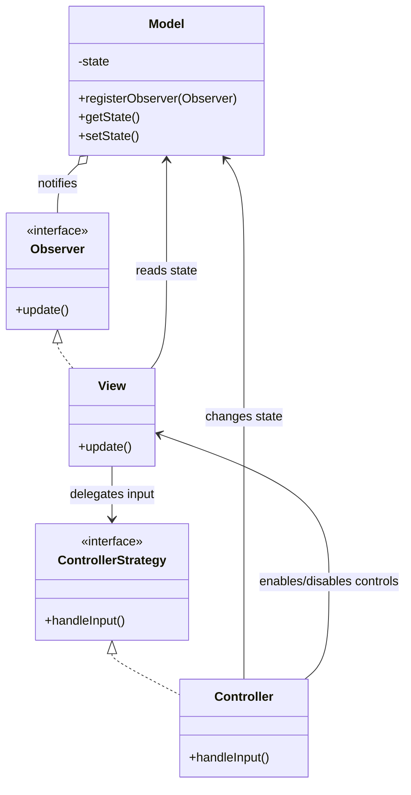
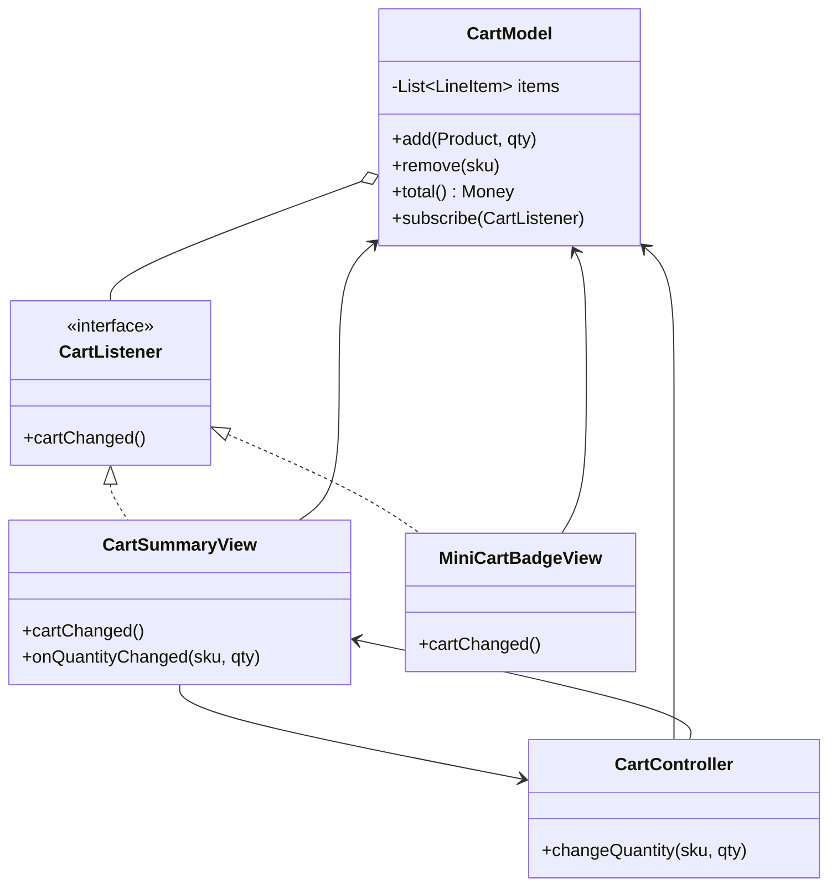

# Compound patterns

Patterns built from other patterns.

## Contents

- [Model-View-Controller (Compound Pattern)](#model-view-controller-compound-pattern)

## Model-View-Controller (Compound Pattern)


**Source:** *Head First Design Patterns*, Chapter 12 — "Compound Patterns" (read it). Summary below, book as bibliography — short quotes only where the exact wording matters.

### What it is & when to use it

The chapter first warms up by stacking six patterns onto the duck simulator (Adapter for geese, Decorator to count quacks, Abstract Factory to create decorated ducks, Composite + Iterator for flocks, Observer for "quackologists") — and notes that's *not* a compound pattern, just patterns used together. A **compound pattern** is a *recurring* combination that solves a general problem. The king of them is **MVC**:

- **Model** — all the data, state, and application logic. Oblivious to views and controllers, except that it notifies observers when its state changes.
- **View** — presents the model; gets the state it displays directly from the model.
- **Controller** — takes user input from the view, figures out what it means, and tells the model (and sometimes the view) what to change.

The five-step loop: user acts on the view → view tells controller → controller changes the model (and may change the view, e.g. disable a button) → model notifies the view → view asks the model for state and redraws.

Which patterns make it up:

| Pattern | Role in MVC |
|---|---|
| Observer (`behavioral.md`) | the model is the subject; views (and sometimes controllers) observe it, so one model can drive many views |
| Strategy (`behavioral.md`) | the controller is the view's strategy for handling input; swap controllers to change behavior |
| Composite (`structural.md`) | the view is a tree of nested UI components; the top-level one is told to update and the rest follow |
| Adapter (`structural.md`) (optional) | adapt a new model to an existing view/controller |

**Model 2** is MVC adapted to the web request/response cycle: a servlet (controller) handles the HTTP request and updates the model (beans), then forwards to a JSP (view) that renders HTML. The browser can't be notified, so Observer mostly drops out — which is the shape of every server-side MVC framework since (Spring MVC, Rails, Django, ASP.NET MVC).

### How it works



(In the book: a DJ app — `BeatModel`, `DJView`, `BeatController`; then a `HeartModel` reused with the same view through a `HeartAdapter` and a different controller.)

### Example: shopping cart widget



```java
public class CartController {
    private final CartModel cart; private final CartSummaryView view;

    public void changeQuantity(String sku, int qty) {
        if (qty < 0) { view.showError("Quantity can't be negative"); return; }
        if (qty == 0) cart.remove(sku); else cart.setQuantity(sku, qty);
        view.setCheckoutEnabled(cart.total().isPositive());
    }
}

public class MiniCartBadgeView implements CartListener {
    public void cartChanged() { badge.setText(String.valueOf(cart.itemCount())); }
}
```

Changing a quantity in the cart page updates the header badge too — the controller never touched the badge; the model's notification did. A "quick-buy" variant swaps in a different controller with the same views.

### Comparisons

The Clean Architecture places all of MVC in the *interface adapters* ring and argues the "model" there should be a thin view model, with real business rules in use cases and entities underneath — MVC organizes the UI, not the whole application. The Humble Object split (testable presenter, dumb view) is a stricter descendant of the same separation.

### Related

- Observer Pattern (`behavioral.md`)
- Strategy Pattern (`behavioral.md`)
- Composite Pattern (`structural.md`)
- Adapter Pattern (`structural.md`)
- What Is a Design Pattern (`principles.md`)
- Mediator Pattern (`behavioral.md`)
