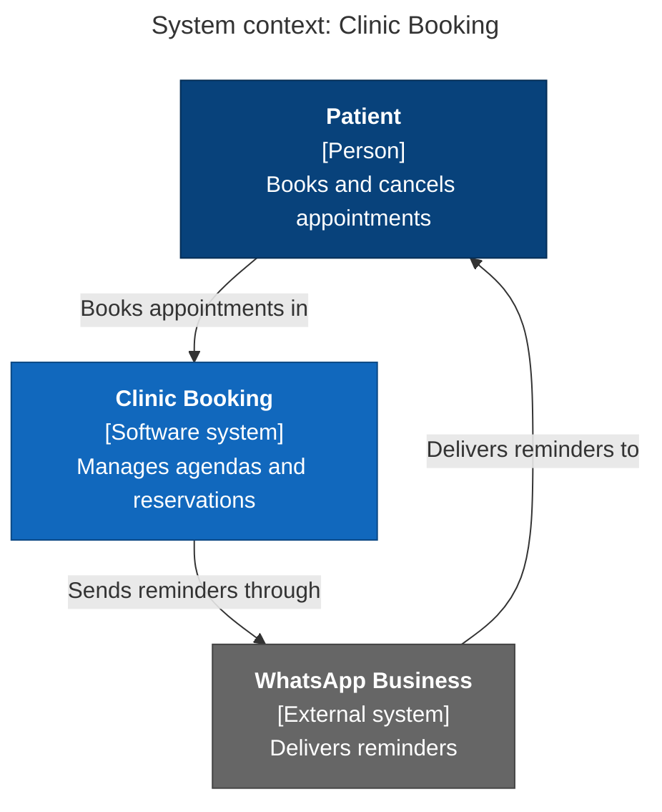
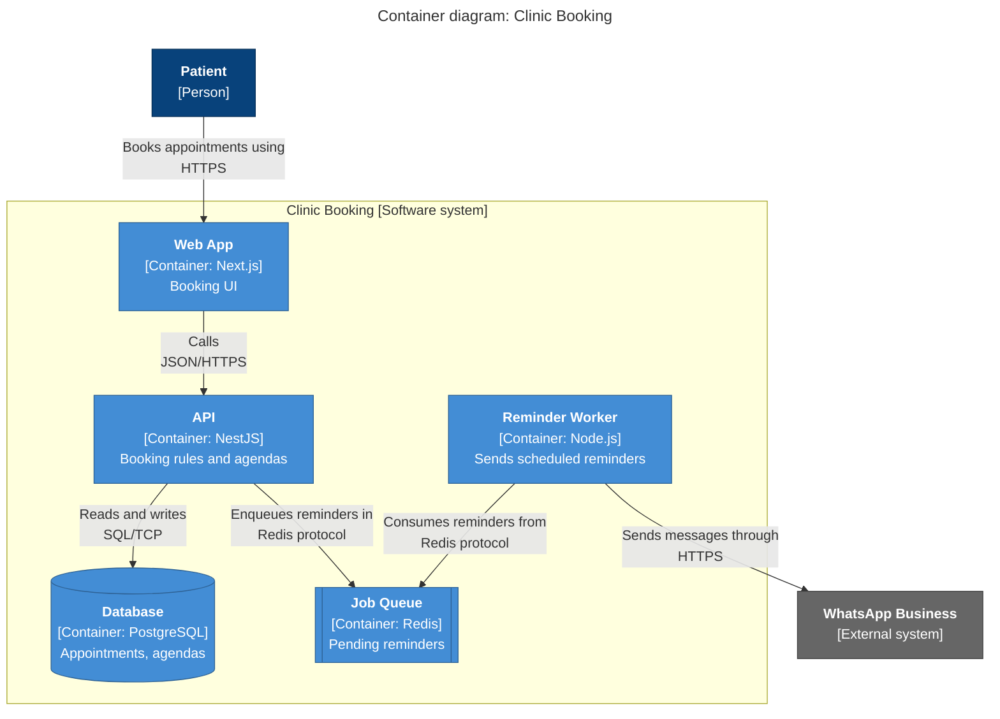

# C4 diagrams in Mermaid

Use `flowchart`, which renders everywhere and gives full control over layout. Mermaid's native `C4Context` syntax is marked experimental and its layout is hard to control, so prefer it only if the repo already uses it. The `classDef` lines double as the legend's styling.

## System context

## Container

## Component

Same shape as the container diagram, with the `subgraph` standing for one container and the nodes marked `[Component: technology]`. Show the neighbouring containers outside the subgraph.

## Dynamic

Use a `sequenceDiagram`, one flow per diagram, with numbered steps (`autonumber`) and participants named after the containers.

## Deployment

Use nested `subgraph`s for deployment nodes (region, cluster, VPC), with container instances inside them and the replica count in the label, e.g. `API x3`.

## Legend

Add a small legend in the text next to the diagram, or as a separate `subgraph Key` when colors carry meaning: dark blue is a person, blue is this system or its containers, and grey is external.
