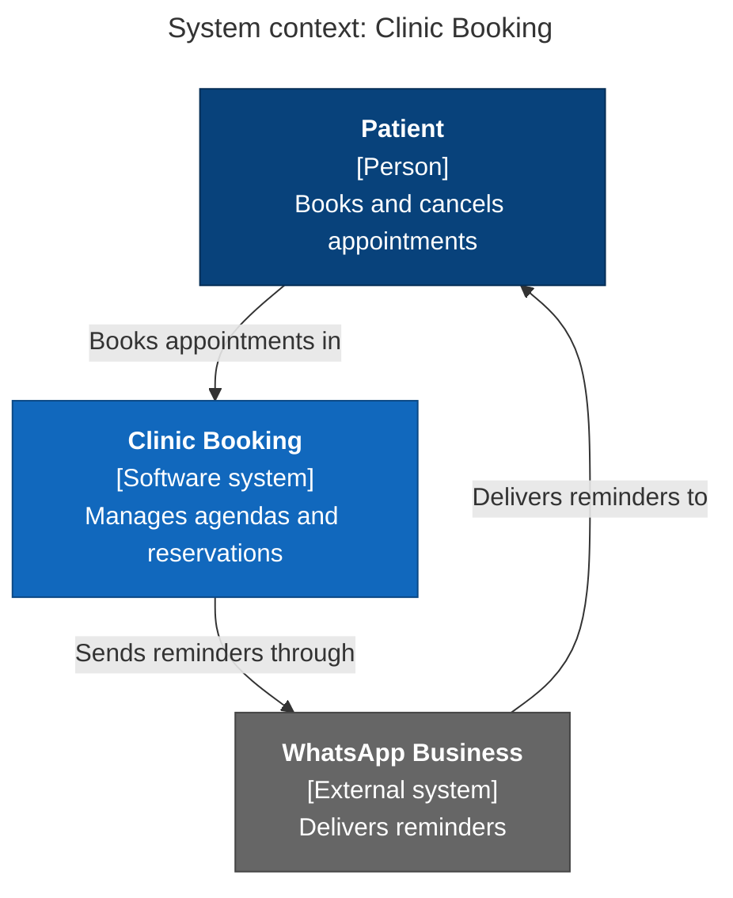
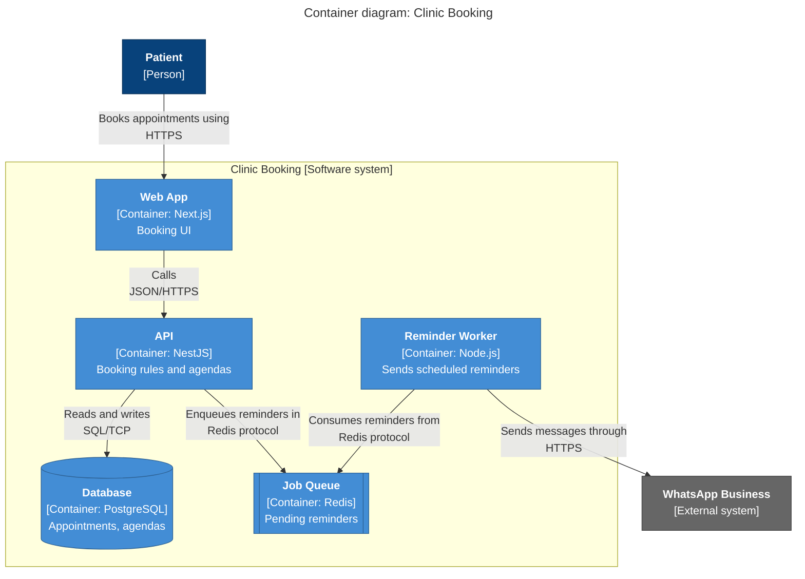
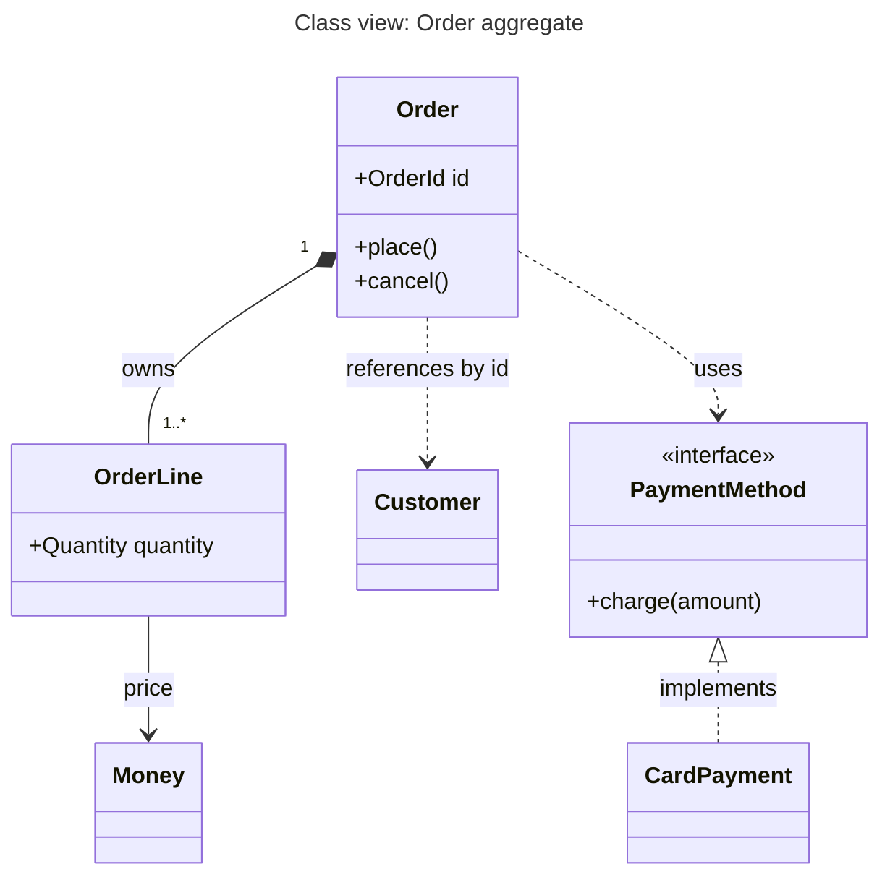

# C4 diagrams in Mermaid

Use `flowchart` for broad renderer support and direct layout control. Match the Mermaid version and syntax supported by the intended host; no syntax renders identically everywhere. Prefer native C4 syntax when the repository already supports and uses it. `classDef` styles elements; explain color meanings in a visible legend rather than relying on the source code as a key.

For definitions, see the primary C4 references for [software systems](https://c4model.com/abstractions/software-system), [containers](https://c4model.com/abstractions/container) and [components](https://c4model.com/abstractions/component). The examples below are illustrative topology, not facts to copy into a user's system.

## System context

## Container

## Component

Same shape as the container diagram, with the `subgraph` standing for one container and the nodes marked `[Component: technology]`. Show the neighbouring containers outside the subgraph.

## Dynamic

Use a `sequenceDiagram`, one flow per diagram, with numbered steps (`autonumber`) and participants named after the containers. In message labels and notes, avoid raw semicolons: the sequence grammar can interpret them as statement delimiters even inside natural-language notes. Use a comma or split the note, then render the exact fence to catch grammar-specific punctuation failures.

## Deployment

Use nested `subgraph`s for deployment nodes (region, cluster, VPC), with container instances inside them and the replica count in the label, e.g. `API x3`.

## Class view

Use `classDiagram` for a focused view of how a few types relate, not for every class in a module. Names below are illustrative.

`*--` is composition (the part cannot outlive the whole), `-->` an association, `..>` a dependency or reference, `<|..` implementation and `<|--` inheritance. Pick the arrow from the actual lifecycle and code, not from a foreign key. Show only the members that explain the relationship.

## Legend

Add a small legend in the text next to the diagram, or as a separate `subgraph Key` when colors carry meaning: dark blue is a person, blue is this system or its containers, and grey is external.

## Validate the artifact you deliver

Extract each Mermaid fence without changing its contents. If the project provides a renderer or parser, use its supported version. With Mermaid CLI already installed, `mmdc -i diagram.mmd -o diagram.svg` renders one extracted diagram; check the resulting image, including labels, boundaries and edge direction. For another host, test in that host when possible.

A parse check proves only syntax acceptance for that parser/version. Rendering produces an artifact; visual inspection checks whether its layout communicates the intended view. Keep those claims separate. If neither parser nor renderer is available, review structure manually and explicitly report that rendering was not checked. Do not install tools or send private architecture content to a hosted renderer without the task's applicable permissions.

The examples use HTML labels, which can depend on host configuration. If the host rejects them, use plain quoted labels with supported line breaks. Give elements stable unique IDs and quote labels containing punctuation. A sequence diagram shows message order for a specific flow; it does not by itself prove deployment or data ownership.
