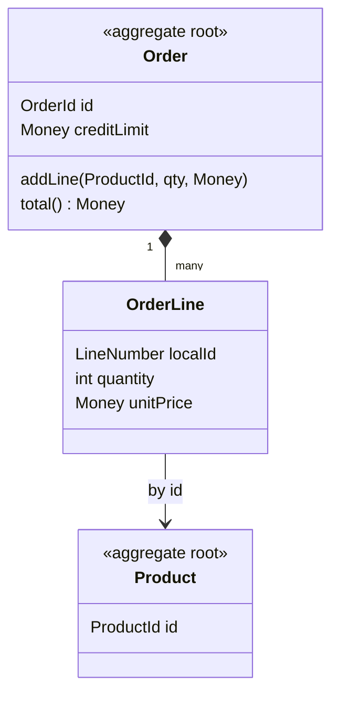
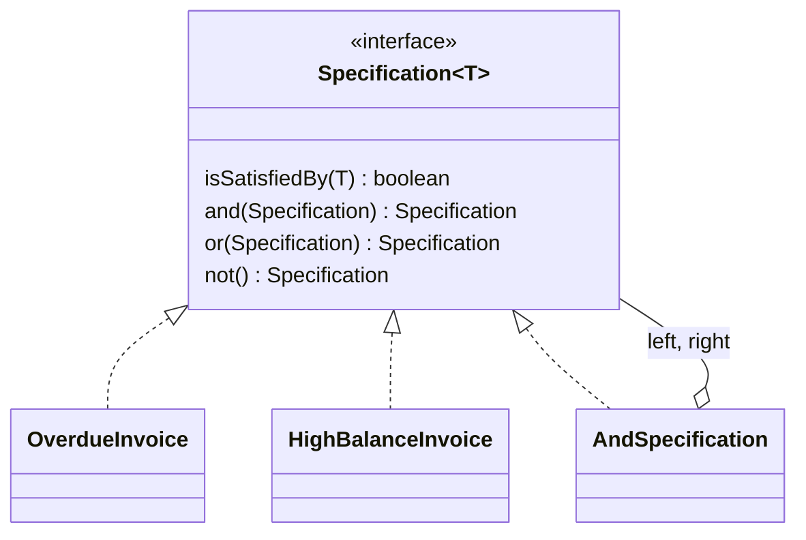

# Tactical building blocks

Chapters 4–6: isolating the domain, entities, value objects, services, modules, aggregates, factories, repositories and specifications.

## Contents

- [Layered Architecture](#layered-architecture)
- [The Smart UI "Anti-Pattern"](#the-smart-ui-anti-pattern)
- [Entity](#entity)
- [Value Object](#value-object)
- [Domain Service](#domain-service)
- [Modules](#modules)
- [Associations in the Domain Model](#associations-in-the-domain-model)
- [Aggregate](#aggregate)
- [Factory (DDD)](#factory-ddd)
- [Repository](#repository)
- [Specification](#specification)

## Layered Architecture


**Source:** *Domain-Driven Design*, Chapter 4.

### What it means in practice

Domain logic smeared across UI handlers, SQL and framework callbacks can't be read, tested or reasoned about as a model. Evans partitions the program into four layers. Each layer depends only on the layers below it and talks upward through callbacks or Observer-style loose coupling:

| Layer | Responsibility |
|---|---|
| **User interface** (presentation) | Show information, interpret user commands |
| **Application** | Thin: coordinate tasks and delegate to the domain. Holds no business rules and no business state, only the progress of a task |
| **Domain** | Business concepts, state and rules: *the heart of business software* |
| **Infrastructure** | Generic technical capabilities: persistence, messaging, email, UI widgets |

What matters is not the exact layer count but that **the domain layer is isolated**: its objects don't display or store themselves and don't run application workflows. That leaves them free to express the model. Frameworks are welcome as long as they don't force the domain into their shape.

Compared with Martin's version, Evans's diagram has the domain depending *down* on infrastructure. The Clean Architecture inverts that dependency so infrastructure plugs into the domain (Dependency Rule). Both agree on the goal: an isolated domain.

### Example: a "transfer funds" request

```java
// Application layer — orchestration only
public class TransferFundsService {
    public void transfer(AccountId from, AccountId to, Money amount) {
        tx.run(() -> {
            Account source = accounts.byId(from);
            Account target = accounts.byId(to);
            transfers.execute(source, target, amount);    // domain service
            notifier.transferCompleted(source, target, amount); // infrastructure
        });
    }
}

// Domain layer — the rules
public class FundsTransfer {
    public void execute(Account source, Account target, Money amount) {
        source.debit(amount);    // throws InsufficientFunds, enforces overdraft rules
        target.credit(amount);
    }
}
```

### Related

- The Smart UI "Anti-Pattern" — the deliberate opposite.
- Domain Service — services exist in every layer; only domain services carry business meaning.
- Model-Driven Design (`modeling.md`) — what the isolation is for.
- Responsibility Layers (`large-scale-structure.md`) — layering *inside* the domain layer.
- Repository — infrastructure hidden behind a domain-facing interface.

## The Smart UI "Anti-Pattern"


**Source:** *Domain-Driven Design*, Chapter 4.

### What it means in practice

Evans presents this honestly as an alternative, not a straw man. Domain-Driven Design pays off for complex domains and skilled teams. For a simple app, or a team without OO modeling skills, a Smart UI may be the right choice.

| Advantages | Disadvantages |
|---|---|
| Fast productivity on simple apps | Integration only through the shared database |
| Less-skilled developers can work this way | Behavior isn't reused; rules get duplicated across screens |
| Each screen is independent, so requirements changes are local | Rapid prototyping hits a ceiling: no abstraction means no rich behavior |
| Relational DBs and 4GL/visual tools work well with it | Migrating to another architecture means a rewrite |

The real lesson is that **it's a one-way choice**. You can't add Domain-Driven Design to a Smart UI later, short of replacing the whole application. And trying to do Model-Driven Design without the skills for it gets you the costs of both approaches with the benefits of neither. Pick one deliberately.

### Example: an internal admin tool

A back-office screen that lets support staff toggle a feature flag, edit a customer's email and view their invoices is a fine Smart UI. A Retool or Rails scaffold with logic in the controllers works, and nobody will miss a domain model. The checkout and pricing engine behind the storefront is not: discounts, taxes and promotions interact, and three screens each re-implementing "apply coupon" is a bug factory.

### Related

- Layered Architecture — the alternative it is contrasted with.

## Entity


**Source:** *Domain-Driven Design*, Chapter 5.

### What it means in practice

Some objects have a **thread of continuity**: they keep being the same thing while every attribute changes, and two of them with identical attributes are still different. Examples are a customer who changes name and email, or an order that moves from cart to delivered. For these objects, identity is the definition.
- **Keep the class focused on identity and life cycle.** Move attributes and behavior out into associated objects, often Value Objects, so the entity doesn't become a dumping ground.
- **Define an identity operation** that is guaranteed unique. Mutable attributes can't serve, because a phone number gets reassigned and an email changes. The ID can come from outside (a tax ID, an order number the customer sees) or be generated by the system, but it must match a real distinction in the domain.
- **Watch for matching-by-attributes requirements**, such as deduplicating customers imported from two systems. Those are hard identity problems and usually need a human in the loop.

Whether something is an Entity depends on the context. An address is a Value Object for a shop but an Entity for a utility company that runs service lines to it.

This is not the same as Martin's Entity (a module carrying critical business rules) or a JPA `@Entity` (a mapped row).

### Example: a customer account

```java
public class Customer {
    private final CustomerId id;           // stable, system-generated
    private EmailAddress email;            // value object, can change
    private PersonName name;               // value object
    private ShippingAddress defaultAddress;

    public void changeEmail(EmailAddress newEmail) { ... }

    @Override public boolean equals(Object o) {
        return o instanceof Customer c && c.id.equals(this.id);   // identity, not attributes
    }
    @Override public int hashCode() { return id.hashCode(); }
}
```

### Related

- Value Object — the complementary building block: no identity.
- Aggregate — entities cluster under a root entity.
- Repository — how entities are found again by identity.
- Factory (DDD) — how they're created and reconstituted.
- Associations in the Domain Model
- Closure of Operations (`supple-design.md`)
- Domain Service
- Model-Driven Design (`modeling.md`)
- Side-Effect-Free Functions (`supple-design.md`)

## Value Object


**Source:** *Domain-Driven Design*, Chapter 5.

### What it means in practice

Many objects describe something rather than *being* someone. You care what they are, not which instance you have. Two `Money(10, USD)` are interchangeable, just as any "4" is the same as any other "4". Giving these objects identity would add tracking cost and muddle the model.
- **Conceptual whole.** Street, city and postal code aren't three fields on `Person`; together they are one `Address` (Ward Cunningham's *Whole Value* pattern).
- **Give it behavior.** `Money.add`, `DateRange.overlaps` and `Percentage.of(amount)` belong to the value, not to a utility class.
- **Immutable.** A change means replacing the value with a new one. That makes sharing safe, which enables Flyweight-style sharing when instances are numerous. Copy instead of share when the value crosses machines.
- **Mutability only as a measured exception:** for values that change very often, are expensive to create, or are never shared. A mutable value must never be shared.
- Values can **reference entities**. A `Route` from city A to city B via highway H is a value even though the cities are entities.

Values make good parameters and return types, and they are the ideal place for side-effect-free functions (`supple-design.md`).

### Example: money and date ranges

```java
public record Money(BigDecimal amount, Currency currency) {
    public Money {
        if (amount.scale() > currency.getDefaultFractionDigits()) throw new IllegalArgumentException();
    }
    public Money plus(Money other) {
        requireSameCurrency(other);
        return new Money(amount.add(other.amount), currency);
    }
    public Money times(Percentage p) { return new Money(p.applyTo(amount), currency); }
}

public record BillingPeriod(LocalDate start, LocalDate end) {
    public boolean overlaps(BillingPeriod o) { return !end.isBefore(o.start) && !o.end.isBefore(start); }
    public long days() { return ChronoUnit.DAYS.between(start, end); }
}
```

`Subscription` now holds a `Money price` and a `BillingPeriod current` instead of four loose fields. Proration logic moves onto `BillingPeriod`, where it can be tested without any entity.

### Related

- Entity — the complementary block: identity matters.
- Side-Effect-Free Functions (`supple-design.md`)
- Closure of Operations (`supple-design.md`) — values are the usual home of closed operations.
- Specification — a specification is a predicate-like value.
- Aggregate — values live inside aggregates and can be handed out freely.
- Design Patterns as Domain Patterns (`modeling.md`)
- Factory (DDD)
- Domain Service
- Model-Driven Design (`modeling.md`)
- Shared Kernel (`context-mapping.md`)
- Standalone Classes (`supple-design.md`)

## Domain Service


**Source:** *Domain-Driven Design*, Chapter 5.

### What it means in practice

Sometimes the concept isn't a thing. Some important domain operations are activities that coordinate several objects, and forcing one into an Entity or Value Object either distorts that object's definition or creates fake "Manager" objects. Make the operation explicit as a Service, which is named with a verb from the Ubiquitous Language (`modeling.md`). A good domain service has three properties:

1. The operation relates to a domain concept that isn't a natural part of an Entity or Value Object.
2. Its interface is defined in terms of other domain model elements.
3. It is **stateless**: no instance history affects its behavior, although it may change global state.

The more common mistake goes the other way: giving up on objects too early and sliding into procedural code where services do everything and entities are bags of getters. Use services sparingly.

Services exist in every layer, and the distinction has to stay sharp:

| Layer | Example | Has business meaning? |
|---|---|---|
| Application | `CheckoutService`: load cart, call domain, send confirmation | No: orchestration only |
| Domain | `PricingService.quote(cart, customer)`: applies tiered discounts across items | Yes |
| Infrastructure | `EmailSender`, `PaymentGatewayClient` | No |

### Example: currency conversion

```java
// Domain service: belongs to neither Money nor Account
public interface ExchangeService {
    Money convert(Money amount, Currency target, Instant at);
}

public class Wallet {
    public void topUp(Money incoming, ExchangeService fx, Clock clock) {
        balance = balance.plus(fx.convert(incoming, balance.currency(), clock.instant()));
    }
}
```

Putting `convert` on `Money` would make every value depend on live exchange rates, and putting it on `Wallet` would hide a concept the treasury team talks about daily.

### Related

- Entity, Value Object — try these first.
- Layered Architecture — application vs. domain vs. infrastructure services.
- Intention-Revealing Interfaces (`supple-design.md`)
- Open Host Service (`context-mapping.md`) — a set of services opened to other contexts.
- Anticorruption Layer (`context-mapping.md`)
- Making Implicit Concepts Explicit (`modeling.md`)
- Model-Driven Design (`modeling.md`)
- Ubiquitous Language (`modeling.md`)

## Modules


**Source:** *Domain-Driven Design*, Chapter 5.

### What it means in practice

Modules (packages, namespaces) are part of the model, not just a code-organization tool. People think in chunks, and modules give them chunks they can understand independently.
- **Cohesion by concept**, not by technical type. If coupling between modules stays high, it is a hint that a concept is missing or misplaced. Fix the model, not just the imports.
- **Names enter the Ubiquitous Language (`modeling.md`).** `billing`, `catalog` and `fulfillment` should say something to an expert.
- **Modules must be able to evolve.** Teams avoid renaming packages because it's tedious, so modules fossilize around an old model. Refactor them along with the classes.
- **Avoid infrastructure-driven packaging.** Splitting one concept across `entities/`, `dao/`, `dto/` and `services/` because a framework suggests it destroys cohesion. Tiered splits belong in the infrastructure, not in the domain.

Modules are a different thing from Bounded Contexts (`context-mapping.md`). Modules organize elements *within one model*; contexts separate different models.

### Example

```
com.shop.domain.billing      Invoice, InvoiceLine, PaymentTerms, TaxCalculator
com.shop.domain.catalog      Product, Variant, PriceList
com.shop.domain.fulfillment  Shipment, Parcel, Carrier, ShippingRate
```

instead of

```
com.shop.model      Invoice, Product, Shipment, Parcel, ...
com.shop.service    InvoiceService, ProductService, ShipmentService, ...
com.shop.repository ...
```

### Related

- Bounded Context (`context-mapping.md`) — not the same thing as a module.
- Segregated Core (`distillation.md`), Generic Subdomains (`distillation.md`), Abstract Core (`distillation.md`) — distillation done with modules.
- Conceptual Contours (`supple-design.md`) — the module boundary should follow these.
- Standalone Classes (`supple-design.md`) — modules limit the web of dependencies; standalone classes cut it.
- Evolving Order (Large-Scale Structure) (`large-scale-structure.md`)
- Model-Driven Design (`modeling.md`)
- Responsibility Layers (`large-scale-structure.md`)
- Ubiquitous Language (`modeling.md`)

## Associations in the Domain Model


**Source:** *Domain-Driven Design*, Chapter 5.

### What it means in practice

Early models are full of bidirectional, many-to-many associations, because that's how the world looks. They are expensive to implement and say very little. Evans gives three ways to make them tractable:

1. **Impose a traversal direction.** Most relationships have a natural bias. You go from `Country` to its presidents, never from a person to "which country was I president of". A bidirectional link means two objects can only be understood together.
2. **Add a qualifier** to reduce multiplicity. "A country has one president *at a given date*" turns one-to-many into one-to-one and embeds a rule in the model.
3. **Eliminate nonessential associations.** The ultimate simplification.

Constraining associations consistently also makes the remaining bidirectional ones meaningful: if one is still there, it is there because the domain needs it. The implementation can be a field, a collection, or a Repository query; any of them works as long as its behavior matches the association.

### Example: customer ↔ orders

```java
// Before: bidirectional, both sides loaded and kept in sync
class Customer { List<Order> orders; }
class Order    { Customer customer; }

// After: one direction, plus a query for the rare reverse case
class Order    { CustomerId customerId; }               // order knows who placed it
interface OrderRepository { List<Order> placedBy(CustomerId id, DateRange range); }
```

`Customer` no longer drags along thousands of orders, and the reverse lookup is qualified by a date range, which matches how support staff actually ask the question.

### Related

- Entity
- Aggregate — the next tool for taming the web of references.
- Repository — a query can stand in for an association.
- Standalone Classes (`supple-design.md`) — the extreme: zero associations.

## Aggregate


**Source:** *Domain-Driven Design*, Chapter 6.

### What it means in practice

In a richly connected model, nothing says where a change stops. Delete a person: does their address go too? Lock one row or twenty? The real problem is a missing boundary in the model, not a database-locking puzzle. An Aggregate draws that boundary around the objects whose **invariants must hold together at the end of every transaction**. The rules:
- The **root** is an Entity with global identity, and it is responsible for checking invariants.
- Inner entities have only **local identity**, unique within the aggregate.
- Outside objects may hold references **to the root only**. The root may hand out transient references to inner objects, and copies of values, which can go anywhere.
- Only roots are loaded directly by queries (Repositories exist per root). Everything else is reached by traversal.
- Inner objects may reference *other* roots.
- Deleting the aggregate removes everything inside it.
- On commit, **all invariants of the whole aggregate** must hold. Rules that span aggregates are allowed to lag and are resolved later by events or batch processes.

The design goal is to keep strict invariants tight and high-contention points loose. Evans's example: a purchase order whose line items reference parts. The PO plus its line items form an aggregate, because the approved limit must hold. `Part` is its own root, and price changes must not reach existing orders, so line items copy the price.



### Example: an order with a credit limit

```java
public class Order {                        // root
    private final OrderId id;
    private final Money creditLimit;
    private final List<OrderLine> lines = new ArrayList<>();

    public void addLine(ProductId product, int qty, Money currentPrice) {
        Money newTotal = total().plus(currentPrice.times(qty));
        if (newTotal.isGreaterThan(creditLimit)) throw new CreditLimitExceeded(id, newTotal);
        lines.add(new OrderLine(nextLineNumber(), product, qty, currentPrice)); // price copied
    }
    public List<OrderLineView> lines() { return lines.stream().map(OrderLine::view).toList(); } // no live refs
}
```

No code path outside `Order` can change a line's quantity, so the limit check can't be bypassed. The order references products only by ID, so a catalog price update never locks or rewrites orders.

### Related

- Entity, Value Object — what goes inside.
- Repository — one per aggregate root.
- Factory (DDD) — creates whole aggregates with invariants satisfied.
- Associations in the Domain Model — aggregates are the next step in cutting the web.
- Assertions (`supple-design.md`) — aggregate invariants are the main assertions to state.
- Conceptual Contours (`supple-design.md`) — aggregate boundaries should follow them.
- Responsibility Layers (`large-scale-structure.md`)
- Standalone Classes (`supple-design.md`)

## Factory (DDD)


**Source:** *Domain-Driven Design*, Chapter 6.

### What it means in practice

Assembling a complex object or a whole Aggregate is a job in itself, and it isn't the object's job. Putting the assembly in the client couples the client to internals. Putting it in the object overloads the object. A Factory encapsulates the assembly. It is a domain *design* element, not a domain concept. The requirements:
- **Atomic:** produce a complete object with every invariant satisfied, or throw. Never return a half-built aggregate.
- **Abstract the type:** clients ask for what they need, not for a concrete class.
- **Parameters** should be domain concepts at the right level, such as `orderFor(customer, cart)` rather than twelve primitives.

Where it lives:
- A **factory method on an existing object** that naturally spawns the new one, for example `Cart.checkout()` returning an `Order`, or a root adding an inner entity.
- A **standalone factory** when no object has the knowledge.
- **A plain constructor is enough** when the class is simple, not polymorphic, and the client may know the concrete type.

Invariant checks can live in the factory or be delegated to the product. Factories for entities assign identity; factories for values return a finished, immutable value.

**Reconstitution** is a second job: rebuilding an object from storage or the wire. It must *not* assign a new ID. It should handle invariant violations in stored data more gracefully than on fresh creation.

The GoF Factory Method, Abstract Factory and Builder are the implementation tools. Evans's emphasis is on *why* creation is a separate responsibility.

### Example: placing an order from a cart

```java
public class Cart {
    public Order checkout(OrderNumberSequence numbers, PricingService pricing) {   // factory method
        if (items.isEmpty()) throw new EmptyCart(id);
        Quote quote = pricing.quote(this);
        return Order.place(numbers.next(), customerId, items, quote);             // whole aggregate, valid
    }
}

public class OrderReconstitutor {   // used only by the repository
    Order fromRow(OrderRow row, List<OrderLineRow> lines) {
        return Order.restore(new OrderId(row.id()), row.status(), mapLines(lines)); // keeps stored id
    }
}
```

### Related

- Aggregate
- Repository — the repository uses a factory to reconstitute what it loads.
- Entity, Value Object
- Intention-Revealing Interfaces (`supple-design.md`)

## Repository


**Source:** *Domain-Driven Design*, Chapter 6.

### What it means in practice

To use a persistent object you must first get hold of it, either by traversing from an object you already have or by a query. Free-form queries scattered everywhere let clients reach inside Aggregates, spread SQL through the domain, and turn objects into data containers. A Repository puts all of that behind a collection-like interface:
- `add` / `remove` plus **selection methods** that return fully built objects: `byId`, `overdueAsOf(date)`.
- **Only for aggregate roots** that genuinely need global access. Anything else is reached by traversal.
- Clients stay focused on the model; storage technology and query strategy are encapsulated.
- Queries can be hard-coded methods, or Specification-based for flexibility. Summary queries such as counts and totals are fine too.

Implementation notes from the book:
- Abstract the type: one repository can return subclasses.
- **Leave transaction control to the client**, not the repository.
- Work *with* your persistence framework rather than against it.
- **Repository vs. factory:** the factory handles the *beginning* of the life cycle (new objects); the repository handles the *middle and end* (finding, storing, deleting). It reconstitutes objects, often delegating to a Factory. Reconstitution is not creation.

When designing tables for a domain model, keep the mapping transparent and stable. Accept some denormalization in favor of the model rather than bending the model to the schema.

### Example: invoices

```java
// Domain layer owns the interface
public interface InvoiceRepository {
    Invoice byNumber(InvoiceNumber number);
    List<Invoice> overdueAsOf(LocalDate date);
    List<Invoice> satisfying(InvoiceSpecification spec);
    void add(Invoice invoice);
}

// Infrastructure implements it
public class JdbcInvoiceRepository implements InvoiceRepository { ... }
public class InMemoryInvoiceRepository implements InvoiceRepository { ... } // tests
```

The dunning use case calls `invoices.overdueAsOf(today)` and never sees SQL. Moving from Postgres to DynamoDB touches one class.

### Related

- Aggregate — repositories exist per root.
- Factory (DDD) — creation vs. reconstitution.
- Specification — repository queries by specification.
- Layered Architecture
- Associations in the Domain Model
- Entity

## Specification


**Source:** *Domain-Driven Design*, Chapter 9 (pattern by Evans and Fowler) and Chapter 10 (combining specifications).

### What it means in practice

Simple tests like `invoice.isOverdue()` belong on the object. But rules like "delinquent", which depend on grace periods, customer status and product line, swamp the object and drag in dependencies. Moving them to the application layer leaves a dead data object behind. A Specification pulls the rule out into its own value with one question: `isSatisfiedBy(candidate)`. One concept serves three uses:
1. **Validation:** does this object meet the requirement?
2. **Selection:** find all objects that meet it. Pass the spec to a Repository, which can translate it to SQL (double dispatch keeps the SQL in the infrastructure).
3. **Building to order (generation):** create something that satisfies it. The spec describes *what*, and a generator figures out *how*.

Chapter 10 makes specifications combinable with logical operators. **`and`, `or` and `not`** produce Composite specifications, and the leaf specs can be shared as Flyweights. **Subsumption** asks whether one spec is stricter than another, so a "high-value order" spec subsumes "order over $100". This moves rules toward a declarative (`supple-design.md`) style and is close to a small Interpreter.



### Example: delinquent invoices for collections

```java
public interface Specification<T> {
    boolean isSatisfiedBy(T t);
    default Specification<T> and(Specification<T> o) { return t -> isSatisfiedBy(t) && o.isSatisfiedBy(t); }
    default Specification<T> not() { return t -> !isSatisfiedBy(t); }
}

public record DelinquentInvoice(LocalDate today) implements Specification<Invoice> {
    public boolean isSatisfiedBy(Invoice inv) {
        int grace = inv.customer().paymentTerms().gracePeriodDays();
        return inv.isUnpaid() && today.isAfter(inv.dueDate().plusDays(grace));
    }
}

Specification<Invoice> sendToCollections = new DelinquentInvoice(today)
        .and(new BalanceOver(Money.usd(500)))
        .and(new UnderDispute().not());

invoices.satisfying(sendToCollections);           // selection
if (sendToCollections.isSatisfiedBy(invoice)) ... // validation
```

### Related

- Making Implicit Concepts Explicit (`modeling.md`)
- Value Object — a specification is a predicate-like value.
- Repository — querying by specification.
- Declarative Design (`supple-design.md`)
- Closure of Operations (`supple-design.md`) — `and` returns another specification.
- Cohesive Mechanisms (`distillation.md`)
- Design Patterns as Domain Patterns (`modeling.md`)
- Responsibility Layers (`large-scale-structure.md`)
- Supple Design (`supple-design.md`)
