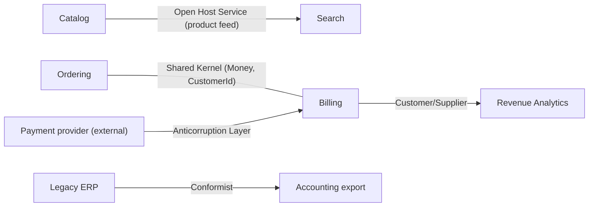
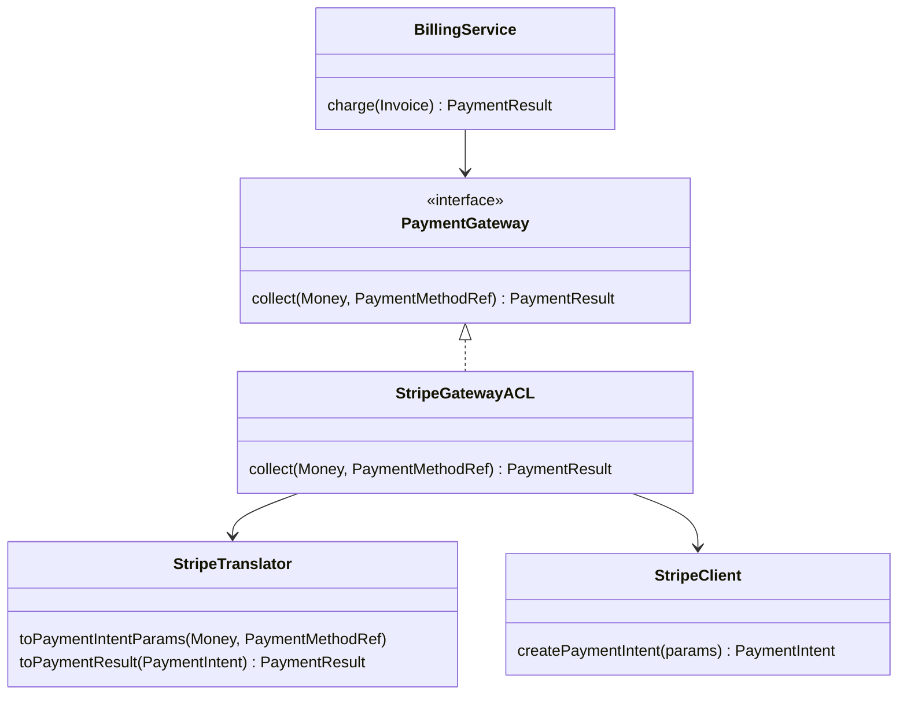

# Bounded contexts and context mapping

Chapter 14: where one model applies, and the relationships available between models and teams.

## Contents

- [Bounded Context](#bounded-context)
- [Context Map](#context-map)
- [Choosing a Model Context Strategy](#choosing-a-model-context-strategy)
- [Continuous Integration (of a Model)](#continuous-integration-of-a-model)
- [Shared Kernel](#shared-kernel)
- [Customer/Supplier Development Teams](#customersupplier-development-teams)
- [Conformist](#conformist)
- [Anticorruption Layer](#anticorruption-layer)
- [Open Host Service](#open-host-service)
- [Published Language](#published-language)
- [Separate Ways](#separate-ways)

## Bounded Context


**Source:** *Domain-Driven Design*, Chapter 14.

### What it means in practice

A model is only meaningful if it is **unified**: every term means one thing and no rules contradict each other. One unified model for a whole enterprise is neither feasible nor worth the cost, and attempts at it bog down or produce a bloated model of options. Multiple models are a fact of life, so make them **explicit**. A Bounded Context marks where one model applies. It is defined by team, by part of the application, and by its physical artifacts: code base and schema. Inside it, consistency is strict. Outside it, other models are allowed to differ.

Evans's opening story shows what goes wrong without boundaries. Two teams shared a `Charge` class, one meaning a charge billed to customers and the other a charge paid to vendors. Each team's changes broke the other's code. Two symptoms reveal that a model has splintered inside one context:
- **Duplicate concepts:** two model elements for the same thing, kept in sync by hand.
- **False cognates:** one term meaning two different things. These are more dangerous.

A Bounded Context is **not a Module (`building-blocks.md`)**. Modules organize elements within one model; contexts separate models. Within a context, Continuous Integration keeps the model unified. Between contexts, a Context Map and explicit translation govern the relationships.

### Example: "Product" in a marketplace

| Context | What "Product" means | Key attributes |
|---|---|---|
| Catalog | A sellable listing shown to shoppers | title, images, variants, SEO slug |
| Inventory | A stock-keeping unit in a warehouse | SKU, bin location, on-hand count |
| Billing | A line that can be invoiced and taxed | tax category, price, revenue account |

Forcing one shared `Product` class across all three gives a 60-field class where every change risks breaking another team. Three contexts give three small models, linked by a `ProductId` and translated at the boundaries.

### Related

- Context Map
- Continuous Integration (of a Model)
- Ubiquitous Language (`modeling.md`) — one language per context.
- Modules (`building-blocks.md`) — not the same thing.
- Choosing a Model Context Strategy — how big to draw them.
- Core Domain (`distillation.md`)
- Evolving Order (Large-Scale Structure) (`large-scale-structure.md`)
- Making Implicit Concepts Explicit (`modeling.md`)
- Pluggable Component Framework (`large-scale-structure.md`)
- Separate Ways
- Shared Kernel
- Strategic Design Decisions (`large-scale-structure.md`)
- System Metaphor (`large-scale-structure.md`)

## Context Map


**Source:** *Domain-Driven Design*, Chapter 14.

### What it means in practice

One Bounded Context doesn't give a global view. People can still unknowingly blur boundaries or duplicate translation logic. A Context Map is the big picture:
- **Map what exists today, not the ideal.** Changes come later.
- **Name every context**, including legacy systems and external services, and use those names in conversation: "in the Billing context, a customer is…".
- **Describe every point of contact**: what is translated, what is shared, and which side is **upstream** (its changes affect the other) or **downstream** (it depends on the other).
- Keep the map at whatever formality works: a diagram, a wiki page, a whiteboard. The essential thing is that everyone knows it.

Each relationship on the map is one of the patterns that follow. Their coordination cost runs from high to low:

| Relationship | Coordination | Coupling |
|---|---|---|
| Shared Kernel | High: joint changes | Shared code |
| Customer/Supplier | Medium: negotiated plans and acceptance tests | Upstream serves downstream |
| Conformist | Low: downstream adopts upstream's model | Full dependence |
| Anticorruption Layer | Low: downstream translates defensively | Isolated |
| Open Host Service + Published Language | One protocol for many consumers | Via the protocol |
| Separate Ways | None | None |



### Example

On an existing marketplace, drawing the map for the first time shows that Ordering and Fulfillment each translate warehouse status codes, with two inconsistent mappings. One of them gets refactored into a single anticorruption layer, and the map gains a name for the warehouse context ("WMS") that everyone now uses.

### Related

- Bounded Context
- Ubiquitous Language (`modeling.md`)
- Shared Kernel, Customer/Supplier Development Teams, Conformist, Anticorruption Layer, Separate Ways, Open Host Service, Published Language — the relationship types.
- Choosing a Model Context Strategy
- Strategic Design Decisions (`large-scale-structure.md`) — combining the map with large-scale structure and distillation.
- Continuous Integration (of a Model)

## Choosing a Model Context Strategy


**Source:** *Domain-Driven Design*, Chapter 14.

### What it means in practice

**Unifying an elephant.** In the parable, six blind men each model one part of an elephant (a wall, a snake, a tree, a rope). For many purposes, translating between their models is enough. Real unification needs a *deeper* model, an animal with parts, and it hinges on minimalism: a trunk is less than a snake, and the "less" matters most. You can't see the whole elephant, but recognizing that your view is partial makes it manageable.

**Guidelines for drawing boundaries:**
- **Decide at team level or higher.** Politics and reporting lines often decide integration more than technical merit does. Assess the cost and communicate it.
- **Start from a realistic Context Map.** Delineate the external and legacy systems first, since those decisions are the easiest.

| Favoring larger contexts | Favoring smaller contexts |
|---|---|
| Smoother flow between user tasks | Less communication overhead between developers |
| One coherent model is easier than two plus mappings | CI is easier with small teams and code bases |
| Translation can be hard or impossible | Large contexts need abstract models and scarce skills |
| A shared language helps the team | Specialized models can fit specialized users' jargon |

- **Deployment** feeds back into boundaries. A Shared Kernel has to be deployed in coordination; translation layers let one side upgrade on its own.

**On a project already under way:** map the current contexts as they really are, tighten CI inside each one, move stray translation code into anticorruption layers, name the contexts, and only then change boundaries, in small pragmatic steps.

**Transformations:** splitting contexts is easy, but merging them is hard.
- *Separate Ways → Shared Kernel:* set up the process and an empty shared test suite first, then share a small, non-core, already-translated subdomain, and grow from there.
- *Shared Kernel → Continuous Integration:* align the teams' processes, rotate people between teams, distill each model, and merge the core quickly once you start.
- *Phasing out a legacy system:* move one iteration-sized piece of functionality at a time into the new system, extending the anticorruption layer as you go, and retire legacy pieces as they become unused.

### Example

A company running a monolith decides that Payments should leave it. Step 1: map today's reality, which shows Payments code called from 14 places. Step 2: introduce a `PaymentGateway` interface inside the monolith, an in-process anticorruption layer. Step 3: move refunds to the new Payments service behind that interface. Step 4: move captures. The monolith shrinks one iteration at a time instead of through a big-bang rewrite.

### Related

- Context Map
- Bounded Context
- Shared Kernel, Continuous Integration (of a Model), Separate Ways, Anticorruption Layer, Customer/Supplier Development Teams, Conformist
- Breakthrough (`modeling.md`) — real unification often needs one.
- Strategic Design Decisions (`large-scale-structure.md`)

## Continuous Integration (of a Model)


**Source:** *Domain-Driven Design*, Chapter 14.

### What it means in practice

Once a Bounded Context is defined, it still fragments if several people work in it. Each developer's mental model drifts, and soon there are duplicate concepts and false cognates in the code. Evans's Continuous Integration works on two levels:
- **Integrating concepts:** constant communication through the Ubiquitous Language (`modeling.md`), so that a shared view of the model emerges as concepts evolve.
- **Integrating the implementation:** a step-by-step, reproducible merge and build, with automated tests that catch fragmentation, run at least daily.

**Don't make the job bigger than it needs to be.** CI is essential only *within* a context. Neighboring contexts don't need to integrate at the same pace, because their relationships are handled by the Context Map patterns.

This is wider than the CI-server practice: the build pipeline is just the mechanical half. The conversations that keep the model in people's heads aligned are the other half.

### Example

The checkout team of six works in one repo with trunk-based development, a 10-minute pipeline, and a domain test suite that exercises `Order`, `Payment` and `Refund` end to end. Twice a week a 15-minute "model check" session reviews new terms that slipped into PR names. When someone added `PendingOrder` alongside `Order(status=PENDING)`, review caught the duplicate concept before it spread.

### Related

- Bounded Context
- Ubiquitous Language (`modeling.md`)
- Shared Kernel — integrated less often than CI, across two teams.
- Context Map
- Customer/Supplier Development Teams — shared acceptance tests run in the supplier's CI.
- Choosing a Model Context Strategy

## Shared Kernel


**Source:** *Domain-Driven Design*, Chapter 14.

### What it means in practice

When two teams work on closely related functionality, full Continuous Integration across both is too much overhead. Fully separate models, on the other hand, mean duplicated effort and painful translation. The middle ground is to share an explicit, **small** subset of the model, with its code and schema.
- The kernel has **special status**: neither team changes it without consulting the other.
- Integrate the shared code frequently, though less often than each team's internal CI, and **run both teams' tests** at each integration.
- Keep it small. A growing kernel raises coordination costs, especially at deployment.

It is also the recommended first step when merging two contexts. Start by sharing a small, non-core subdomain that is already being translated, then grow from there.

### Example

The Ordering and Billing teams share a `commerce-kernel` library containing `Money`, `Currency`, `CustomerId`, `OrderId` and `TaxCategory`, with their tests. A change to `Money`'s rounding rules needs a PR approved by both teams and a green run of both test suites. Everything else (`Order`, `Invoice`, `Payment`) stays private to each context.

### Related

- Context Map
- Bounded Context
- Continuous Integration (of a Model)
- Customer/Supplier Development Teams — the alternative when one side clearly depends on the other.
- Pluggable Component Framework (`large-scale-structure.md`) — its abstract core lives in a shared kernel.
- Value Object (`building-blocks.md`) — kernels are usually made of shared values.
- Choosing a Model Context Strategy
- Conformist

## Customer/Supplier Development Teams


**Source:** *Domain-Driven Design*, Chapter 14.

### What it means in practice

Often one subsystem feeds another, with dependencies running one way only. Left informal, the relationship degrades in one of two ways: the upstream team is frozen, afraid of breaking downstream, or the downstream team is helpless, at the mercy of upstream priorities. Formalize it:
- **Downstream is a real customer.** Its representatives join upstream planning, negotiate the trade-offs, and get committed, scheduled work. That is the opposite of a poor cousin coming to beg.
- **Joint automated acceptance tests** for the interface downstream relies on, run in upstream's CI. Upstream can then change freely, and downstream doesn't have to watch every commit. Changing a test means changing the interface, which requires a conversation.
- Downstream stays available to answer questions during the iteration, like any customer would.

It only works when upstream management actually wants to serve downstream. When it doesn't, downstream falls back to Conformist or an Anticorruption Layer.

### Example

The Orders team (upstream) emits `OrderPlaced` and `OrderRefunded` events, and the Revenue Analytics team (downstream) builds dashboards on them. Analytics attends Orders' sprint planning to ask for a new `discountBreakdown` field, and contributes contract tests (`OrderEventsContractTest`) to the Orders repo. When Orders refactors its pricing internals, the contract tests tell them immediately whether the analytics feed is affected.

### Related

- Context Map
- Conformist — when the customer has no leverage.
- Anticorruption Layer
- Shared Kernel
- Continuous Integration (of a Model)
- Choosing a Model Context Strategy

## Conformist


**Source:** *Domain-Driven Design*, Chapter 14.

### What it means in practice

When the upstream team has no motivation to serve you (a vendor, another division, a big legacy system), Customer/Supplier collapses. Downstream has three choices:
1. **Separate Ways:** give up on the integration.
2. **Anticorruption Layer:** keep your own model and translate defensively.
3. **Conformist:** adopt the upstream model wholesale.

Conformity cramps your design and ties you to upstream's capabilities. Additions are fine, but you can't change their concepts. In return, integration becomes trivial and you share a language (`modeling.md`) with the supplier. It makes sense when the upstream model is decent, or when your context is small and the integration is most of what it does. **Following isn't always bad.** Adopting a mature, well-designed model, such as an industry standard or a good vendor domain, can be better than inventing your own.

Conformist is like a Shared Kernel in that both sides use the same model. The difference is that only one side controls it.

### Example

An internal reporting tool reads accounting data from a NetSuite-like ERP. Rather than invent its own ledger model and translate, the team uses the ERP's concepts directly: subsidiaries, accounting periods, GL accounts, journal entries, with the ERP's names. Finance already speaks that language, and the tool's entire job is to present that data, so a separate model would add translation without adding insight.

### Related

- Context Map
- Customer/Supplier Development Teams
- Anticorruption Layer — the defensive alternative.
- Separate Ways
- Shared Kernel
- Published Language — conforming to a standard language is often the best case.
- Choosing a Model Context Strategy
- Ubiquitous Language (`modeling.md`)

## Anticorruption Layer


**Source:** *Domain-Driven Design*, Chapter 14.

### What it means in practice

Integrating with a legacy system or an external service lets its model seep into yours: its field names, its status codes, its odd concepts. Soon your model is "corrupted" into a patchwork. An Anticorruption Layer is a defensive boundary that speaks *your* model on the inside and *theirs* on the outside.

It is not a messaging mechanism. Its job is **translating concepts**, not transporting data. Its typical internal structure:
- **Services (`building-blocks.md`)** that offer the functionality in the client's terms. To the client, the layer looks like just another part of its own model.
- **Facades** that simplify the other system's interface, still written in *its* model.
- **Adapters** that convert protocols and requests.
- **Translators** that map objects and data between the two models, which may be stateful.

Evans's notes:
- Bidirectional translation is common.
- The layer can do some of the other system's work for it, such as composing calls.
- It can be costly, so it's worth it when the integration matters and the foreign model would damage yours.
- It is the main tool for strangling a legacy system: move functionality out one iteration at a time, growing the layer as you go.



### Example: a payment provider

```java
public class StripeGatewayACL implements PaymentGateway {        // speaks Billing's model
    public PaymentResult collect(Money amount, PaymentMethodRef method) {
        PaymentIntent pi = stripe.createPaymentIntent(translator.toParams(amount, method));
        return translator.toPaymentResult(pi);   // "requires_action" → PaymentResult.needsAuthentication()
    }
}
```

Billing never sees `PaymentIntent`, `requires_action` or amounts expressed in cents. Switching to Adyen means writing another translator, not changing Billing.

### Related

- Context Map
- Conformist — the opposite choice: accept their model.
- Domain Service (`building-blocks.md`)
- Open Host Service — the upstream-side counterpart: a clean protocol for everyone.
- Choosing a Model Context Strategy
- Customer/Supplier Development Teams
- Published Language
- Separate Ways

## Open Host Service


**Source:** *Domain-Driven Design*, Chapter 14.

### What it means in practice

When many systems integrate with yours, building a custom translator for each consumer doesn't scale. Instead, publish **one protocol**: a set of services (`building-blocks.md`) described in a shared vocabulary.
- Enhance it as new integration needs appear.
- For one team's **idiosyncratic needs**, write a one-off translator on top, so the shared protocol stays simple and coherent.
- Consumers become coupled to the host's model, so they have to learn the host's dialect. The protocol should therefore be clean and deliberately designed, usually expressed in a Published Language rather than leaking internal classes.

### Example

Catalog exposes a versioned REST and event API: `GET /products/{id}`, `GET /products?updatedSince=` and `ProductPublished`/`ProductPriceChanged` events, documented with an OpenAPI and JSON Schema contract. Search, Recommendations, Ads and the mobile app all use the same API. When Ads needed a special bulk feed in Google Merchant format, a separate `MerchantFeedTranslator` was built on top of the API instead of adding Google-specific fields to it.

### Related

- Published Language — the usual partner pattern.
- Context Map
- Domain Service (`building-blocks.md`)
- Anticorruption Layer — what a consumer builds when the host's protocol still doesn't fit its model.
- Pluggable Component Framework (`large-scale-structure.md`)

## Published Language


**Source:** *Domain-Driven Design*, Chapter 14.

### What it means in practice

Translating directly from one model to another is fine for two systems. With many systems it becomes N×N translators, and using one system's internal model as the exchange format couples everyone to that system's quirks. A Published Language is a **well-documented, shared format** for the domain information, and each system translates into and out of it.
- It doesn't have to be invented. Industry standards are ideal: Evans's example is CML (Chemical Markup Language).
- It is often paired with an Open Host Service, where the protocol's payloads are expressed in the published language.
- It insulates consumers from the host's internal refactorings, because the format changes only deliberately.

### Example

| Domain | Published language |
|---|---|
| Healthcare | HL7 FHIR resources |
| Payments / banking | ISO 20022 messages |
| Calendars | iCalendar (RFC 5545) |
| E-commerce feeds | schema.org `Product`/`Offer` |
| Internal events | A versioned JSON Schema / Avro registry for `OrderPlaced` etc. |

An order platform publishes `OrderPlaced v3` as an Avro schema in a registry. The warehouse, finance and email services all read that schema rather than Ordering's Java classes, so Ordering can rename internal fields without anyone noticing.

### Related

- Open Host Service
- Context Map
- Ubiquitous Language (`modeling.md`) — a published language is a language shared *between* contexts.
- Anticorruption Layer — translators into and out of the published language.
- Conformist — conforming to a good standard is often wise.
- Analysis Patterns (`modeling.md`) — keeping well-known terms intact.
- Pluggable Component Framework (`large-scale-structure.md`)

## Separate Ways


**Source:** *Domain-Driven Design*, Chapter 14.

### What it means in practice

Integration is always expensive, and sometimes it buys very little. If two sets of functionality don't really need each other's data or logic, cut them loose:
- No shared logic, and minimal data transfer, preferably none.
- They can still be presented together in the UI or wired up in middleware. That is presentation, not model integration.
- Each side can use the simplest model for its own job.

The cost is that you close off options. Integrating later is hard, because the models will have diverged. Use it after an honest look at how much integration the business really needs. Evans's example is an insurance project that slimmed down by dropping planned integrations that were never essential.

### Example

An e-commerce company's careers page runs on an off-the-shelf applicant-tracking SaaS. Someone proposes syncing candidates into the internal customer database, "since they're people too". Choosing Separate Ways means no integration at all: the two contexts share a website header and nothing else. HR's model of a candidate never contaminates the commerce model of a customer.

### Related

- Context Map
- Bounded Context
- Conformist, Anticorruption Layer — the alternatives when integration *is* needed.
- Generic Subdomains (`distillation.md`) — often good candidates to keep separate.
- Choosing a Model Context Strategy
