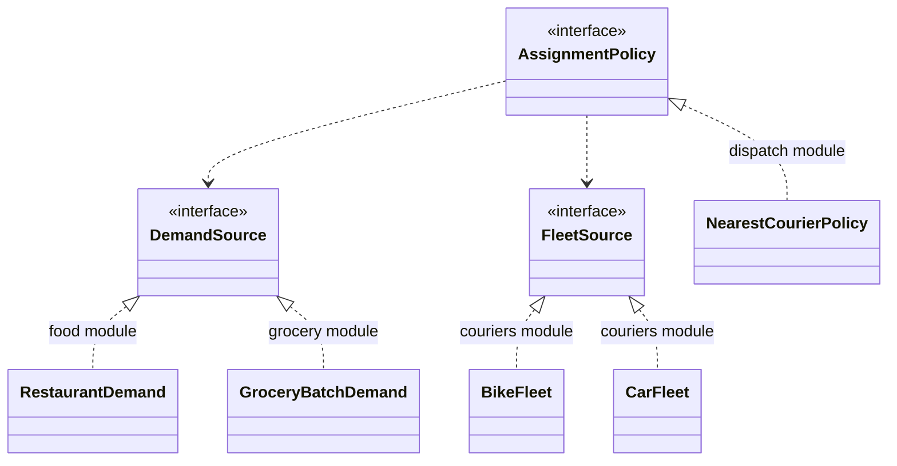

# Distillation: core and generic subdomains

Chapter 15: finding what deserves the best modeling effort, and getting everything else out of its way.

## Contents

- [Core Domain](#core-domain)
- [Generic Subdomains](#generic-subdomains)
- [Domain Vision Statement](#domain-vision-statement)
- [Highlighted Core](#highlighted-core)
- [Cohesive Mechanisms](#cohesive-mechanisms)
- [Segregated Core](#segregated-core)
- [Abstract Core](#abstract-core)

## Core Domain

> Boil the model down. Find the CORE DOMAIN and provide a means of easily distinguishing it from the mass of supporting model and code. Bring the most valuable and specialized concepts into sharp relief. Make the CORE small.

**Source:** *Domain-Driven Design*, Chapter 15.

### What it means in practice

Even an isolated domain layer can be too large to grasp. Distillation separates out the essence, **the part that distinguishes the software and makes it worth building**. The other parts become better through the process too, as Generic Subdomains and Cohesive Mechanisms.
- **Apply top talent to the core, and recruit for it.** The usual trap is that the strongest technical people end up on infrastructure and generic parts, never learn the domain, and so never get assigned to the core. Break that cycle with strong, long-term developers paired with domain experts. Short-term contractors are a "leak in the bucket".
- **The core usually can't be bought.** If a framework constrains you inside the core, either you're losing an essential asset, or the core is elsewhere, or you don't need custom software for it.
- **Choosing the core depends on point of view.** Money is generic for a shop but core for a currency-trading platform. Revisit the choice as insight grows.
- **Choose refactoring targets by the core.** When pain-driven refactoring traces back to the core, fix that first. When free to refactor, start with the core's factoring and its separation from the rest.

**An escalation of distillations**, from cheap to radical:

1. Domain Vision Statement
2. Highlighted Core
3. Generic Subdomains and Cohesive Mechanisms factored out
4. Segregated Core
5. Abstract Core

**Deep models distill.** A Breakthrough (`modeling.md`) creates value anywhere, but in the core it can change the trajectory of the whole project.

### Example: a food-delivery platform

| Part | Classification | Treatment |
|---|---|---|
| Dispatch: matching orders to couriers, batching, ETA prediction | **Core** | Best engineers, deep model, built in-house |
| Restaurant menus and pricing | Supporting | Built in-house, kept simple |
| Payments, invoicing, tax | Generic | Stripe, Avalara, off-the-shelf billing |
| Maps and geocoding | Generic | Google Maps / Mapbox APIs |
| Notifications | Generic | Twilio / Firebase |

When two refactorings compete for time, the one in dispatch wins.

### Related

- Generic Subdomains
- Domain Vision Statement
- Highlighted Core
- Cohesive Mechanisms
- Segregated Core
- Abstract Core
- Bounded Context (`context-mapping.md`)
- Refactoring Toward Deeper Insight (`modeling.md`)
- Breakthrough (`modeling.md`)
- Strategic Design Decisions (`large-scale-structure.md`)
- Supple Design (`supple-design.md`) — where the effort on suppleness should go first.
- Evolving Order (Large-Scale Structure) (`large-scale-structure.md`)

## Generic Subdomains

> Identify cohesive subdomains that are not the motivation for your project. Factor out generic models of these subdomains and place them in separate MODULES. Leave no trace of your specialties in them.

**Source:** *Domain-Driven Design*, Chapter 15.

### What it means in practice

Many parts of a model add complexity without capturing anything specialized: time zones, currencies, addresses, org charts, accounting, scheduling. Mixed into the core, they hide it and absorb the best developers' attention. Separate them into their own modules (`building-blocks.md`), keep your specialties out of them, give their continued development lower priority than the Core Domain, and don't assign core developers to them. Four options for getting one:

| Option | Advantages | Disadvantages |
|---|---|---|
| **1. Off-the-shelf** | Less code, maintenance outsourced, mature | Learning curve, integration, possibly overbuilt, quality unknown |
| **2. Published design/model** | Proven, well-documented, matches outside knowledge (analysis patterns (`modeling.md`)) | May not fit exactly, still has to be built |
| **3. Outsourced implementation** | Keeps the core team free; good for a well-specified generic part | Needs a clear interface and tests; knowledge leaves with the contractor |
| **4. In-house** | Exactly fits your needs; easy integration | Ongoing maintenance and training cost; easy to over-invest |

Two cautions:
- **Generic doesn't mean reusable.** Build only the slice you need, not a universal framework. Reuse is a bonus, not the goal.
- **Project risk:** build the first cut of the system on part of the core, however simple. Generic parts look safer but don't prove the system can succeed.

Evans's time-zone example compares an in-house implementation that went badly with one done properly in a generic module.

### Example

A B2B scheduling product needs recurring events, time-zone conversion and holiday calendars. The team uses `java.time` plus an RRULE library for recurrence (off-the-shelf) and a published holiday dataset, all wrapped in a `calendar` module with no product concepts in it. The core team's effort goes into the actual differentiator: optimizing shift assignments for clinics.

### Related

- Core Domain
- Cohesive Mechanisms — the other by-product: computation rather than domain model.
- Segregated Core — the same separation, approached from the core's side.
- Modules (`building-blocks.md`)
- Analysis Patterns (`modeling.md`)
- Separate Ways (`context-mapping.md`)
- Strategic Design Decisions (`large-scale-structure.md`)

## Domain Vision Statement

> Write a short description (about one page) of the CORE DOMAIN and the value it will bring, the "value proposition." Ignore those aspects that do not distinguish this domain model from others.

**Source:** *Domain-Driven Design*, Chapter 15.

### What it means in practice

At the start of a project, the model doesn't exist yet. Even later, nobody can see the whole of it. The team needs a shared direction for distillation, so write one page:
- What the Core Domain is and what value it brings.
- How the model serves and balances diverse interests.
- **Only what distinguishes this model.** Technology choices, deployment and generic features don't belong in it.
- Write it early and revise it as insight grows. It can be shared with management, nontechnical staff and even customers.

It's the cheapest distillation step, and it has the least effect on the design. It still needs something more concrete, like a Highlighted Core, to bridge to the code.

### Example: dispatch for a delivery platform

| Part of the vision statement | Not part of it (important, but not distinctive) |
|---|---|
| The model represents couriers, orders and restaurants in real time, so that orders are batched and assigned to minimize delivery time while keeping courier earnings fair. | The app runs on Kubernetes in two regions. |
| ETA predictions are first-class objects with confidence ranges, so that promises to customers can be tuned per market. | Payments go through Stripe. |
| Dispatch policies can be adjusted per city by operations staff without a deploy. | The API is GraphQL. |

### Related

- Core Domain
- Highlighted Core — the next, more concrete step.
- Ubiquitous Language (`modeling.md`) — the statement is written in it.
- Strategic Design Decisions (`large-scale-structure.md`)
- System Metaphor (`large-scale-structure.md`) — another lightweight shared picture.

## Highlighted Core

> Flag the elements of the CORE DOMAIN within the primary repository of the model, without particularly trying to elucidate its role. Make it effortless for a developer to know what is in or out of the CORE.

**Source:** *Domain-Driven Design*, Chapter 15.

### What it means in practice

A vision statement names the core in broad terms, but people still disagree on exactly which classes belong to it, and filtering the whole model in your head every day is tiring. Restructuring the code is the ideal fix, but it isn't always practical, and doing it well requires already being able to see the core. Two lightweight techniques make the core visible without restructuring:
- **The distillation document:** three to seven sparse pages describing the core elements and their main interactions. Its risks are those of any document (it may go unmaintained, go unread, or add one more source of truth), so keep it minimalist and focused on the stable central abstractions. It also works as a **process tool**: a change that affects the document's contents is a change to the core and calls for consultation.
- **The flagged core:** mark core elements in the code or model itself, with an annotation, a tag in the model tool, or a list. Doing so is cheap and easy to maintain.

### Example

```java
@CoreDomain   // custom annotation, plus a README listing the ~15 flagged classes
public class DispatchPlan { ... }

@CoreDomain
public interface AssignmentPolicy { ... }
```

An ArchUnit rule reports changes to `@CoreDomain` classes in PR descriptions, so the dispatch lead reviews them. The distillation document in the repo explains how `Order`, `CourierShift`, `DispatchPlan` and `AssignmentPolicy` interact, in four pages.

### Related

- Core Domain
- Domain Vision Statement
- Segregated Core — the structural step that follows.
- Abstract Core — ends up looking like the distillation document, but in code.
- Ubiquitous Language (`modeling.md`)

## Cohesive Mechanisms

> Partition a conceptually COHESIVE MECHANISM into a separate lightweight framework. Particularly watch for formalisms or well-documented categories of algorithms. Expose the capabilities of the framework with an INTENTION-REVEALING INTERFACE.

**Source:** *Domain-Driven Design*, Chapter 15.

### What it means in practice

Sometimes the bulk of a model's code isn't about *what* the domain is but about *how* to compute something it needs. That computational "how" buries the "what". Pull it out into a lightweight framework with an intention-revealing interface (`supple-design.md`). Then the core states the problem declaratively and the mechanism solves it.
- **Look for formalisms:** graph theory, constraint solving, scheduling, specification evaluation. Proven algorithms come with documentation and textbook vocabulary for free.
- **Generic Subdomain vs. Cohesive Mechanism.** A generic subdomain is still an expressive model of part of the domain, just a less central one. A mechanism represents nothing in the domain; it solves a computational problem. In Evans's words: "A model proposes; a COHESIVE MECHANISM disposes."
- **Exception:** a proprietary algorithm that *is* the competitive advantage, such as a unique scheduling optimizer, belongs in the core.
- **Full circle.** Once the mechanism exists, the model can often be simplified until the mechanism is folded back in as a declarative style.

Evans's example is an organization chart whose code was dominated by tree-traversal logic. A small **graph** framework (nodes, edges, traversal) took that over, and the org model simply declared people as nodes and relationships as edges.

### Example: a referral and permission graph

```java
// Mechanism: knows graphs, not companies
public interface Graph<N> {
    Optional<List<N>> shortestPath(N from, N to);
    Set<N> reachableFrom(N start, Predicate<Edge<N>> via);
}

// Core: declares the domain in graph terms and asks questions
public class OrganizationAccess {
    boolean canApprove(Employee approver, Employee requester) {
        return orgGraph.reachableFrom(approver, edge -> edge.is(MANAGES)).contains(requester);
    }
}
```

The traversal (BFS/DFS, Dijkstra) is unit-tested once in isolation. The access model reads like policy.

### Related

- Core Domain
- Generic Subdomains
- Intention-Revealing Interfaces (`supple-design.md`)
- Declarative Design (`supple-design.md`)
- Specification (`building-blocks.md`) — a specification-evaluation framework is another typical mechanism.
- Supple Design (`supple-design.md`) — "draw on established formalisms".
- Segregated Core

## Segregated Core

> Refactor the model to separate the CORE concepts from supporting players (including ill-defined ones) and strengthen the cohesion of the CORE while reducing its coupling to other code.

**Source:** *Domain-Driven Design*, Chapter 15.

### What it means in practice

Even with the core highlighted, core classes still sit in modules alongside supporting code and stay entangled with it. A Segregated Core makes the separation **structural**: move the core concepts into their own module (`building-blocks.md`) or modules, and push every generic or supporting element out, *even if that means splitting highly coupled elements*. It's the Generic Subdomains idea approached from the other side.

Steps from the book:
1. Identify a core subdomain, possibly using the distillation document.
2. Move related classes into a new module named for the concept.
3. Refactor code to sever data and functionality that aren't directly part of the concept, putting it in other packages.
4. Refactor the segregated core module to make its relationships and interactions simpler and more communicative.
5. Repeat with another core subdomain until done.

**Costs:** this can make relationships with tightly coupled classes more obscure or complicated, and it is a lot of work. It's worth it when the system is large, the core is critical, and the core is being lost in the noise. Like any team-wide structural decision, it is made deliberately, and the team agrees on what goes in the core.

### Example

Before the change, `com.delivery.orders` contained `Order`, `OrderReceiptPdf`, `OrderEmailTemplates`, `DispatchScoring` and `CourierAssignment`. Dispatch logic was tangled with receipts. After it:

```
com.delivery.dispatch        DispatchPlan, AssignmentPolicy, CourierShift, EtaEstimate   ← core
com.delivery.orders          Order, OrderLine (supporting)
com.delivery.notifications   OrderEmailTemplates, OrderReceiptPdf (generic)
```

`dispatch` depends on a narrow `OrderSnapshot` value, not on all of `orders`.

### Related

- Core Domain
- Highlighted Core — the step before.
- Abstract Core — the step after.
- Generic Subdomains
- Modules (`building-blocks.md`)
- Cohesive Mechanisms

## Abstract Core

> Identify the most fundamental concepts in the model and factor them into distinct classes, abstract classes, or interfaces. Design this abstract model so that it expresses most of the interaction between significant components.

**Source:** *Domain-Driven Design*, Chapter 15.

### What it means in practice

In a large system, even the segregated core can be big, and there is a lot of interaction between subdomain modules. The most ambitious distillation step is to express the **fundamental concepts and their interactions as abstractions** (interfaces and abstract classes) in their own module, and leave the specialized implementations in subdomain modules.
- Specialized modules reference the abstract core, **not each other**.
- The abstract core gives a succinct, rigorous view of the main concepts. It ends up looking like the distillation document of the Highlighted Core, but written in code.
- It isn't mechanical. Moving all frequently referenced classes into one module produces a mess. It takes deep insight (`modeling.md`) and usually considerable redesign.

This is Martin's Stable Abstractions and Dependency Inversion applied at the level of a domain model. It is also the hub of a Pluggable Component Framework (`large-scale-structure.md`).



### Example

The delivery platform expands from restaurants to groceries and parcels. Instead of letting `grocery` call into `food` and `parcels` call into both, the team extracts `dispatch-core`: `DemandSource`, `FleetSource`, `AssignmentPolicy` and `DeliveryPromise`. Each vertical implements these interfaces and depends only on the core. Adding pharmacy delivery is a new module that touches no existing vertical.

### Related

- Core Domain
- Segregated Core
- Highlighted Core
- Pluggable Component Framework (`large-scale-structure.md`) — built on an abstract core.
- Modules (`building-blocks.md`)
- Refactoring Toward Deeper Insight (`modeling.md`)
