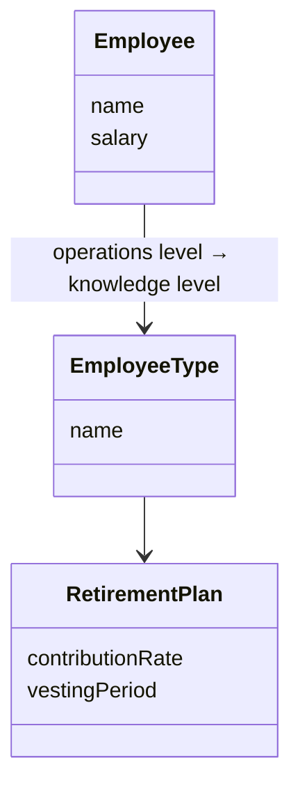

# Large-scale structure

Chapters 16–17: shared structures that help a very large model stay understandable, and how strategic decisions get made.

## Contents

- [Strategic Design Decisions](#strategic-design-decisions)
- [Evolving Order (Large-Scale Structure)](#evolving-order-large-scale-structure)
- [System Metaphor](#system-metaphor)
- [Responsibility Layers](#responsibility-layers)
- [Knowledge Level](#knowledge-level)
- [Pluggable Component Framework](#pluggable-component-framework)

## Strategic Design Decisions


**Source:** *Domain-Driven Design*, Chapter 17 and Conclusion.

### What it means in practice

The three principles of strategic design are **context**, **distillation** and **large-scale structure**. They complement each other rather than substituting for one another:
- A large-scale structure can live inside one Bounded Context (`context-mapping.md`), or it can organize the whole Context Map (`context-mapping.md`). A legacy system can be described by which layers its services fall into.
- The structure can explain the relationships between the Core (`distillation.md`) and the Generic Subdomains (`distillation.md`), and the structure itself may be part of the core insight.

**Assessment first.** Before choosing a strategy, answer six questions:
- Can you draw a consistent context map?
- Is the language really ubiquitous, and is it rich enough?
- Is the core identified, and is there a vision statement, or could you write one?
- Does the technology help or hinder a model-driven design?
- Do the developers have the technical skills?
- Do they know the domain, and are they interested in it?

**Who sets the strategy?** Either it emerges from the application teams, or a **customer-focused architecture team** acts as a peer to those teams, discovers patterns with them, and gets its hands dirty. The ivory-tower architect fails. Evans's six essentials:

1. **Decisions must reach the entire team.** Real influence counts more than official authority.
2. **The decision process must absorb feedback.** Only application developers have the depth of knowledge needed, so architects must stay close to them.
3. **The plan must allow for evolution** (Evolving Order).
4. **Architecture teams must not take all the strongest people.** Applications need strong designers, and strategy needs domain knowledge.
5. **Strategic design requires minimalism and humility.** Every element gets in someone's way, so each one has to earn its place.
6. **Objects are specialists; developers are generalists.** Don't split people into "designers" and "coders" the way you split responsibilities.

The same goes for technical frameworks: evolve them with application teams, keep them minimal, and **don't write frameworks for dummies**. Coddling supposedly less-smart developers underestimates how hard application work is. **Beware the master plan:** Evans quotes Christopher Alexander on planning the University of Oregon campus. Master plans fail because they impose a "totalitarian order" that can't adapt to change. Piecemeal growth guided by shared principles produces organic order instead.

### Example

A 120-engineer company sets up a four-person "domain architecture guild" instead of an architecture department. Each member spends half their time on a product team. The guild maintains the context map, the core-domain list and a three-layer responsibility structure. Each quarter it re-evaluates the structure against real pain reported by teams, and twice it has removed rules nobody used. No framework is mandated. Shared libraries survive only if two or more teams adopt them voluntarily.

### Related

- Context Map (`context-mapping.md`)
- Core Domain (`distillation.md`)
- Evolving Order (Large-Scale Structure)
- Responsibility Layers
- Hands-On Modelers (`modeling.md`) — the same rule at project level.
- Choosing a Model Context Strategy (`context-mapping.md`)
- Domain Vision Statement (`distillation.md`)
- Bounded Context (`context-mapping.md`)
- Generic Subdomains (`distillation.md`)
- System Metaphor

## Evolving Order (Large-Scale Structure)


**Source:** *Domain-Driven Design*, Chapter 16.

### What it means in practice

In a big system, people stop seeing the forest for the trees. Neither Modules (`building-blocks.md`), Bounded Contexts (`context-mapping.md`) nor distillation (`distillation.md`) explains how all the parts fit together, and without coordination each team solves the same problems in its own idiosyncratic way. A **large-scale structure** is a set of shared concepts or rules that shapes the design of the whole system. It acts as a language for discussing the system in broad strokes and lets independent work stay consistent. It usually doesn't appear in UML: it shapes and explains the model rather than being part of it.

The danger is that up-front architectures venturing into the domain constrain developers in ways that don't fit the details. Hence **Evolving Order**:
- Let the structure emerge and change as understanding grows, even into a completely different kind of structure.
- Using a structure trades optimal design of individual parts for manageability of the whole, so keep the trade small.
- A small team with a modest model may need **no** large-scale structure. Well-named modules and some distillation can be enough. A structure that doesn't fit does more harm than having none.

**How restrictive should it be?** Minimally. Tight structures like a Pluggable Component Framework pay off only in specific situations. Keep the structure ferociously distilled, rely on communication and self-discipline rather than enforcement, and expect restructuring to *yield* a supple design (`supple-design.md`), since each structure change makes the next one easier. Distillation lightens the load too: a structure is easier to apply to a well-distilled model.

The structural patterns in the book are System Metaphor, Responsibility Layers, Knowledge Level and Pluggable Component Framework.

### Example

A logistics SaaS starts with no explicit structure. At around 40 developers, teams keep putting pricing logic in "tracking" modules. The architects propose responsibility layers (Capability → Operations → Decision Support), refactor two modules to see how they fit, adjust the layer definitions after the trial, and only then roll them out. A year later, when the product adds a marketplace for carriers, a "Commitment" layer is added. The structure grew with the business instead of being decreed on day one.

### Related

- System Metaphor
- Responsibility Layers
- Knowledge Level
- Pluggable Component Framework
- Strategic Design Decisions — how structure, contexts and distillation combine.
- Breakthrough (`modeling.md`) — structures shift in the same punctuated way models do.
- Bounded Context (`context-mapping.md`)
- Core Domain (`distillation.md`)
- Modules (`building-blocks.md`)
- Supple Design (`supple-design.md`)

## System Metaphor


**Source:** *Domain-Driven Design*, Chapter 16 (from Extreme Programming).

### What it means in practice

A good metaphor can organize a whole design in one picture. A firewall works like a building's firewall; a "pipeline" of stages; a "ledger". When one emerges naturally:
- Organize the design around it and absorb it into the Ubiquitous Language (`modeling.md`).
- It improves communication and consistency, even across Bounded Contexts (`context-mapping.md`).
- **All metaphors are inexact.** Continually check for overextension or inaptness, and drop it when it misleads.

The **naive metaphor** is what XP fell back on when no good metaphor was found: "the system is just its domain model". Evans says DDD doesn't need it, because the domain model *is* already the shared conceptual core, and a forced metaphor adds nothing. Metaphors are opportunistic: use one when it's genuinely illuminating.

### Example

A CI/CD platform adopts the **assembly line** metaphor: builds are workpieces moving through **stations** (stages), each station has **workers** (runners), and a defect stops the line. New features slot in naturally, such as a "quality gate station" or "line throughput" metrics. But when the team added parallel fan-out and fan-in, the assembly-line picture misled people, who expected strictly sequential stations. The team kept the metaphor for UX and docs but stopped using it to structure the scheduler.

### Related

- Evolving Order (Large-Scale Structure)
- Ubiquitous Language (`modeling.md`)
- Responsibility Layers — the most common alternative structure.
- Domain Vision Statement (`distillation.md`) — another lightweight shared picture.
- Strategic Design Decisions
- Bounded Context (`context-mapping.md`)

## Responsibility Layers


**Source:** *Domain-Driven Design*, Chapter 16.

### What it means in practice

Layered Architecture (`building-blocks.md`) separates the domain from UI and infrastructure, but the domain layer itself can still be a flat jumble. Responsibility Layers stratify the **domain** by broad responsibility, so that every object, Aggregate (`building-blocks.md`) and Module (`building-blocks.md`) fits within one layer, and upper layers depend on lower ones, never the reverse. Communication upward goes through events or Observer.

Good layers have three properties:
- **Storytelling:** they communicate the priorities of the business. Choosing them is a business modeling decision, not a technical one.
- **Conceptual dependency:** upper concepts make sense only against the lower ones, and lower concepts stand on their own.
- **Conceptual contours (`supple-design.md`):** layers fall where rates and sources of change differ.

Evans's recurring layers for enterprise systems, from bottom to top:

| Layer | Question it answers | Example (car-sharing platform) |
|---|---|---|
| **Potential** (Capability) | What *could* we do? | Fleet, vehicles, parking zones, insurance contracts |
| **Operations** | What *are* we doing? | Active trips, reservations, maintenance jobs |
| **Commitment** | What have we *promised*? | Corporate SLAs, booked long-term rentals |
| **Decision Support** | What *should* we do? | Rebalancing recommendations, dynamic pricing analysis |
| **Policy** | What are the *rules and goals*? | Surge pricing rules, minimum battery levels, city regulations |

Use four, maybe five layers at most, otherwise the story is lost. Not every domain fits this set: finance and insurance may merge Potential into Operations. Start somewhere and let the order evolve.

### Example: dependencies point down

```java
// Operations depends on Potential
class Trip { Vehicle vehicle; Member driver; Route route; }     // Vehicle lives in Potential

// Decision Support reads Operations and Potential, never written to by them
class RebalancingAdvisor { List<Move> recommend(FleetSnapshot fleet, DemandForecast demand) { ... } }

// Policy constrains the others, often as Strategy/Specification objects passed down
interface PricingPolicy { Money priceFor(Trip trip, ZoneDemand demand); }
```

The `Vehicle` class has no idea trips exist. That's why the same fleet model serves both the consumer app and a B2B leasing product.

### Related

- Evolving Order (Large-Scale Structure)
- Layered Architecture (`building-blocks.md`) — layers *around* the domain; these are layers *inside* it.
- Conceptual Contours (`supple-design.md`)
- Knowledge Level
- Strategic Design Decisions — layers can organize a whole context map.
- Aggregate (`building-blocks.md`)
- Modules (`building-blocks.md`)
- System Metaphor

## Knowledge Level


**Source:** *Domain-Driven Design*, Chapter 16 (from Fowler, *Analysis Patterns*).

### What it means in practice

Some applications must let users reshape the roles and rules of the model at installation or at runtime. Org charts differ by company, and employee types differ by country. Hard-coding one structure fails: users abuse fields to fit their reality, behavior misfires, and migrations become archaeology. Making every object fully configurable fails differently, because objects become jacks-of-all-trades. The Knowledge Level separates the model into two levels:
- **Operations level:** the concrete things, such as an employee, a payroll run, a claim.
- **Knowledge level:** objects that *describe* how the operations level should behave, such as an employee type with its pension rules, or a claim category with its approval rules. Users or superusers edit these.

Operations objects refer to their knowledge-level descriptors and delegate rule-dependent behavior to them. In the POSA terminology, the pattern is the base level and meta level of Reflection.

**Use it sparingly.** The indirection unravels complexity but adds obscurity. If the knowledge level itself grows complex, neither developers nor users can predict the system's behavior.



### Example: configurable support tiers

```java
// Knowledge level: edited by admins in the back office
public class SupportTier {            // "Gold", "Enterprise", "Startup"
    Duration firstResponseTarget;
    Set<Channel> allowedChannels;
    EscalationRule escalation;
}

// Operations level: concrete tickets behave according to their customer's tier
public class Ticket {
    Customer customer;
    Instant openedAt;
    boolean isBreachingSla(Instant now) {
        return now.isAfter(openedAt.plus(customer.tier().firstResponseTarget()));
    }
}
```

Sales can introduce a "Healthcare Premium" tier with a 1-hour target and phone access without a deploy. The ticket code never changes.

### Related

- Evolving Order (Large-Scale Structure)
- Analysis Patterns (`modeling.md`) — the pattern's origin.
- Responsibility Layers — the knowledge level often lines up with a Policy layer.

## Pluggable Component Framework


**Source:** *Domain-Driven Design*, Chapter 16.

### What it means in practice

When many applications and components must interoperate, often built by different teams or vendors, each independently derived model needs a translator to every other one. A Pluggable Component Framework instead defines a central hub:
- An **Abstract Core (`distillation.md`) of interfaces and interactions**, shared as a Shared Kernel (`context-mapping.md`).
- Components implement those interfaces and plug in. Applications use any component **strictly through the interfaces**.
- Multiple Bounded Contexts (`context-mapping.md`) can sit behind the component interfaces, which is what makes the approach work with many sources.

Drawbacks:
- It is a very **restrictive** large-scale structure, and it can only be designed once the domain is well understood, typically after several applications have been built without it. Evans warns against starting with it.
- Changing the abstract core is very costly, because every component and application has to move.
- Components can't easily add capabilities beyond the abstract core.

Evans's example is the SEMATECH CIM framework for semiconductor factories. It defines interfaces for process machines and material lots, and a protocol for hosting them, so any vendor's machine plugs into any compliant manufacturing system.

### Example: payment methods in a checkout platform

```java
// Abstract core (shared kernel)
public interface PaymentMethodPlugin {
    String id();                                         // "card", "pix", "klarna"
    boolean supports(Country country, Currency currency);
    AuthorizationResult authorize(PaymentRequest request);
    CaptureResult capture(AuthorizationId id, Money amount);
}

// Plugins, each its own module, often built by different teams or partners
public class PixPlugin implements PaymentMethodPlugin { ... }
public class KlarnaPlugin implements PaymentMethodPlugin { ... }
```

Checkout discovers plugins at startup and offers the ones that `supports(...)` the shopper's market. Adding a new local payment method means writing a new plugin, without touching checkout. The cost: when 3-D Secure flows forced a new `requiresChallenge` step, every plugin had to be updated.

### Related

- Abstract Core (`distillation.md`)
- Shared Kernel (`context-mapping.md`)
- Evolving Order (Large-Scale Structure) — don't impose this before the domain is understood.
- Open Host Service (`context-mapping.md`), Published Language (`context-mapping.md`) — looser alternatives for many-party integration.
- Bounded Context (`context-mapping.md`)
