# Behavioral patterns

Ways to distribute behavior and communication between objects.

## Contents

- [Strategy Pattern](#strategy-pattern)
- [State Pattern](#state-pattern)
- [Observer Pattern](#observer-pattern)
- [Command Pattern](#command-pattern)
- [Template Method Pattern](#template-method-pattern)
- [Iterator Pattern](#iterator-pattern)
- [Chain of Responsibility Pattern](#chain-of-responsibility-pattern)
- [Mediator Pattern](#mediator-pattern)
- [Memento Pattern](#memento-pattern)
- [Visitor Pattern](#visitor-pattern)
- [Interpreter Pattern](#interpreter-pattern)

## Strategy Pattern

> The Strategy Pattern defines a family of algorithms, encapsulates each one, and makes them interchangeable. Strategy lets the algorithm vary independently from clients that use it.

**Source:** *Head First Design Patterns*, Chapter 1 — "Intro to Design Patterns" (read it). Summary below, book as bibliography — short quotes only where the exact wording matters.

### What it is & when to use it

Strategy pulls a family of interchangeable behaviors (algorithms) out behind a common interface, so an object can delegate to whichever one it's holding instead of implementing the behavior itself — and that behavior can be swapped at runtime.

Reach for it when:

- Several classes differ only in one specific behavior (how they fly, sort, validate, price something), and subclassing to cover every combination would duplicate code or force behavior onto subclasses that shouldn't have it.
- You want to change an object's behavior at runtime without changing its class.
- You want each behavior to be reusable and testable on its own, decoupled from the classes that use it.

It's the concrete example behind Favor Composition Over Inheritance (`principles.md`): instead of inheriting behavior, an object HAS-A behavior object and delegates to it.

### The motivating problem

The book introduces Strategy through SimUDuck, a duck-pond simulator. Putting `fly()` in the `Duck` superclass makes every duck inherit it — including rubber ducks, which shouldn't fly. Overriding `fly()` per subclass avoids that but duplicates the fix across every subclass that needs one. Pulling `fly()`/`quack()` into a `Flyable`/`Quackable` interface avoids the wrong inheritance but kills code reuse, since Java interfaces carry no implementation.

The actual fix: apply Encapsulate What Varies (`principles.md`) — pull `fly()` and `quack()` out of `Duck` entirely and turn each into its own family of interchangeable classes, then have `Duck` hold a reference to one of each (Program To An Interface (`principles.md`)) and delegate to it.

### Participants

- **Context** — holds a reference to a strategy interface and delegates to it instead of implementing the behavior itself.
- **Strategy interface** — declares the behavior every concrete strategy must implement.
- **ConcreteStrategy** — each one implements the behavior a different way.

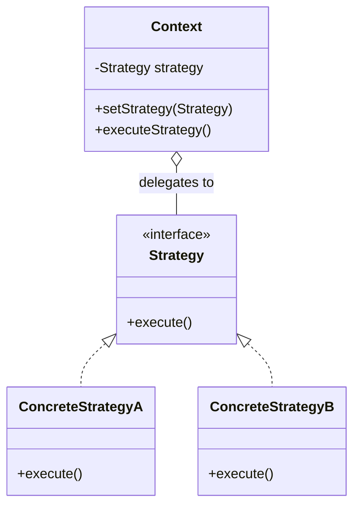

(In the book's example: `Duck` is the Context, `FlyBehavior`/`QuackBehavior` are the Strategy interfaces, and `FlyWithWings`/`FlyNoWay`/`Quack`/`Squeak` are the ConcreteStrategies.)

### Example: payment method at checkout

A far more common real case than ducks: an e-commerce checkout that must support several payment methods, selectable per order and extendable without touching the checkout logic.

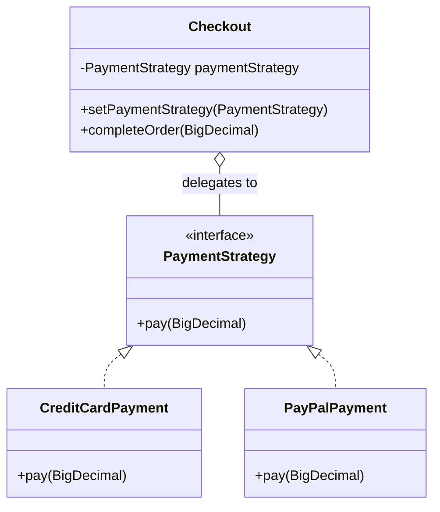

```java
public interface PaymentStrategy {
    void pay(BigDecimal amount);
}

public class CreditCardPayment implements PaymentStrategy {
    private final String cardNumber;

    public CreditCardPayment(String cardNumber) {
        this.cardNumber = cardNumber;
    }

    public void pay(BigDecimal amount) {
        System.out.println("Charged $" + amount + " to card " + cardNumber);
    }
}

public class PayPalPayment implements PaymentStrategy {
    private final String email;

    public PayPalPayment(String email) {
        this.email = email;
    }

    public void pay(BigDecimal amount) {
        System.out.println("Charged $" + amount + " via PayPal (" + email + ")");
    }
}

public class Checkout {
    private PaymentStrategy paymentStrategy;

    public void setPaymentStrategy(PaymentStrategy strategy) {
        this.paymentStrategy = strategy;
    }

    public void completeOrder(BigDecimal amount) {
        paymentStrategy.pay(amount);
    }
}
```

```java
Checkout checkout = new Checkout();
checkout.setPaymentStrategy(new PayPalPayment("user@mail.com"));
checkout.completeOrder(new BigDecimal("49.99"));
```

`Checkout` never branches on payment type (`if method == "paypal" ...`) and never changes when a new payment method is added — that's a new `PaymentStrategy` implementation, nothing else. The strategy is picked at checkout time and can change order to order, or mid-session if the user switches payment method.

### Design toolbox takeaways

- Patterns don't hand you code — they hand you a general solution you adapt to your own app.
- Most patterns exist to isolate one axis of change so it doesn't ripple through the rest of the system.
- Three OO principles underlie Strategy (and most patterns that follow it in the book): Encapsulate What Varies (`principles.md`), Program To An Interface (`principles.md`), and Favor Composition Over Inheritance (`principles.md`).

### Related

- Encapsulate What Varies (`principles.md`)
- Program To An Interface (`principles.md`)
- Favor Composition Over Inheritance (`principles.md`)
- Adapter Pattern (`structural.md`)
- State Pattern — identical class diagram, different intent: states swap themselves, strategies are chosen by the client.
- Template Method Pattern — varies steps via inheritance; Strategy varies the whole algorithm via composition.
- Command Pattern — also behavior-in-an-object, but as a one-shot request with undo/queue semantics.
- Bridge Pattern (`structural.md`) — same composition shape applied to a whole abstraction hierarchy.
- MVC (`compound.md`) — the controller is the view's strategy.
- What Is a Design Pattern (`principles.md`)
- Decorator Pattern (`structural.md`)
- The Hollywood Principle (`principles.md`)
- Visitor Pattern
- Inheritance Tax (`principles.md`)

## State Pattern

> The State Pattern allows an object to alter its behavior when its internal state changes. The object will appear to change its class.

**Source:** *Head First Design Patterns*, Chapter 10 — "the State Pattern" (read it). Summary below, book as bibliography — short quotes only where the exact wording matters.

### What it is & when to use it

The procedural way to build a state machine is a `state` field plus a `switch` in every method — and every new state means editing every method. State pattern turns each state into its own class implementing a common interface with all the actions; the context holds a reference to its current state object and delegates every action to it. Each state class knows how to behave for each action *in that state* and which state comes next. Behavior changes as the state object is swapped — the object "appears to change its class".

Reach for it when:

- An object's behavior depends heavily on its state and you see the same `switch (status)` repeated across methods.
- You have a real lifecycle: orders, subscriptions, documents in a review workflow, connections, game characters.
- New states/transitions keep being added and each addition risks breaking others.

Design choices: transitions can live in the **state classes** (more decentralized; states know their siblings) or in the **context** (states stay independent; the context holds the transition table). State objects with no per-instance data can be **shared** among contexts. Cost: more classes.

### How it works

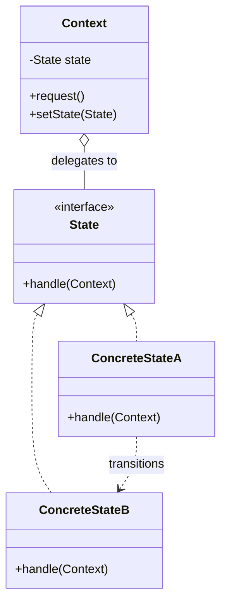

(In the book: `GumballMachine` is the Context; `NoQuarterState`, `HasQuarterState`, `SoldState`, `SoldOutState`, `WinnerState` implement `insertQuarter()`, `ejectQuarter()`, `turnCrank()`, `dispense()`.)

### Example: order lifecycle

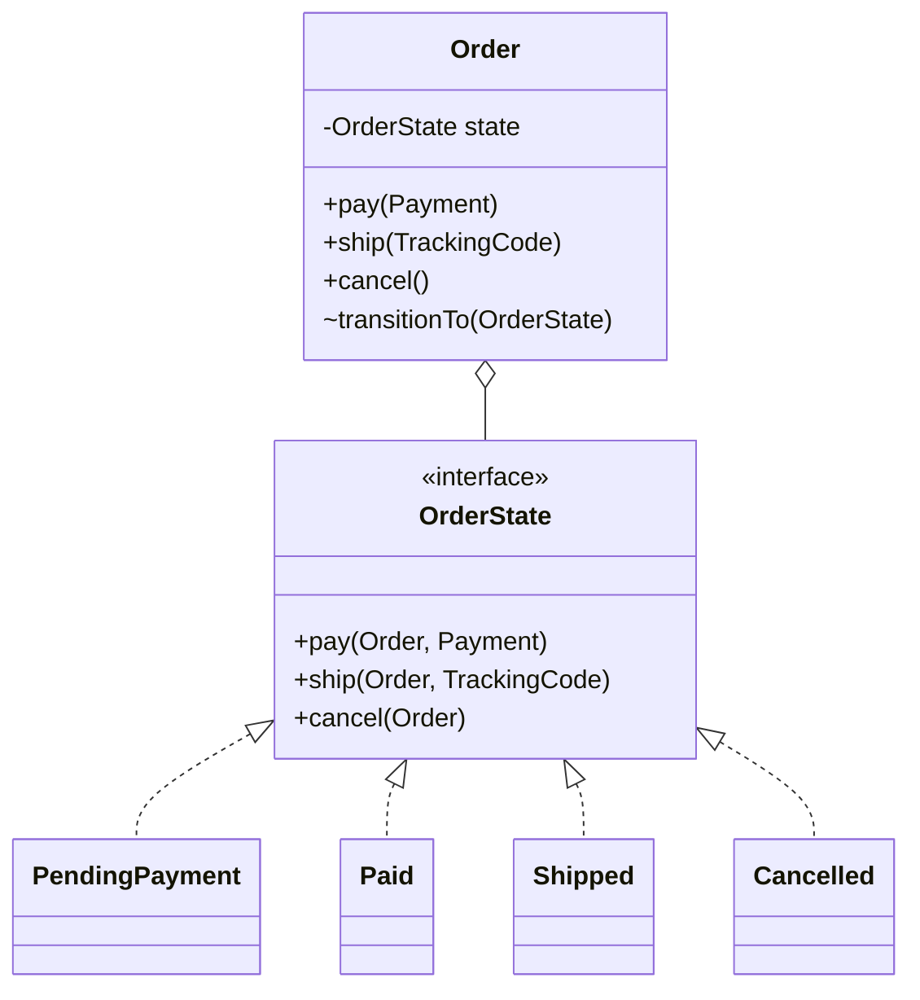

```java
public interface OrderState {
    default void pay(Order o, Payment p)       { throw new IllegalOrderTransition("pay", this); }
    default void ship(Order o, TrackingCode t) { throw new IllegalOrderTransition("ship", this); }
    default void cancel(Order o)               { throw new IllegalOrderTransition("cancel", this); }
}

class PendingPayment implements OrderState {
    public void pay(Order o, Payment p) { o.recordPayment(p); o.transitionTo(new Paid()); }
    public void cancel(Order o)         { o.transitionTo(new Cancelled()); }
}

class Paid implements OrderState {
    public void ship(Order o, TrackingCode t) { o.recordShipment(t); o.transitionTo(new Shipped()); }
    public void cancel(Order o)               { o.refund(); o.transitionTo(new Cancelled()); }
}

class Shipped implements OrderState {}          // nothing allowed except via returns flow
class Cancelled implements OrderState {}

public class Order {
    private OrderState state = new PendingPayment();
    public void pay(Payment p)        { state.pay(this, p); }
    public void ship(TrackingCode t)  { state.ship(this, t); }
    public void cancel()              { state.cancel(this); }
    void transitionTo(OrderState next) { state = next; }
}
```

"Cancel a paid order → refund first" lives in exactly one place (`Paid.cancel`). Adding `PartiallyShipped` is a new class plus edits to the states that can lead to it — no giant switch to keep in sync.

### Comparisons

| | State | Strategy |
|---|---|---|
| Class diagram | same | same |
| Intent | behavior changes *automatically* as internal state changes | client *configures* the context with an algorithm |
| Who swaps the object | the states/context, as part of normal operation | the client, usually rarely |
| Do the objects know each other? | states often know their successors | strategies are independent |

### Related

- Strategy Pattern
- Encapsulate What Varies (`principles.md`) — what varies is behavior per state.
- Flyweight Pattern (`structural.md`) — stateless State objects can be shared like flyweights.
- What Is a Design Pattern (`principles.md`)

## Observer Pattern

> The Observer Pattern defines a one-to-many dependency between objects so that when one object changes state, all its dependents are notified and updated automatically.

**Source:** *Head First Design Patterns*, Chapter 2 — "the Observer Pattern" (read it). Summary below, book as bibliography — short quotes only where the exact wording matters.

### What it is & when to use it

One object (the **subject**) owns some state; any number of other objects (**observers**) want to react when it changes. Instead of the subject calling each of them by name, observers register through a common interface and the subject loops over whoever is registered. The subject knows nothing about its observers except that they implement `Observer` — the book's showcase for Strive for Loosely Coupled Designs (`principles.md`).

Reach for it when:

- A change in one object must trigger reactions elsewhere, and the set of reacting objects should be open-ended (added/removed at runtime, new kinds added without touching the subject).
- You want side effects (emails, analytics, cache invalidation, UI refresh) out of the core object's code.
- Several views must stay in sync with one model (the heart of MVC (`compound.md`)).

Things to watch: don't rely on notification **order**; choose between **push** (subject sends the data in `update(...)`) and **pull** (observer asks the subject for what it needs — the book considers pull more "correct" since observers take only what they need); and remember to unsubscribe, or observers leak.

### How it works

- **Subject** — interface for `registerObserver`, `removeObserver`, `notifyObservers`.
- **ConcreteSubject** — holds the state and the observer list; calls `notifyObservers()` when state changes.
- **Observer** — interface with `update()`.
- **ConcreteObserver** — registers with a subject and reacts in `update()`.

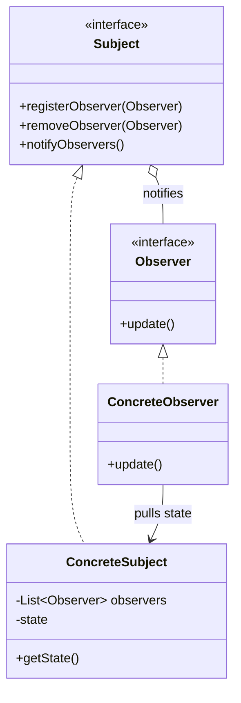

(In the book: `WeatherData` is the subject; `CurrentConditionsDisplay`, `StatisticsDisplay`, and `ForecastDisplay` are observers.)

### Example: order status changes

An order moves through statuses; customers get emails, analytics records the funnel, and the warehouse dashboard refreshes — and next month someone will want a Slack alert for high-value orders.

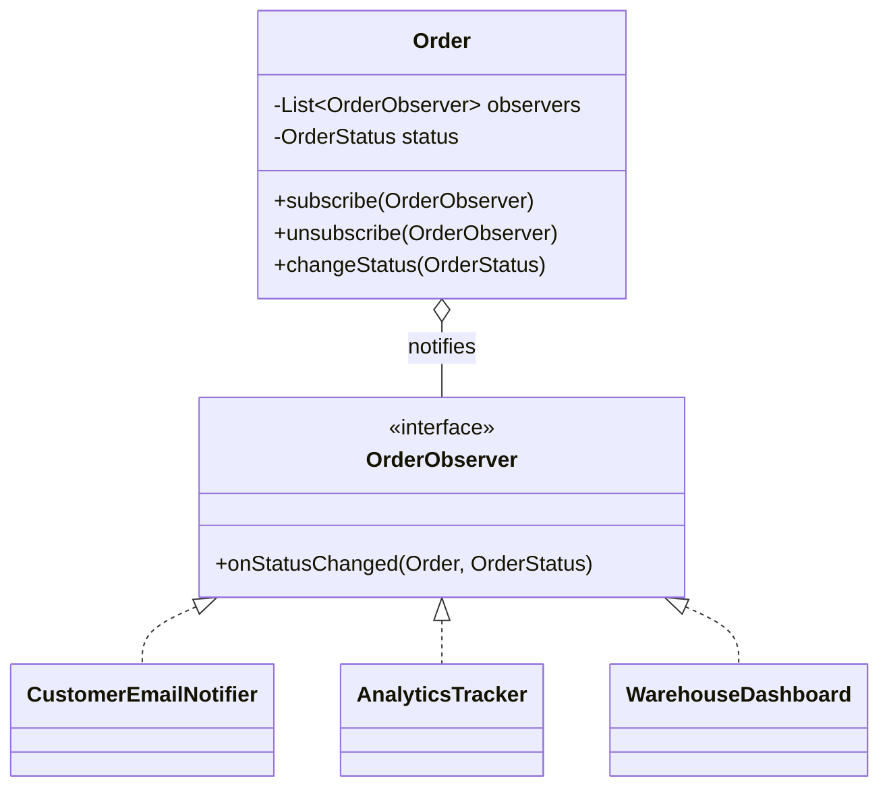

```java
public interface OrderObserver {
    void onStatusChanged(Order order, OrderStatus previous);
}

public class Order {
    private final List<OrderObserver> observers = new ArrayList<>();
    private OrderStatus status = OrderStatus.PENDING;

    public void subscribe(OrderObserver o)   { observers.add(o); }
    public void unsubscribe(OrderObserver o) { observers.remove(o); }

    public void changeStatus(OrderStatus next) {
        OrderStatus previous = status;
        status = next;
        observers.forEach(o -> o.onStatusChanged(this, previous));
    }
    public OrderStatus status() { return status; }
}

public class CustomerEmailNotifier implements OrderObserver {
    public void onStatusChanged(Order order, OrderStatus previous) {
        if (order.status() == OrderStatus.SHIPPED) mailer.sendShippedEmail(order);
    }
}
```

```java
order.subscribe(new CustomerEmailNotifier(mailer));
order.subscribe(new AnalyticsTracker(segment));
order.changeStatus(OrderStatus.SHIPPED);   // both react; Order never names them
```

The Slack alert is one new `OrderObserver` — `Order` doesn't change. (Java's old `java.util.Observable` is a class, not an interface, which forces inheritance; the book warns against it and recommends rolling your own, as above. Modern code often uses an event bus, which is the same idea with the subscription list moved out of the subject.)

### Comparisons

| Pattern | Difference |
|---|---|
| Mediator | Observer broadcasts one-to-many and the subject has no logic about the reactions; a Mediator centralizes *two-way* coordination logic between peers. |
| MVC (`compound.md`) | Uses Observer so the model can update any number of views without knowing them. |
| Command | Observers react to "something happened"; commands represent "do this". |

### Related

- Strive for Loosely Coupled Designs (`principles.md`) — the principle this chapter introduces.
- Encapsulate What Varies (`principles.md`) — what varies is the number and kind of observers.
- Program To An Interface (`principles.md`) — subject and observers only know each other's interfaces.
- Favor Composition Over Inheritance (`principles.md`) — observers are composed with subjects at runtime, not via inheritance.
- Hollywood Principle (`principles.md`) — observers don't poll; the subject calls them.
- Model-View-Controller (Compound Pattern) (`compound.md`)
- Mediator Pattern
- Chain of Responsibility Pattern
- Command Pattern
- What Is a Design Pattern (`principles.md`)

## Command Pattern

> The Command Pattern encapsulates a request as an object, thereby letting you parameterize other objects with different requests, queue or log requests, and support undoable operations.

**Source:** *Head First Design Patterns*, Chapter 6 — "the Command Pattern" (read it). Summary below, book as bibliography — short quotes only where the exact wording matters.

### What it is & when to use it

Command turns "call this method on that object with these arguments" into an object with a single `execute()` method. The thing that *triggers* the action (the **invoker** — a button, a scheduler, a queue worker) just holds commands and calls `execute()`; it has no idea what the action does or which object (**receiver**) actually does the work. That decoupling of requester from performer is the whole point.

Once a request is an object, you get extras almost for free:

- **Parameterize** invokers — assign any command to any button/slot/menu, even at runtime. A `NoCommand` (null object) avoids `null` checks for empty slots.
- **Undo** — add `undo()` that reverses `execute()`; keep a stack of executed commands for multi-level undo.
- **Macro commands** — a command holding a list of commands, executed (and undone) together.
- **Queue** requests — producers push commands, worker threads pop and execute them without knowing what they are.
- **Log** requests — persist commands as they run; after a crash, replay them (transactional recovery).

Reach for it when actions need to be configured, deferred, queued, logged, retried, or undone, or when UI elements must trigger operations without depending on business classes. "Smart" commands that do the work themselves instead of delegating to a receiver are common in practice.

### How it works

- **Command** — interface with `execute()` (and optionally `undo()`).
- **ConcreteCommand** — binds a receiver and the action/arguments; `execute()` calls the receiver.
- **Receiver** — knows how to actually do the work.
- **Invoker** — holds commands and calls `execute()` at the right time.
- **Client** — creates ConcreteCommands and sets their receivers.

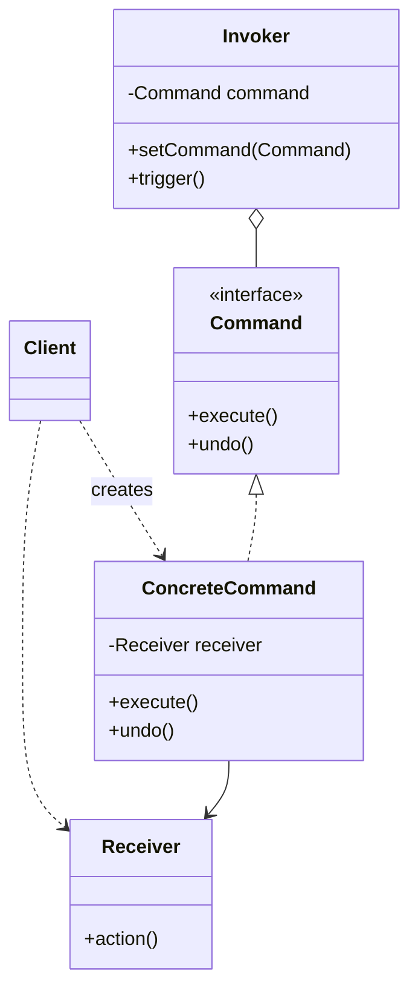

(In the book: the home-automation `RemoteControl` is the Invoker, `LightOnCommand`/`GarageDoorOpenCommand` are ConcreteCommands, `Light`/`GarageDoor` are Receivers; then a `MacroCommand` "party mode", and undo.)

### Example: bulk admin actions with undo

A back-office tool lets admins apply actions to products; every action must be undoable and recorded in an audit log.

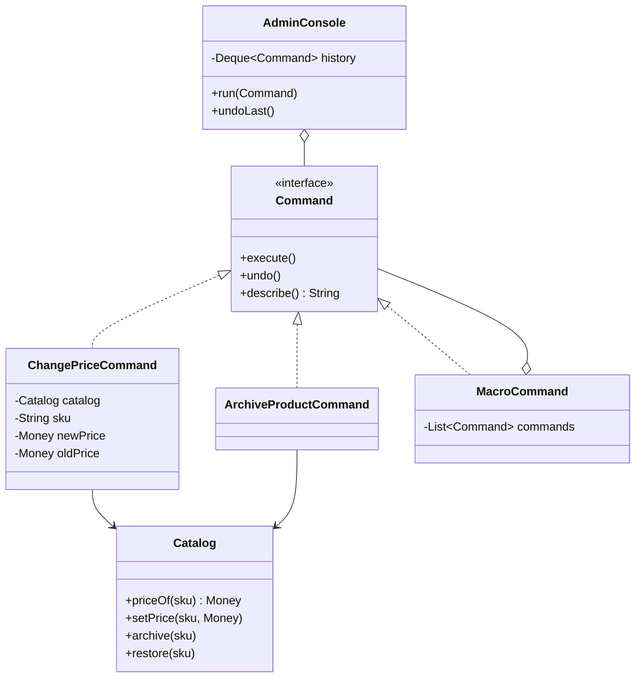

```java
public interface Command {
    void execute();
    void undo();
    String describe();
}

public class ChangePriceCommand implements Command {
    private final Catalog catalog; private final String sku; private final Money newPrice;
    private Money oldPrice;

    public void execute() { oldPrice = catalog.priceOf(sku); catalog.setPrice(sku, newPrice); }
    public void undo()    { catalog.setPrice(sku, oldPrice); }
    public String describe() { return "price " + sku + " → " + newPrice; }
}

public class MacroCommand implements Command {
    private final List<Command> commands;
    public void execute() { commands.forEach(Command::execute); }
    public void undo()    { commands.reversed().forEach(Command::undo); }
    public String describe() { return commands.size() + " changes"; }
}

public class AdminConsole {
    private final Deque<Command> history = new ArrayDeque<>();
    public void run(Command c) { c.execute(); history.push(c); audit.log(c.describe()); }
    public void undoLast()     { if (!history.isEmpty()) history.pop().undo(); }
}
```

"Apply 20% Black Friday discount to 300 SKUs" is one `MacroCommand` of `ChangePriceCommand`s — one click to apply, one to undo, one audit entry. The same command objects could be serialized onto a job queue instead of run inline.

### Comparisons

| Pattern | Difference |
|---|---|
| Strategy | Both wrap behavior in an object. A strategy is *how* the context does its job (interchangeable algorithms); a command is *a request to do something*, usually one-shot, with undo/queue/log semantics. |
| Memento | Command's undo can store the previous state as a memento instead of recomputing it. |
| Chain of Responsibility | A command object is often what gets passed down a chain. |
| Observer | Events say "this happened"; commands say "do this". |

### Related

- Strive for Loosely Coupled Designs (`principles.md`) — invoker and receiver never know each other.
- Encapsulate What Varies (`principles.md`) — what varies is the request itself.
- Memento Pattern
- Composite Pattern (`structural.md`) — a MacroCommand is a composite of commands.
- Chain of Responsibility Pattern
- Observer Pattern
- Strategy Pattern
- What Is a Design Pattern (`principles.md`)

## Template Method Pattern

> The Template Method Pattern defines the skeleton of an algorithm in a method, deferring some steps to subclasses. Template Method lets subclasses redefine certain steps of an algorithm without changing the algorithm's structure.

**Source:** *Head First Design Patterns*, Chapter 8 — "the Template Method Pattern" (read it). Summary below, book as bibliography — short quotes only where the exact wording matters.

### What it is & when to use it

When several classes run the same algorithm and differ only in a few steps, put the algorithm in one method of an abstract base class — the **template method**, usually `final` so subclasses can't reorder it — and let subclasses fill in the steps that vary. The base class owns the flow; subclasses just plug in. That's the Hollywood Principle (`principles.md`) in its purest form.

A template's steps come in three kinds:

- **Concrete** steps implemented in the base class (shared by everyone).
- **Abstract** steps each subclass *must* implement.
- **Hooks** — methods with a default (often empty, or returning `true`) that subclasses *may* override to influence the algorithm (e.g. skip an optional step).

Reach for it when:

- Two or more classes contain duplicated flows with small variations (the book's `Coffee` and `Tea` both boil water, brew, pour, add condiments).
- You want to enforce an order of steps while allowing customization.
- You're writing a framework that calls user code at defined points (`Arrays.sort` calling `compareTo`, servlet `doGet`, JUnit `setUp`).

### How it works

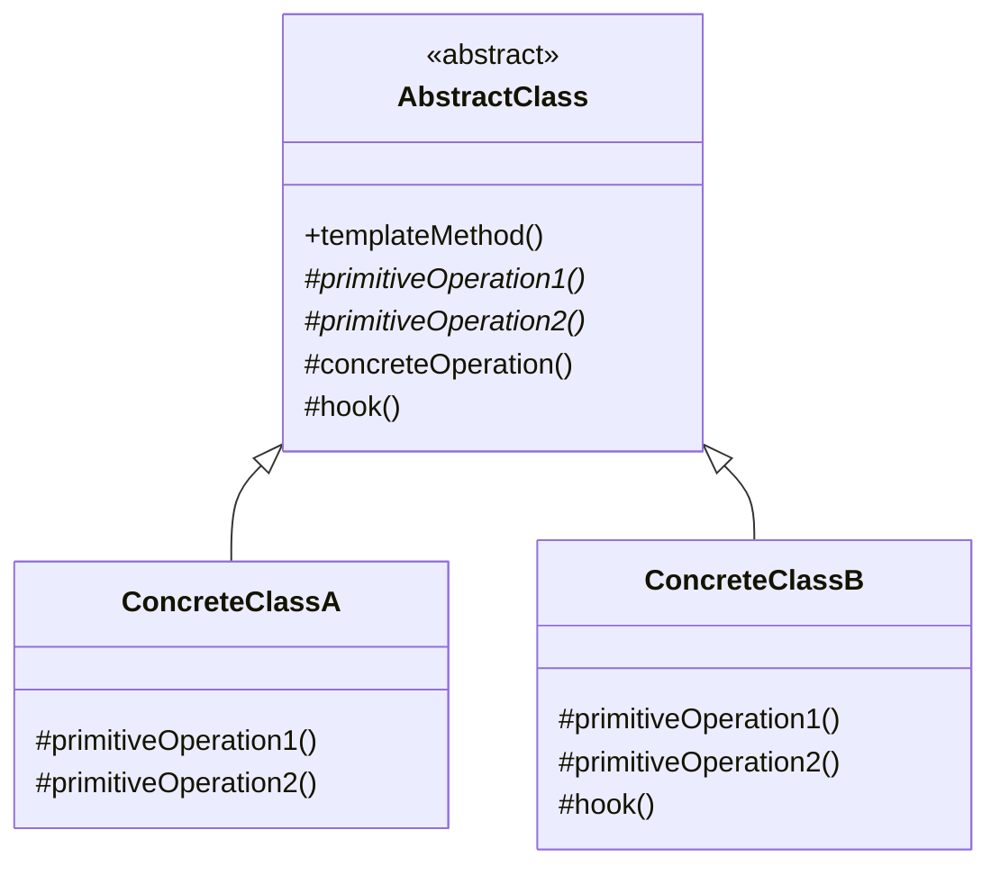

(In the book: `CaffeineBeverage.prepareRecipe()` is the template method; `brew()` and `addCondiments()` are abstract; `customerWantsCondiments()` is a hook.)

### Example: data import pipeline

Every importer reads a file, parses records, validates them, saves the valid ones, and reports — only parsing and validation differ per source.

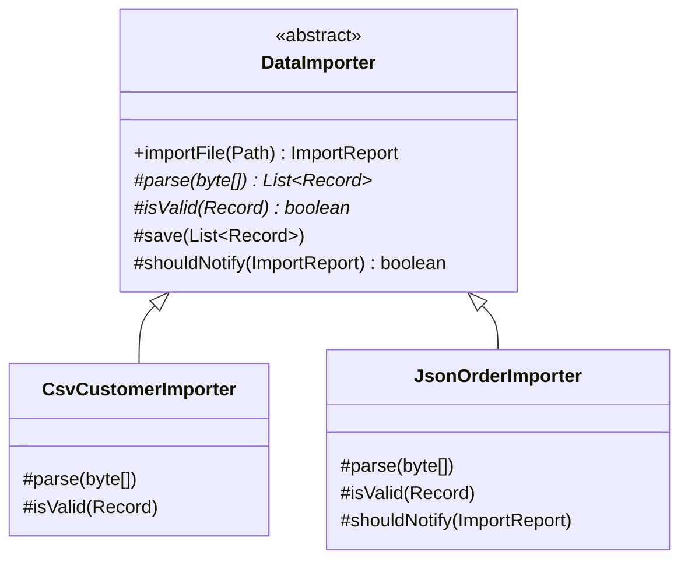

```java
public abstract class DataImporter {
    public final ImportReport importFile(Path path) {           // the template method
        List<Record> records = parse(Files.readAllBytes(path));
        List<Record> valid = records.stream().filter(this::isValid).toList();
        save(valid);
        ImportReport report = new ImportReport(records.size(), valid.size());
        if (shouldNotify(report)) notifier.send(report);
        return report;
    }

    protected abstract List<Record> parse(byte[] content);     // must implement
    protected abstract boolean isValid(Record record);          // must implement
    protected void save(List<Record> records) { repository.saveAll(records); }  // shared
    protected boolean shouldNotify(ImportReport r) { return r.rejected() > 0; } // hook
}

public class JsonOrderImporter extends DataImporter {
    protected List<Record> parse(byte[] content) { return json.readList(content, Record.class); }
    protected boolean isValid(Record r) { return r.has("orderId") && r.decimal("total").signum() > 0; }
    protected boolean shouldNotify(ImportReport r) { return true; }   // finance wants every run
}
```

Adding an XML supplier feed is one subclass; the read → parse → validate → save → notify order can't be broken by anyone.

### Comparisons

| | Template Method | Strategy |
|---|---|---|
| Varies | some *steps* of an algorithm | the *whole* algorithm |
| Mechanism | inheritance | composition/delegation |
| Swap at runtime? | no — fixed by subclass | yes |
| Code reuse | shared steps live in the base class | each strategy is self-contained |

Factory Method (`creational.md`) is a specialization of Template Method where the deferred step is object creation.

### Related

- Hollywood Principle (`principles.md`) — introduced in this chapter.
- Strategy Pattern
- Factory Method Pattern (`creational.md`)
- Favor Composition Over Inheritance (`principles.md`) — the reason to prefer Strategy when you need runtime flexibility.
- What Is a Design Pattern (`principles.md`)

## Iterator Pattern

> The Iterator Pattern provides a way to access the elements of an aggregate object sequentially without exposing its underlying representation.

**Source:** *Head First Design Patterns*, Chapter 9 — "the Iterator and Composite Patterns" (read it). Summary below, book as bibliography — short quotes only where the exact wording matters.

### What it is & when to use it

Different collections store elements differently (array, list, map, tree, remote pages), and clients that loop over them end up with one loop per storage type. Iterator moves *traversal* into a separate object with a uniform interface (`hasNext()`/`next()`), so clients write one loop that works over any aggregate, and the aggregate can change its internal representation freely.

It also applies the Single Responsibility Principle, which the book introduces in this chapter: managing a collection and iterating over it are two different responsibilities, two different reasons to change — so they go in two classes.

Reach for it when:

- Clients need to walk a collection without knowing (or depending on) how it's stored.
- You want several traversals over the same aggregate (filtered, reversed, depth-first) or several simultaneous cursors.
- The data isn't all in memory — paginated APIs, database cursors, streamed files — and you want callers to see a plain sequence.

In Java, implementing `Iterable<T>` makes any aggregate usable in an enhanced `for` loop. A **null iterator** (always `hasNext() == false`) avoids special-casing leaves that have nothing to iterate.

### How it works

- **Aggregate** — interface with `createIterator()` (Java: `Iterable.iterator()`).
- **ConcreteAggregate** — stores the elements and returns a matching iterator.
- **Iterator** — interface with `hasNext()`, `next()` (optionally `remove()`).
- **ConcreteIterator** — tracks the current position for one traversal.

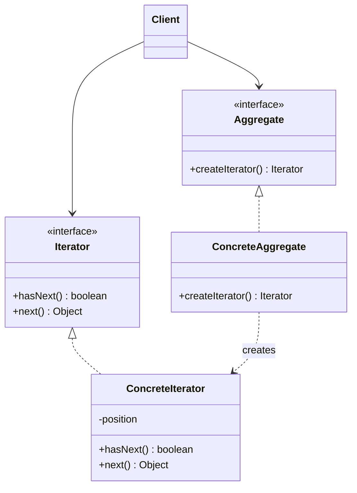

(In the book: the Pancake House menu uses an `ArrayList`, the Diner menu an array, the Café menu a `Hashtable`; the `Waitress` prints all three through one `Iterator` interface.)

### Example: a paginated REST API as a plain sequence

The payments provider returns transactions 100 per page with a `next_cursor`. Reconciliation code shouldn't care.

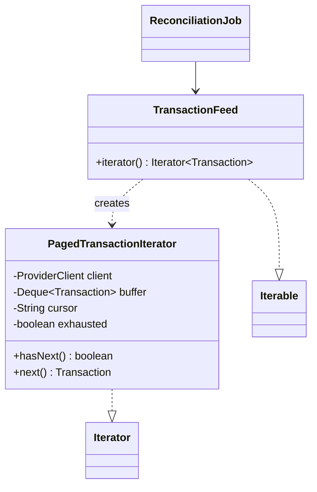

```java
public class TransactionFeed implements Iterable<Transaction> {
    private final ProviderClient client; private final LocalDate since;
    public Iterator<Transaction> iterator() { return new PagedTransactionIterator(client, since); }
}

class PagedTransactionIterator implements Iterator<Transaction> {
    private final Deque<Transaction> buffer = new ArrayDeque<>();
    private String cursor; private boolean exhausted;

    public boolean hasNext() {
        if (buffer.isEmpty() && !exhausted) {
            Page page = client.listTransactions(since, cursor, 100);
            buffer.addAll(page.items());
            cursor = page.nextCursor();
            exhausted = (cursor == null);
        }
        return !buffer.isEmpty();
    }
    public Transaction next() {
        if (!hasNext()) throw new NoSuchElementException();
        return buffer.poll();
    }
}
```

```java
for (Transaction t : new TransactionFeed(client, yesterday)) ledger.match(t);
```

Pages are fetched lazily as the loop advances; if the provider switches from cursors to offsets, only the iterator changes.

### Comparisons

| Pattern | Relationship |
|---|---|
| Composite (`structural.md`) | Iterating a tree needs a composite iterator (usually stack-based); the book pairs the two in one chapter. |
| Visitor | Iterator hands *you* each element; Visitor brings an *operation* to each element. |
| Builder (`creational.md`) | The book's analogy: Builder encapsulates *construction* the way Iterator encapsulates *traversal*. |

### Related

- Encapsulate What Varies (`principles.md`) — what varies is how the collection is stored.
- Program To An Interface, Not An Implementation (`principles.md`)
- Composite Pattern (`structural.md`)
- Builder Pattern (`creational.md`)
- Interpreter Pattern
- Memento Pattern
- Visitor Pattern
- What Is a Design Pattern (`principles.md`)

## Chain of Responsibility Pattern

> Use the Chain of Responsibility Pattern when you want to give more than one object a chance to handle a request.

**Source:** *Head First Design Patterns*, Appendix — "Leftover Patterns" (read it). Summary below, book as bibliography — short quotes only where the exact wording matters.

### What it is & when to use it

Handlers are linked into a chain; each has a reference to its **successor**. A request goes to the first handler, which either handles it or passes it along. The sender only knows the head of the chain — it never knows which handler (if any) ends up doing the work.

Reach for it when:

- Several objects might handle a request and the right one is decided at runtime by inspecting it (routing, approvals, event handling in UI toolkits).
- You want to add, remove, or reorder handlers dynamically without touching the sender.

Benefits: decouples sender from receivers; each handler stays simple and doesn't know the chain's structure. Drawbacks: handling isn't guaranteed — a request can fall off the end (add a catch-all handler if that matters), and runtime behavior can be hard to observe and debug.

A popular variant — HTTP middleware/servlet filters — lets *every* handler do some work and then pass the request on, which drifts toward Decorator (`structural.md`).

### How it works

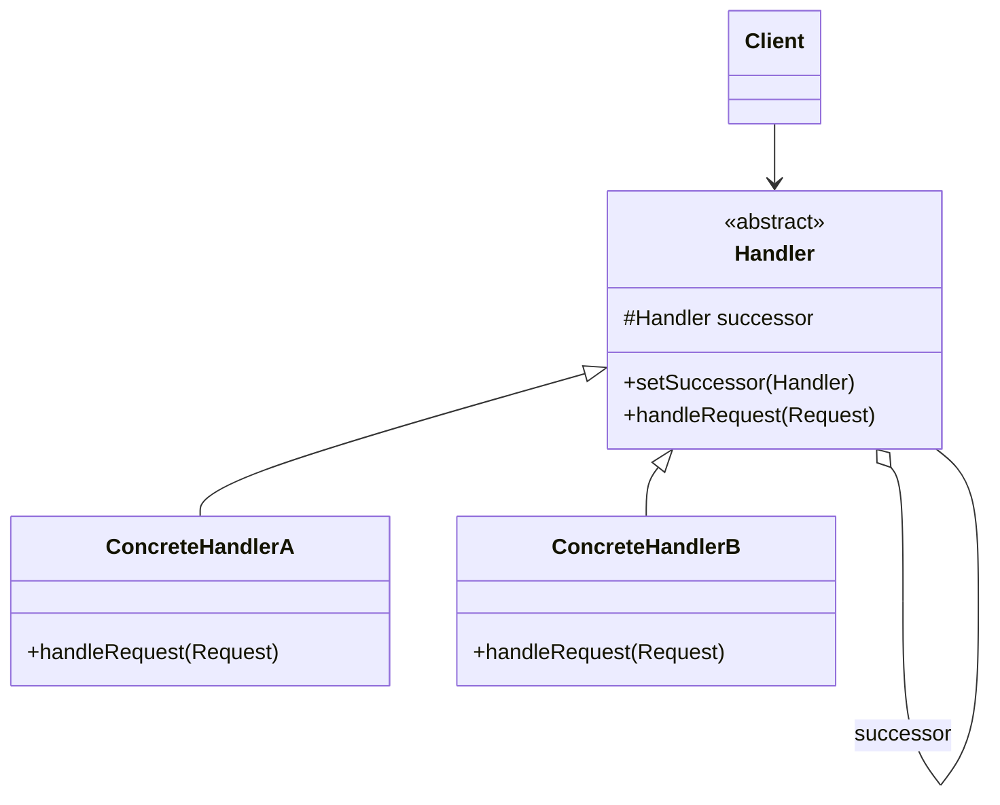

(In the book: Mighty Gumball's inbox — `SpamHandler` → `FanHandler` → `ComplaintHandler` → `NewLocHandler`.)

### Example: expense approval limits

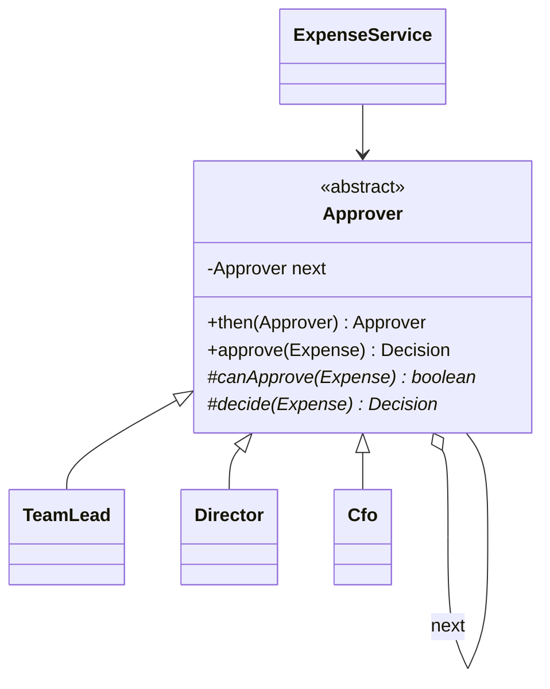

```java
public abstract class Approver {
    private Approver next;
    public Approver then(Approver next) { this.next = next; return next; }

    public Decision approve(Expense e) {
        if (canApprove(e)) return decide(e);
        if (next != null)  return next.approve(e);
        return Decision.rejected("No approver for " + e.amount());     // fell off the chain
    }
    protected abstract boolean canApprove(Expense e);
    protected abstract Decision decide(Expense e);
}

public class TeamLead extends Approver {
    protected boolean canApprove(Expense e) { return e.amount().lte(Money.of(500)); }
    protected Decision decide(Expense e)    { return Decision.approved("team lead"); }
}
```

```java
Approver chain = new TeamLead();
chain.then(new Director()).then(new Cfo());
expenseService.submit(expense, chain);
```

Finance adding "travel > $2,000 also needs Compliance" is a new handler inserted in the chain; `ExpenseService` doesn't change.

### Comparisons

| Pattern | Difference |
|---|---|
| Decorator (`structural.md`) | Every decorator acts and always forwards; in CoR typically *one* handler acts and the chain stops. |
| Command | The request travelling down a chain is often a command object. |
| Composite (`structural.md`) | A parent in a composite tree is a natural successor (e.g. UI events bubbling up). |
| Observer | Observer notifies *all* receivers; CoR offers the request to receivers until one takes it. |

### Related

- Strive for Loosely Coupled Designs (`principles.md`) — sender and receivers don't know each other.
- Decorator Pattern (`structural.md`)
- Command Pattern
- Composite Pattern (`structural.md`)
- Observer Pattern
- What Is a Design Pattern (`principles.md`)

## Mediator Pattern

> Use the Mediator Pattern to centralize complex communications and control between related objects.

**Source:** *Head First Design Patterns*, Appendix — "Leftover Patterns" (read it). Summary below, book as bibliography — short quotes only where the exact wording matters.

### What it is & when to use it

When a group of objects all need to react to each other, the rules end up scattered across every object and each one references all the others — a tightly coupled mesh. A mediator becomes the hub: each **colleague** only tells the mediator when its state changes and responds to the mediator's requests. All the "when A happens, update B and C unless D" logic lives in the mediator, and colleagues are completely decoupled from each other.

Reach for it when:

- Many-to-many interactions between related objects make every class depend on every other.
- Interaction rules keep changing (new rules, new participants) and you want one place to edit them.
- Coordinating GUI components is the classic case.

Benefits: colleagues become reusable (they no longer embed system rules); maintenance is simpler with control logic centralized; fewer and simpler messages between objects. Drawback: without care, the mediator itself becomes an overly complex god object.

### How it works

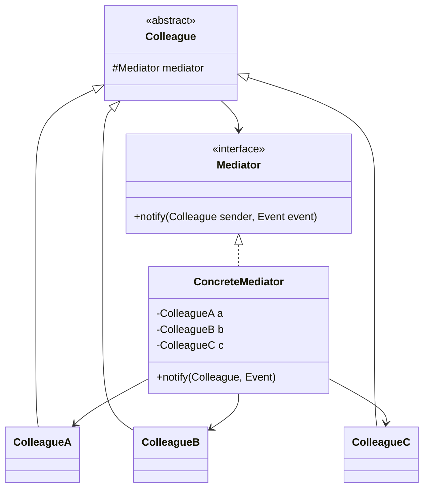

(In the book: Bob's smart house — `Alarm`, `CoffeePot`, `Calendar`, `Sprinkler` stop calling each other once a mediator holds rules like "no coffee on weekends" and "set the alarm early on trash day".)

### Example: checkout form

Rules: choosing "Pickup in store" hides the address form and sets shipping to $0; changing the country reloads shipping options; applying a coupon recalculates the total; the Pay button is enabled only when everything is valid.

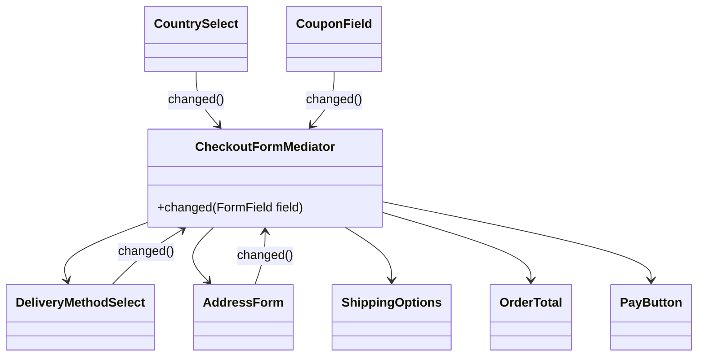

```java
public class CheckoutFormMediator {
    // holds references to all widgets

    public void changed(FormField field) {
        if (field == delivery) {
            boolean pickup = delivery.value() == DeliveryMethod.PICKUP;
            address.setVisible(!pickup);
            shipping.setFixed(pickup ? Money.ZERO : null);
        }
        if (field == country)  shipping.reload(country.value());
        if (field == coupon)   total.applyCoupon(coupon.value());
        if (field != total)    total.recalculate(cart, shipping.selected());
        pay.setEnabled(address.isValidOrHidden() && shipping.hasSelection() && !coupon.isInvalid());
    }
}

public class CouponField extends FormField {
    void onBlur() { mediator.changed(this); }          // knows nothing about totals or buttons
}
```

Each widget is reusable on other pages; product changing "pickup is only for orders under 20 kg" edits one method.

### Comparisons

| Pattern | Difference |
|---|---|
| Observer | Distributes notifications one-to-many with no coordination logic; a mediator *owns* the logic. Colleagues often notify the mediator via an observer mechanism. |
| Facade (`structural.md`) | One-directional: clients use the facade, subsystem classes don't know it exists. Mediator is two-directional: colleagues talk to it and it talks back. |
| MVC (`compound.md`) | A controller coordinating several widgets is effectively a mediator. |

### Related

- Strive for Loosely Coupled Designs (`principles.md`) — colleagues are fully decoupled from each other.
- Principle of Least Knowledge (Law of Demeter) (`principles.md`) — each colleague has exactly one friend.
- Observer Pattern
- Facade Pattern (`structural.md`)
- Model-View-Controller (Compound Pattern) (`compound.md`)
- What Is a Design Pattern (`principles.md`)

## Memento Pattern

> Use the Memento Pattern when you need to be able to return an object to one of its previous states; for instance, if your user requests an "undo."

**Source:** *Head First Design Patterns*, Appendix — "Leftover Patterns" (read it). Summary below, book as bibliography — short quotes only where the exact wording matters.

### What it is & when to use it

Memento has two goals: **save** the important state of a key object, and **keep that object encapsulated** while doing it. The object itself (the **originator**) produces a snapshot — the memento — and knows how to restore from it. Whoever keeps the snapshots (the **caretaker**: an undo stack, a save-game slot) holds them as opaque tokens and can't read or modify what's inside. Keeping the saved state outside the originator also respects SRP.

Reach for it when:

- You need undo/redo, checkpoints, drafts, or "restore to last good state".
- Exposing the object's internals (getters/setters for everything) just to save them would break encapsulation.

Benefits: keeps the key object cohesive and its data encapsulated; recovery is easy to implement. Drawback: saving and restoring can be slow or memory-hungry for big states (in Java, serialization is one option).

### How it works

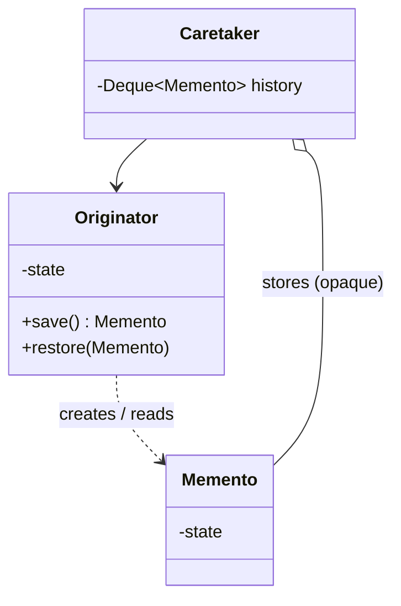

(In the book: a role-playing game's `MasterGameObject` returns its state for a "save progress" feature; the client stores it and later calls `restoreState(saved)` without ever inspecting it.)

### Example: invoice editor with undo

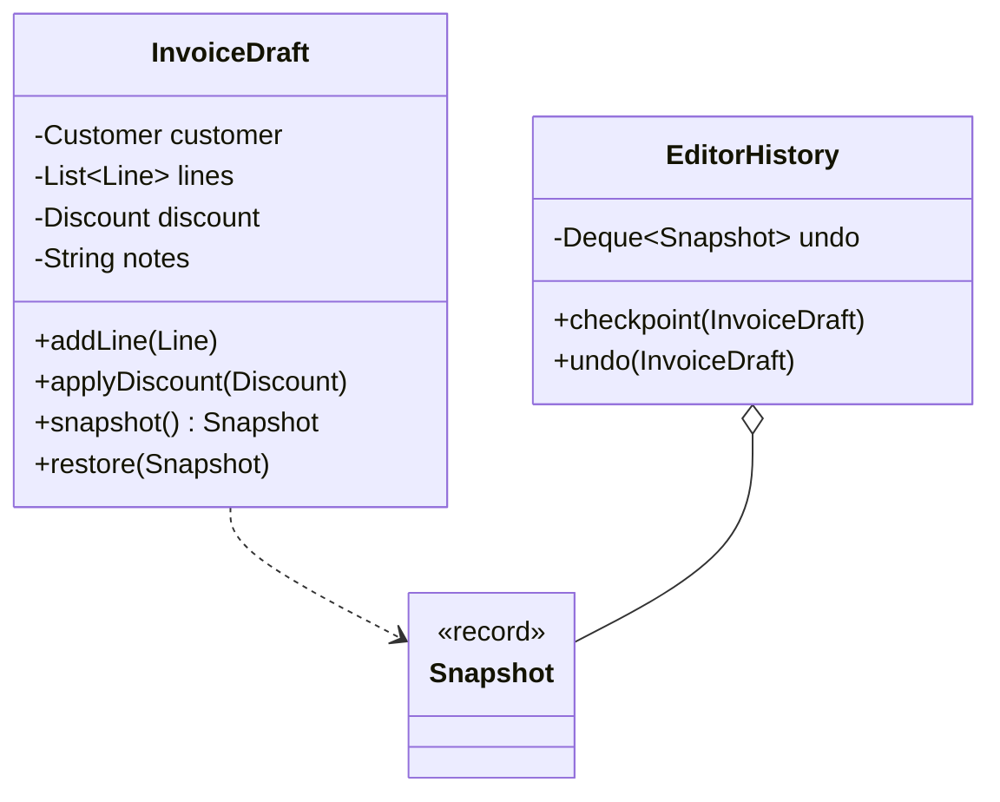

```java
public class InvoiceDraft {
    private Customer customer; private List<Line> lines = new ArrayList<>();
    private Discount discount = Discount.NONE; private String notes = "";

    // The memento: nested, immutable, constructor visible only to InvoiceDraft
    public static final class Snapshot {
        private final Customer customer; private final List<Line> lines;
        private final Discount discount; private final String notes;
        private Snapshot(InvoiceDraft d) {
            customer = d.customer; lines = List.copyOf(d.lines); discount = d.discount; notes = d.notes;
        }
    }

    public Snapshot snapshot()      { return new Snapshot(this); }
    public void restore(Snapshot s) { customer = s.customer; lines = new ArrayList<>(s.lines);
                                      discount = s.discount; notes = s.notes; }
}

public class EditorHistory {
    private final Deque<InvoiceDraft.Snapshot> undo = new ArrayDeque<>();
    public void checkpoint(InvoiceDraft d) { undo.push(d.snapshot()); }
    public void undo(InvoiceDraft d)       { if (!undo.isEmpty()) d.restore(undo.pop()); }
}
```

`EditorHistory` can store and hand back snapshots but has no getters to peek at line items or discounts; `InvoiceDraft` exposes no setters just for the sake of undo. Persisting the latest snapshot every 30 seconds gives "recover unsaved draft" for free.

### Comparisons

| Pattern | Relationship |
|---|---|
| Command | Command's `undo()` can either compute the inverse operation or restore a memento captured before `execute()`. Mementos are simpler; inverse ops are cheaper for big objects. |
| Prototype (`creational.md`) | Cloning the originator is one way to make a memento, if the clone stays private. |
| Iterator | An iterator's position can be saved as a memento to resume traversal later. |

### Related

- Command Pattern
- Encapsulate What Varies (`principles.md`)
- Iterator Pattern
- Prototype Pattern (`creational.md`)
- What Is a Design Pattern (`principles.md`)

## Visitor Pattern

> Use the Visitor Pattern when you want to add capabilities to a composite of objects and encapsulation is not important.

**Source:** *Head First Design Patterns*, Appendix — "Leftover Patterns" (read it). Summary below, book as bibliography — short quotes only where the exact wording matters.

### What it is & when to use it

When you keep adding new *operations* over a stable structure of classes (a composite (`structural.md`) tree, an AST, a document model), adding one method to every class for every new operation scatters each operation across the whole hierarchy. Visitor moves each operation into its own visitor class, with one method per element type. A traverser (or the elements themselves, via `accept(visitor)`) walks the structure and hands each element to the visitor.

Reach for it when:

- The element classes rarely change, but the operations on them keep growing (exports, reports, validations, tax rules).
- An operation needs to accumulate state across the whole structure (totals, rendering output).

Benefits: new operations without changing the structure; adding operations is easy; each operation's code is centralized in one class. Drawbacks: the composite's **encapsulation is broken** (visitors need access to element state); and because traversal is involved, **changing the structure is harder** — a new element type means updating every visitor. That's the trade-off: Visitor makes operations cheap to add and element types expensive.

The classic GoF form uses **double dispatch**: `element.accept(visitor)` calls `visitor.visit(this)`, so the right overload for the element's runtime type runs. Modern Java can get similar results with sealed interfaces + pattern-matching `switch`.

### How it works

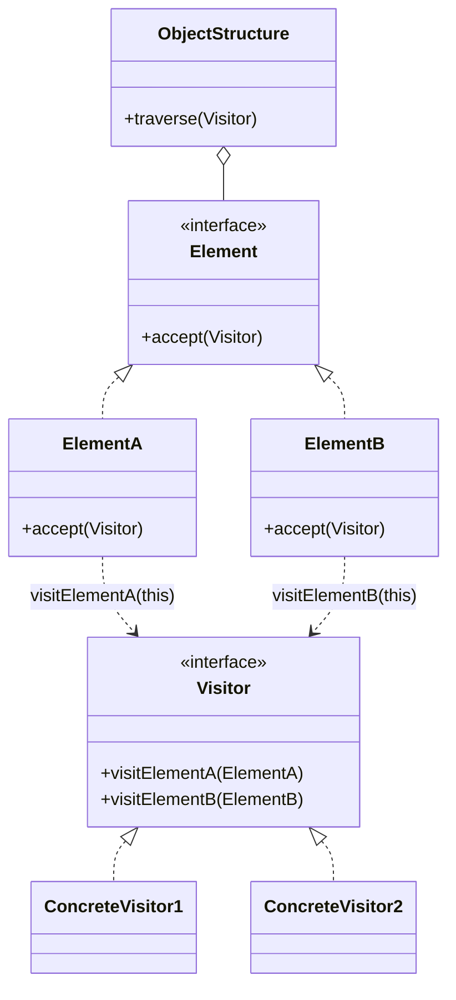

(In the book: health-conscious diners want calories, protein, and carbs for every `Menu`, `MenuItem`, and `Ingredient`; instead of adding `getCalories()` etc. to all three classes, a `Visitor` guided by a traverser gathers the state.)

### Example: operations over the product catalog

Reusing the bundles from the Composite (`structural.md`) note (`Product`, `Bundle`). Finance needs tax computation, ops needs a CSV export, and the marketplace feed needs an XML dump — and next quarter something else.

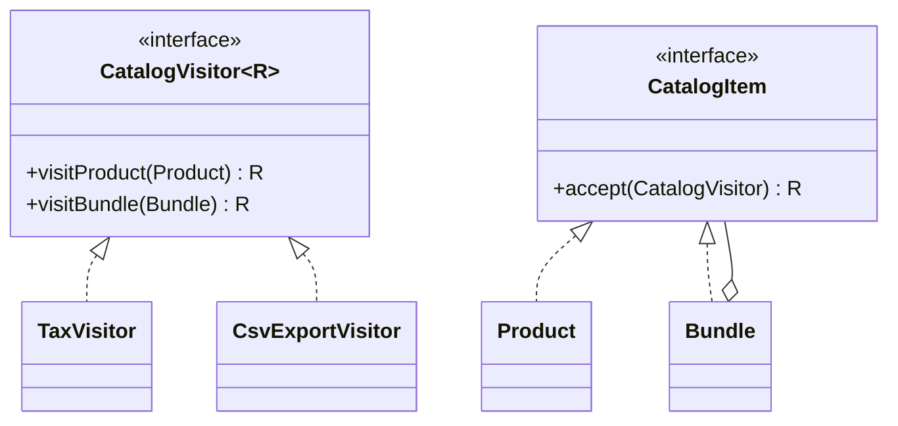

```java
public interface CatalogVisitor<R> {
    R visitProduct(Product p);
    R visitBundle(Bundle b);
}

// in Product:  public <R> R accept(CatalogVisitor<R> v) { return v.visitProduct(this); }
// in Bundle:   public <R> R accept(CatalogVisitor<R> v) { return v.visitBundle(this); }

public class TaxVisitor implements CatalogVisitor<Money> {
    private final TaxTable taxes;
    public Money visitProduct(Product p) { return p.price().times(taxes.rateFor(p.taxCategory())); }
    public Money visitBundle(Bundle b) {
        return b.items().stream().map(i -> i.accept(this)).reduce(Money.ZERO, Money::plus);
    }
}

public class CsvExportVisitor implements CatalogVisitor<Void> {
    private final CsvWriter out;
    public Void visitProduct(Product p) { out.row(p.sku(), p.name(), p.price()); return null; }
    public Void visitBundle(Bundle b)   { out.row("BUNDLE", b.name(), b.price());
                                          b.items().forEach(i -> i.accept(this)); return null; }
}
```

```java
Money tax = cart.items().stream().map(i -> i.accept(new TaxVisitor(taxTable))).reduce(Money.ZERO, Money::plus);
```

The XML feed is a third visitor; `Product` and `Bundle` don't change. But adding a `Subscription` item type would require a `visitSubscription` in every visitor.

### Comparisons

| Pattern | Relationship |
|---|---|
| Composite (`structural.md`) | The usual structure a visitor walks. |
| Iterator | Iterator gives you each element; Visitor brings type-specific operations to each element. |
| Interpreter | Visitors add operations (to-SQL, pretty print) over the interpreter's expression tree. |
| Strategy | One interchangeable algorithm for one context; Visitor is an operation spread across many element types. |

### Related

- Composite Pattern (`structural.md`)
- Interpreter Pattern
- Iterator Pattern
- Strategy Pattern
- What Is a Design Pattern (`principles.md`)

## Interpreter Pattern

> Use the Interpreter Pattern to build an interpreter for a language.

**Source:** *Head First Design Patterns*, Appendix — "Leftover Patterns" (read it). Summary below, book as bibliography — short quotes only where the exact wording matters.

### What it is & when to use it

For a small language with a simple grammar, Interpreter defines **one class per grammar rule**. A sentence in the language becomes a tree of those objects (an abstract syntax tree — structurally a Composite (`structural.md`)), and calling `interpret(context)` on the root evaluates it recursively, each node interpreting its children.

Reach for it when:

- Users or configuration need a small domain-specific language: rule engines, search/filter expressions, feature-flag targeting, pricing rules.
- Simplicity matters more than efficiency.

Benefits: each rule in its own class makes the language easy to implement, change, and extend; you can add other operations over the same classes (pretty-printing, validation). Drawback: it gets cumbersome when the grammar grows large — then a parser generator/compiler is the better tool. (Parsing text into the tree is a separate problem the pattern doesn't cover.)

### How it works

```mermaid
classDiagram
    class Client
    class Context
    class AbstractExpression {
        <<interface>>
        +interpret(Context)
    }
    class TerminalExpression {
        +interpret(Context)
    }
    class NonterminalExpression {
        -List~AbstractExpression~ children
        +interpret(Context)
    }
    Client --> AbstractExpression
    Client --> Context
    AbstractExpression <|.. TerminalExpression
    AbstractExpression <|.. NonterminalExpression
    NonterminalExpression o-- AbstractExpression
```

(In the book: a toy duck-control language — `right; while (daylight) fly; quack;` — with classes `Sequence`, `Repetition`, `Variable`, `QuackCommand`, `RightCommand`, `FlyCommand`.)

### Example: order filter expressions

Support agents type filters like `status = shipped AND total > 100 OR country = AR` in the admin panel.

```mermaid
classDiagram
    class OrderFilter {
        <<interface>>
        +matches(Order) boolean
    }
    class FieldEquals {
        -String field
        -String value
    }
    class FieldGreaterThan {
        -String field
        -BigDecimal value
    }
    class And {
        -OrderFilter left
        -OrderFilter right
    }
    class Or {
        -OrderFilter left
        -OrderFilter right
    }
    class Not {
        -OrderFilter inner
    }
    OrderFilter <|.. FieldEquals
    OrderFilter <|.. FieldGreaterThan
    OrderFilter <|.. And
    OrderFilter <|.. Or
    OrderFilter <|.. Not
    And o-- OrderFilter
    Or o-- OrderFilter
    Not o-- OrderFilter
```

```java
public interface OrderFilter { boolean matches(Order order); }      // the Context is the Order

record FieldEquals(String field, String value) implements OrderFilter {
    public boolean matches(Order o) { return o.field(field).equalsIgnoreCase(value); }
}
record FieldGreaterThan(String field, BigDecimal value) implements OrderFilter {
    public boolean matches(Order o) { return new BigDecimal(o.field(field)).compareTo(value) > 0; }
}
record And(OrderFilter left, OrderFilter right) implements OrderFilter {
    public boolean matches(Order o) { return left.matches(o) && right.matches(o); }
}
record Or(OrderFilter left, OrderFilter right) implements OrderFilter {
    public boolean matches(Order o) { return left.matches(o) || right.matches(o); }
}
```

```java
OrderFilter f = FilterParser.parse("status = shipped AND total > 100 OR country = AR");
// → Or(And(FieldEquals(status, shipped), FieldGreaterThan(total, 100)), FieldEquals(country, AR))
List<Order> hits = orders.stream().filter(f::matches).toList();
```

Adding `NOT` or `IN (...)` is one more class. A second operation — translating the same tree into a SQL `WHERE` clause — is a natural job for a Visitor.

### Comparisons

| Pattern | Relationship |
|---|---|
| Composite (`structural.md`) | The expression tree *is* a composite; Interpreter adds grammar semantics. |
| Visitor | Adds new operations (to-SQL, pretty-print) over the expression classes without editing them. |
| Flyweight (`structural.md`) | Terminal symbols can be shared. |
| Iterator | Can traverse the tree. |

### Related

- Composite Pattern (`structural.md`)
- Visitor Pattern
- Flyweight Pattern (`structural.md`)
- Iterator Pattern
- What Is a Design Pattern (`principles.md`)
