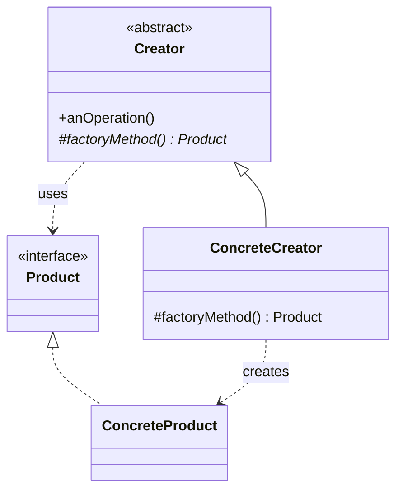
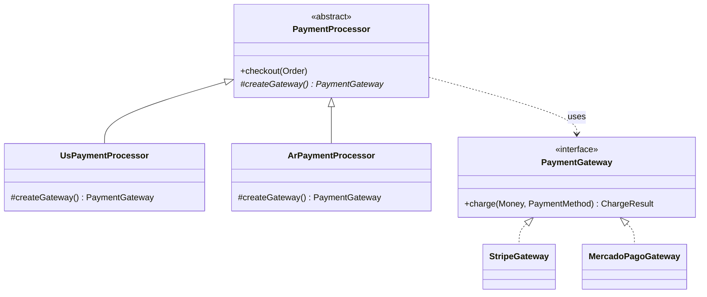
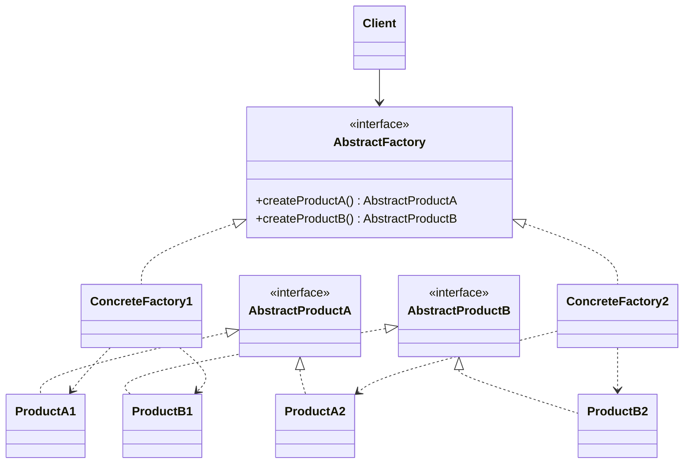
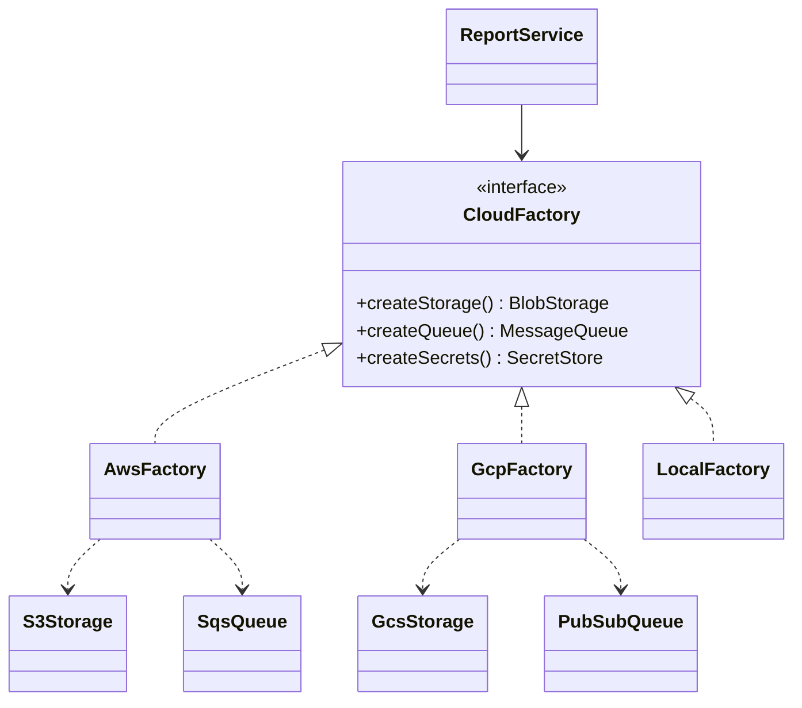
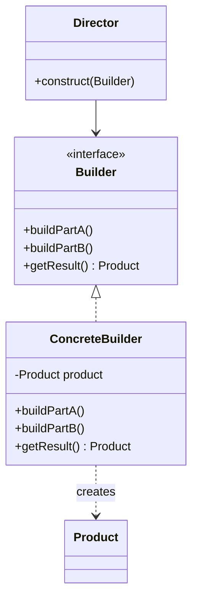
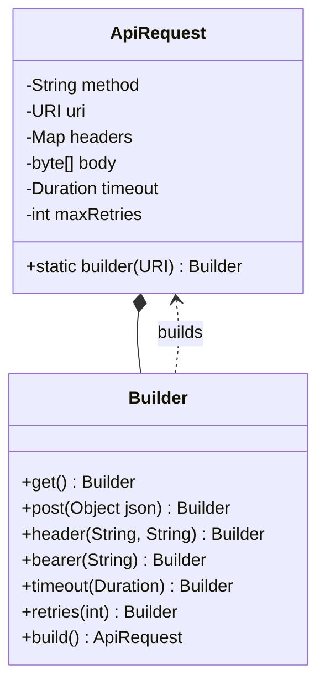
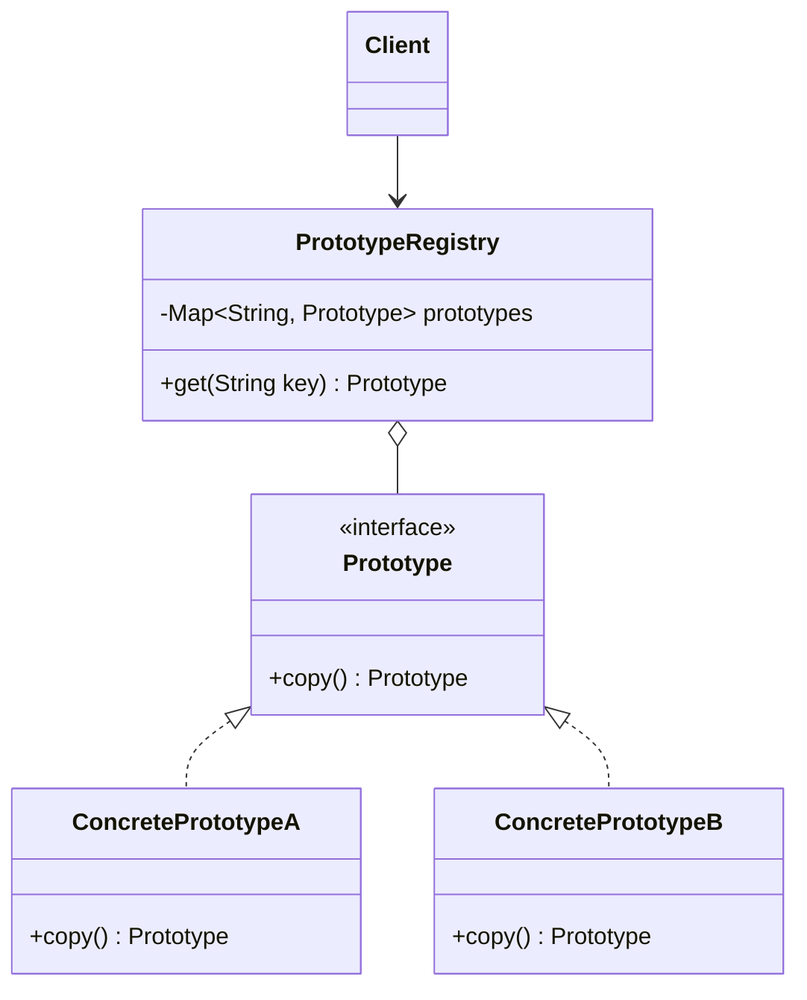
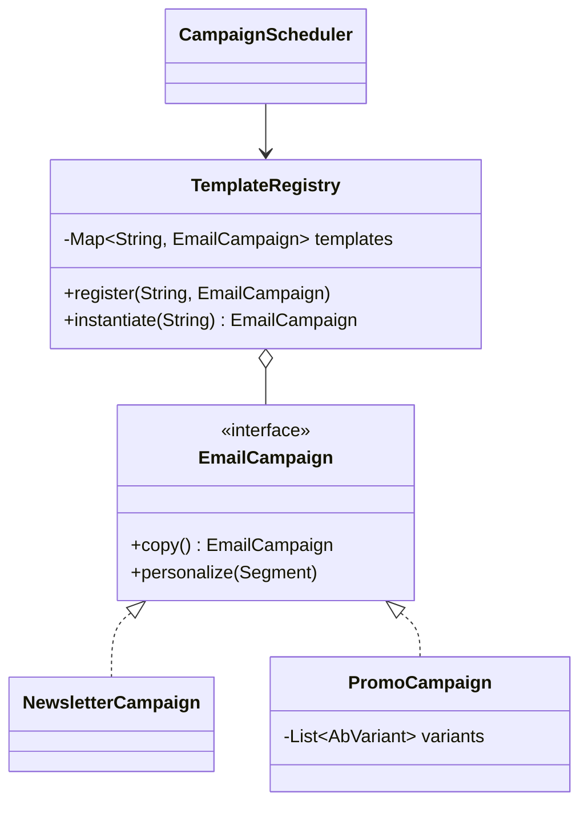
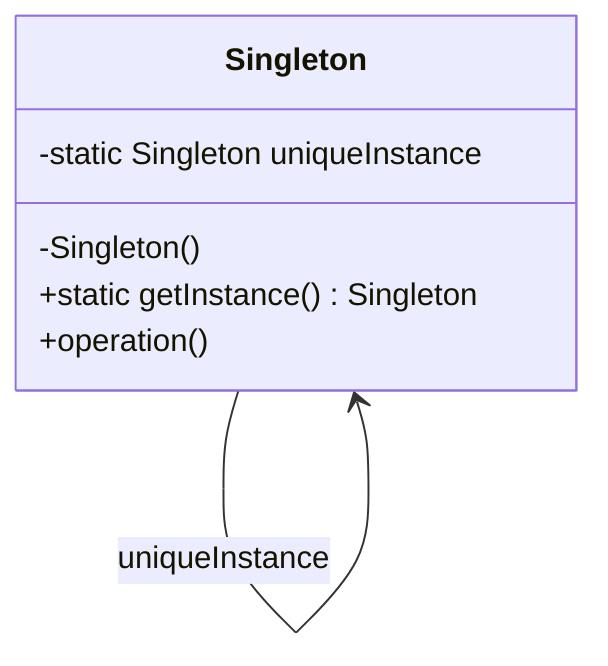
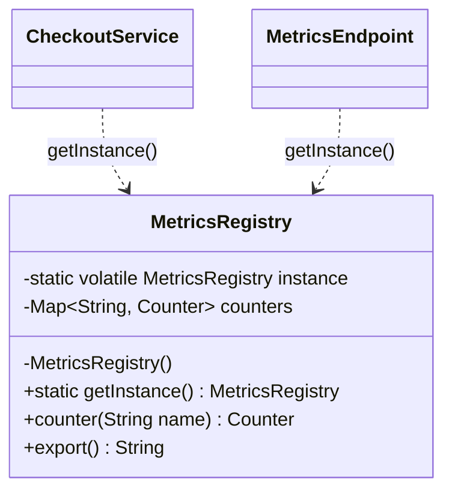

# Creational patterns

Ways to decouple code from how its objects are created.

## Contents

- [Factory Method Pattern](#factory-method-pattern)
- [Abstract Factory Pattern](#abstract-factory-pattern)
- [Builder Pattern](#builder-pattern)
- [Prototype Pattern](#prototype-pattern)
- [Singleton Pattern](#singleton-pattern)

## Factory Method Pattern

> The Factory Method Pattern defines an interface for creating an object, but lets subclasses decide which class to instantiate. Factory Method lets a class defer instantiation to subclasses.

**Source:** *Head First Design Patterns*, Chapter 4 — "the Factory Pattern" (read it). Summary below, book as bibliography — short quotes only where the exact wording matters.

### What it is & when to use it

Every `new ConcreteClass()` is a dependency on a concrete type and a spot that must be reopened when new types appear — the opposite of OCP. Applying Encapsulate What Varies (`principles.md`) to *object creation* gives the factory family.

The chapter builds up in two steps:

1. **Simple Factory** (not a real pattern, more an idiom) — move the `if/switch` that picks the concrete class into one factory object that clients call. One place to change, but still one big conditional.
2. **Factory Method** — the creator class declares an abstract `createX()` method and writes the rest of its logic against the abstract product; each **subclass** implements `createX()` to return its concrete product. The creator never knows which product it got.

Reach for it when:

- A class has a workflow that is fixed, but *which* concrete object it works with varies per subclass/variant (region, tenant, platform).
- You want frameworks or base classes to let users plug in their own product types.
- Creation logic is duplicated in several places — centralize it.

It's a specialization of Template Method (`behavioral.md`): the factory method is one "step" the subclass fills in. It relies on **inheritance**, unlike Abstract Factory, which relies on composition.

### How it works

- **Product** — interface of the objects being created.
- **ConcreteProduct** — the actual implementations.
- **Creator** — abstract class with the abstract `factoryMethod()` plus operations that use the product.
- **ConcreteCreator** — overrides `factoryMethod()` to return a ConcreteProduct.



(In the book: `PizzaStore` is the Creator with `createPizza()`, `NYPizzaStore`/`ChicagoPizzaStore` are ConcreteCreators, `Pizza` is the Product.)

### Example: payments per country

The checkout flow (validate → charge → record) is identical everywhere, but the gateway depends on the market: Stripe in the US, Mercado Pago in Argentina.



```java
public abstract class PaymentProcessor {
    public final Receipt checkout(Order order) {
        order.validate();
        PaymentGateway gateway = createGateway();                 // factory method
        ChargeResult result = gateway.charge(order.total(), order.paymentMethod());
        return ledger.record(order, result);
    }
    protected abstract PaymentGateway createGateway();
}

public class UsPaymentProcessor extends PaymentProcessor {
    protected PaymentGateway createGateway() { return new StripeGateway(stripeKey); }
}

public class ArPaymentProcessor extends PaymentProcessor {
    protected PaymentGateway createGateway() { return new MercadoPagoGateway(mpToken); }
}
```

Launching Brazil means one new subclass; `checkout()` is never edited. The simple-factory version would be a `PaymentGatewayFactory.forCountry(country)` with a `switch` — fine for small cases, but every new country edits that switch.

### Comparisons

| | Factory Method | Abstract Factory |
|---|---|---|
| Creates | one product | a family of related products |
| Mechanism | inheritance — subclass overrides a method | composition — client is given a factory object |
| Typical shape | a `createX()` hook inside a class with other logic | an interface whose *only* job is creation (often each method is itself a factory method) |

All factories serve DIP: high-level code (`PaymentProcessor`) and low-level code (`StripeGateway`) both depend on the abstraction `PaymentGateway`.

### Related

- Encapsulate What Varies (`principles.md`)
- Abstract Factory Pattern
- Template Method Pattern (`behavioral.md`) — Factory Method is a Template Method whose step is "create".
- Hollywood Principle (`principles.md`) — the creator calls the subclass's factory method, not vice versa.
- Prototype Pattern — another way to create objects without naming their class: copy an existing one.
- Builder Pattern
- Decorator Pattern (`structural.md`)
- Flyweight Pattern (`structural.md`)
- What Is a Design Pattern (`principles.md`)

## Abstract Factory Pattern

> The Abstract Factory Pattern provides an interface for creating families of related or dependent objects without specifying their concrete classes.

**Source:** *Head First Design Patterns*, Chapter 4 — "the Factory Pattern" (read it). Summary below, book as bibliography — short quotes only where the exact wording matters.

### What it is & when to use it

When objects come in **families** that must be used together (all AWS or all GCP; all light-theme or all dark-theme widgets), a single factory interface declares one creation method per product. Each concrete factory produces a consistent family, and the client is composed with one factory at runtime — so it can't accidentally mix an AWS queue with a GCP bucket, and it never names a concrete class.

Reach for it when:

- Several products vary *together* along one axis (vendor, platform, region, theme, test vs. production).
- You want to switch the whole family by swapping one object (often chosen in `main` / DI configuration).
- Clients must stay independent of how their collaborators are created.

Cost: adding a new *kind* of product (a new method on the interface) means changing every concrete factory. Each method on an abstract factory is often implemented as a factory method.

### How it works

- **AbstractFactory** — interface with `createProductA()`, `createProductB()`, ...
- **ConcreteFactory1/2** — each implements every method for one family.
- **AbstractProductA/B** — interfaces for each kind of product.
- **Client** — written against AbstractFactory and abstract products; composed with a concrete factory at runtime.



(In the book: `PizzaIngredientFactory` with `createDough()`, `createSauce()`, `createCheese()`...; `NYPizzaIngredientFactory` and `ChicagoPizzaIngredientFactory` produce regional ingredient families.)

### Example: cloud provider families



```java
public interface CloudFactory {
    BlobStorage createStorage();
    MessageQueue createQueue();
    SecretStore createSecrets();
}

public class AwsFactory implements CloudFactory {
    public BlobStorage createStorage()  { return new S3Storage(bucket); }
    public MessageQueue createQueue()   { return new SqsQueue(queueUrl); }
    public SecretStore createSecrets()  { return new AwsSecretsManager(region); }
}

public class LocalFactory implements CloudFactory {        // dev & tests
    public BlobStorage createStorage()  { return new InMemoryStorage(); }
    public MessageQueue createQueue()   { return new InMemoryQueue(); }
    public SecretStore createSecrets()  { return new EnvSecretStore(); }
}

public class ReportService {
    private final BlobStorage storage;
    private final MessageQueue queue;
    public ReportService(CloudFactory cloud) {
        this.storage = cloud.createStorage();
        this.queue = cloud.createQueue();
    }
}
```

`main` picks `new AwsFactory()` or `new LocalFactory()` from config; nothing else in the codebase knows which cloud it's on.

### Comparisons

See Factory Method vs. Abstract Factory. In short: Factory Method = one product via inheritance; Abstract Factory = a family via composition. Builder is the other creational choice when *one* complex object must be assembled in steps rather than a family produced in one call each.

### Related

- Factory Method Pattern
- Program To An Interface, Not An Implementation (`principles.md`)
- Favor Composition Over Inheritance (`principles.md`)
- Builder Pattern
- Singleton Pattern — a concrete factory is often needed only once per app.
- Bridge Pattern (`structural.md`)
- Prototype Pattern
- What Is a Design Pattern (`principles.md`)

## Builder Pattern

> Use the Builder Pattern to encapsulate the construction of a product and allow it to be constructed in steps.

**Source:** *Head First Design Patterns*, Appendix — "Leftover Patterns" (read it). Summary below, book as bibliography — short quotes only where the exact wording matters.

### What it is & when to use it

When an object is complex — many optional parts, a varying number of sub-parts, steps that must happen in some order — Builder moves the assembly into a separate builder object. The client (or a *director*) calls step methods on the builder and finally asks it for the finished product. The book's analogy: just as Iterator (`behavioral.md`) encapsulates traversal and hides the collection's representation, Builder encapsulates construction and hides the product's representation.

Reach for it when:

- Constructors grow long lists of optional parameters (the "telescoping constructor" problem).
- The product is built in a multi-step, varying process — unlike factories, which build in one call.
- You want to build different representations with the same steps (swap the concrete builder), or build composite (`structural.md`) structures.

Benefits: hides the product's internals; product implementations can be swapped because the client sees only the builder interface. Cost: the client needs more domain knowledge than with a factory (it has to know the steps).

### How it works



(In the book: a theme-park `VacationBuilder` with `buildDay()`, `addHotel()`, `addTickets()`, `addReservation()`, and `getVacationPlanner()`.)

### Example: outgoing API requests



```java
public final class ApiRequest {
    private final String method; private final URI uri; private final Map<String, String> headers;
    private final byte[] body; private final Duration timeout; private final int maxRetries;

    private ApiRequest(Builder b) { /* copy fields, already validated */ }
    public static Builder builder(URI uri) { return new Builder(uri); }

    public static final class Builder {
        private String method = "GET"; private final URI uri;
        private final Map<String, String> headers = new LinkedHashMap<>();
        private byte[] body = new byte[0]; private Duration timeout = Duration.ofSeconds(10);
        private int maxRetries = 0;

        public Builder post(Object json)  { method = "POST"; body = Json.write(json);
                                            return header("Content-Type", "application/json"); }
        public Builder header(String k, String v) { headers.put(k, v); return this; }
        public Builder bearer(String token)       { return header("Authorization", "Bearer " + token); }
        public Builder timeout(Duration t)        { timeout = t; return this; }
        public Builder retries(int n)             { maxRetries = n; return this; }

        public ApiRequest build() {
            if (method.equals("POST") && body.length == 0) throw new IllegalStateException("POST without body");
            return new ApiRequest(this);
        }
    }
}
```

```java
ApiRequest req = ApiRequest.builder(URI.create("https://api.shop.com/v1/orders"))
    .post(newOrder)
    .bearer(token)
    .timeout(Duration.ofSeconds(3))
    .retries(2)
    .build();
```

The result is immutable and validated once; no 7-argument constructor with `null`s. (This fluent, director-less style is the most common form today — `HttpRequest.newBuilder()`, `StringBuilder`, Lombok `@Builder`.)

### Comparisons

| Pattern | Difference |
|---|---|
| Abstract Factory / Factory Method | Produce an object in one call; Builder assembles one complex object step by step. |
| Prototype | Creates by copying a configured instance instead of building from scratch. |
| Composite (`structural.md`) | Builders are often used to assemble composite trees. |

### Related

- Iterator Pattern (`behavioral.md`) — the book's analogy for what Builder encapsulates.
- Encapsulate What Varies (`principles.md`)
- Abstract Factory Pattern
- Composite Pattern (`structural.md`)
- Decorator Pattern (`structural.md`)
- Factory Method Pattern
- Prototype Pattern
- What Is a Design Pattern (`principles.md`)

## Prototype Pattern

> Use the Prototype Pattern when creating an instance of a given class is either expensive or complicated.

**Source:** *Head First Design Patterns*, Appendix — "Leftover Patterns" (read it). Summary below, book as bibliography — short quotes only where the exact wording matters.

### What it is & when to use it

Instead of constructing objects from scratch, keep fully configured **prototype** instances and make new objects by **copying** them. A registry maps keys to prototypes; the client asks for "a copy of X" and gets one — without knowing (or being able to name) the concrete class.

Reach for it when:

- Creating an instance is expensive (loading resources, heavy computation, remote calls) or involves many configuration steps.
- The set of types is open-ended or defined at runtime (user-defined templates, plugins), so you can't hard-code a factory per type.
- A system must create objects of many types in a complex class hierarchy.

Benefits: hides creation complexity; clients can create objects whose type they don't know; copying can be cheaper than building. Drawback: copying correctly can be hard — **shallow vs. deep copy** (shared mutable sub-objects) and Java's awkward `clone()`. Copy constructors or explicit `copy()` methods are usually safer than `Cloneable`.

### How it works



(In the book: a game's `MonsterRegistry` returns `correctMonster.clone()` — including player-generated monsters whose class the spawning code never knows.)

### Example: email campaign templates

Marketing builds campaign templates in an editor (layout, blocks, tracking, A/B variants) — expensive to assemble and fully user-defined. Each send clones a template and personalizes the copy.



```java
public interface EmailCampaign {
    EmailCampaign copy();
    void personalize(Segment segment);
}

public class PromoCampaign implements EmailCampaign {
    private String subject; private List<Block> blocks; private List<AbVariant> variants;

    private PromoCampaign(PromoCampaign other) {           // deep copy constructor
        subject = other.subject;
        blocks = other.blocks.stream().map(Block::copy).toList();
        variants = other.variants.stream().map(AbVariant::copy).toList();
    }
    public EmailCampaign copy() { return new PromoCampaign(this); }
    public void personalize(Segment s) { subject = subject.replace("{{segment}}", s.name()); }
}

public class TemplateRegistry {
    private final Map<String, EmailCampaign> templates = new ConcurrentHashMap<>();
    public void register(String key, EmailCampaign template) { templates.put(key, template); }
    public EmailCampaign instantiate(String key) { return templates.get(key).copy(); }
}
```

```java
EmailCampaign c = registry.instantiate("black-friday-2024");
c.personalize(Segment.VIP);
scheduler.schedule(c, tomorrow9am);
```

Personalizing the copy never touches the template, because blocks and variants are deep-copied.

### Comparisons

| Pattern | Difference |
|---|---|
| Factory Method | Needs a subclass per product type; Prototype needs only a registered instance — good when types are dynamic. |
| Abstract Factory | A concrete factory can be implemented by storing prototypes and cloning them. |
| Builder | Builds from scratch in steps; Prototype starts from an already built object. |
| Memento (`behavioral.md`) | A private copy of an object's state is also a memento. |

### Related

- Factory Method Pattern
- Abstract Factory Pattern
- Builder Pattern
- Program To An Interface, Not An Implementation (`principles.md`) — clients create objects knowing only the prototype interface.
- Memento Pattern (`behavioral.md`)
- What Is a Design Pattern (`principles.md`)

## Singleton Pattern

> The Singleton Pattern ensures a class has only one instance, and provides a global point of access to it.

**Source:** *Head First Design Patterns*, Chapter 5 — "the Singleton Pattern" (read it). Summary below, book as bibliography — short quotes only where the exact wording matters.

### What it is & when to use it

The class manages its own single instance: a private constructor so nobody else can `new` it, a static field holding the instance, and a static `getInstance()` that creates it (lazily or eagerly) and returns it. Unlike a plain global variable, the object can be created lazily and the class controls its own instantiation.

Reach for it when exactly one instance must exist and having two would be a bug: a connection pool, a thread pool, a registry, a hardware device driver, an in-process cache.

The hard part is **multithreading**. A naive lazy `getInstance()` can create two instances when two threads race through `if (instance == null)`. The book's three fixes:

1. `synchronized getInstance()` — correct but pays the lock on every call.
2. **Eager** creation (`private static final X INSTANCE = new X();`) — the JVM guarantees one instance; fine if creation is cheap.
3. **Double-checked locking** with a `volatile` field — locks only on first creation (broken before Java 5).

Other caveats: multiple class loaders can each create "the" instance; subclassing is awkward with a private constructor; and a Singleton is **global state** — hidden dependencies that make code hard to test. Modern practice usually keeps "only one instance" as a decision made by the DI container or `main`, not baked into the class. An `enum` with one value is the simplest thread-safe Java singleton.

### How it works



(In the book: `ChocolateBoiler`, whose state machine would overflow the boiler if two instances existed.)

### Example: application metrics registry

All counters must land in one registry that the `/metrics` endpoint exports; two registries would silently split the numbers.



```java
public final class MetricsRegistry {
    private static volatile MetricsRegistry instance;
    private final Map<String, Counter> counters = new ConcurrentHashMap<>();

    private MetricsRegistry() {}

    public static MetricsRegistry getInstance() {
        if (instance == null) {                         // fast path, no lock
            synchronized (MetricsRegistry.class) {
                if (instance == null) instance = new MetricsRegistry();
            }
        }
        return instance;
    }

    public Counter counter(String name) { return counters.computeIfAbsent(name, Counter::new); }
}
```

```java
MetricsRegistry.getInstance().counter("checkout.completed").increment();
```

Testability alternative: create one `MetricsRegistry` in `main` and inject it — still one instance, but no hidden global access point, and tests can pass a fresh registry.

### Comparisons

| Approach | One instance? | Global access? | Testability |
|---|---|---|---|
| Singleton | enforced by the class | yes | poor (hidden dependency) |
| Static utility class | no instance at all | yes | poor; no polymorphism |
| One instance created in `main` and injected | by convention/DI config | no | good |

### Related

- Abstract Factory Pattern — concrete factories are frequent singletons.
- Flyweight Pattern (`structural.md`) — also about controlling instance count, but for many shared instances, not one.
- Anti-Patterns (`principles.md`)
- What Is a Design Pattern (`principles.md`)
