# Structural patterns

Ways to compose objects and adapt interfaces.

## Contents

- [Adapter Pattern](#adapter-pattern)
- [Facade Pattern](#facade-pattern)
- [Decorator Pattern](#decorator-pattern)
- [Proxy Pattern](#proxy-pattern)
- [Composite Pattern](#composite-pattern)
- [Bridge Pattern](#bridge-pattern)
- [Flyweight Pattern](#flyweight-pattern)

## Adapter Pattern

> The Adapter Pattern converts the interface of a class into another interface the clients expect. Adapter lets classes work together that couldn't otherwise because of incompatible interfaces.

**Source:** *Head First Design Patterns*, Chapter 7 — "the Adapter and Facade Patterns", Adapter section (read it). Summary below, book as bibliography — short quotes only where the exact wording matters.

### What it is & when to use it

Adapter translates the interface a client already expects (`Target`) into calls on an object that exposes a different, incompatible interface (`Adaptee`) — without modifying either side.

Reach for it when:

- Existing code is written against one interface, but the class you need to plug in exposes a different one — most commonly a third-party SDK or vendor library whose API doesn't match the interface the rest of your codebase depends on.
- You can't or don't want to touch the client code or the class being adapted.
- You want the interface-translation logic centralized in one place instead of scattered `if`/conversion logic across the codebase.

It's easy to confuse with Decorator — both wrap an object — but Adapter only *translates* an interface, it never adds new behavior. Full comparison in Adapter vs Decorator below.

### How it works

- **Target** — the interface the client already codes against.
- **Adapter** — implements `Target`, holds a reference to an `Adaptee`, and translates each `Target` call into one or more `Adaptee` calls.
- **Adaptee** — the existing class with the incompatible interface; it's never modified.
- **Client** — only ever talks to `Target`; it never knows an adapter or an adaptee exist. Client and Adaptee stay fully decoupled.

Two flavors exist:

- **Object adapter** (the only one possible in Java) — the Adapter *composes* the Adaptee (Favor Composition Over Inheritance (`principles.md`)). Because of that, it can adapt any subclass of the Adaptee too, not just one exact class.
- **Class adapter** — the Adapter *subclasses* both Target and Adaptee. Needs multiple inheritance, so Java can't do it. It can override the Adaptee's behavior directly, at the cost of being locked to one specific class.

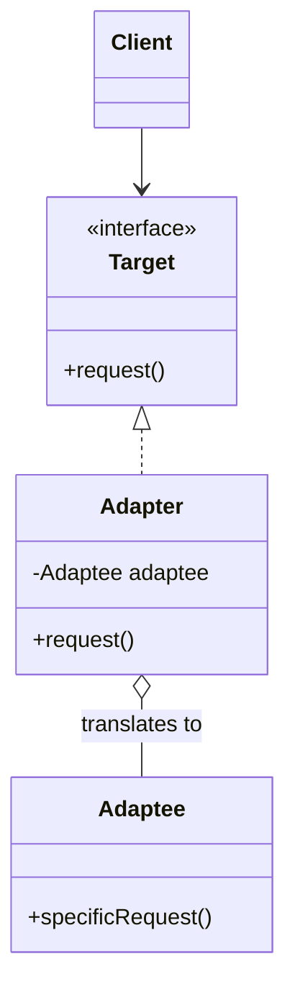

### Example: wrapping a third-party payment SDK

The case you actually run into: your app defines its own `PaymentGateway` interface so the rest of the codebase never depends on a specific vendor. A payment provider's SDK (e.g. Stripe-style) exposes a completely different, more generic API — you don't control it and won't modify it.

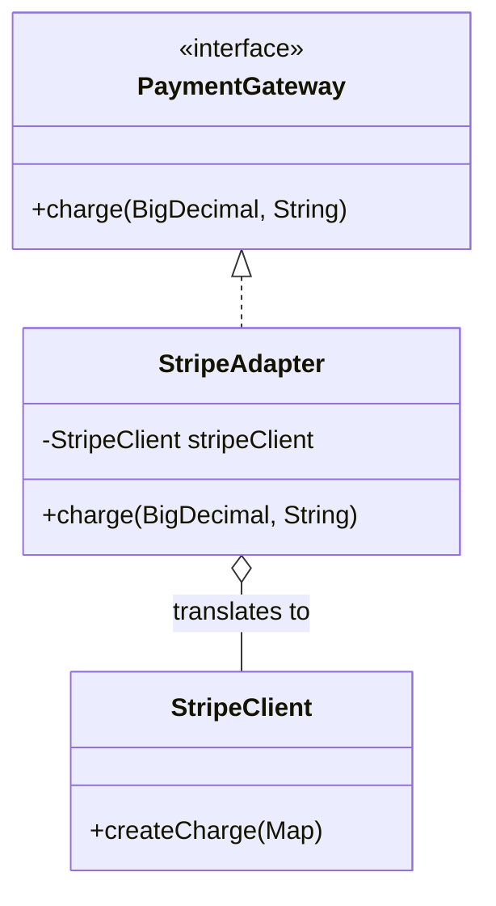

```java
// Your app's own interface — this is what the rest of the codebase depends on
public interface PaymentGateway {
    void charge(BigDecimal amount, String currency);
}

// Third-party SDK, different method name, different parameter shape
public class StripeClient {
    public StripeChargeResult createCharge(Map<String, Object> params) {
        // ... calls the vendor's API
    }
}

public class StripeAdapter implements PaymentGateway {
    private final StripeClient stripeClient;

    public StripeAdapter(StripeClient stripeClient) {
        this.stripeClient = stripeClient;
    }

    public void charge(BigDecimal amount, String currency) {
        Map<String, Object> params = Map.of(
            "amount", amount.movePointRight(2).intValue(), // Stripe expects cents
            "currency", currency
        );
        stripeClient.createCharge(params);
    }
}
```

The rest of the app only ever talks to `PaymentGateway`. Swapping Stripe for another provider later means writing one new adapter class — nothing that calls `charge()` has to change.

### Real-world Java example

Java's own `Enumeration` → `Iterator` migration is an Adapter: `EnumerationIterator implements Iterator`, delegating `hasNext()`/`next()` to `hasMoreElements()`/`nextElement()`. `Iterator.remove()` has no `Enumeration` equivalent, so the adapter throws `UnsupportedOperationException` — a case where the adaptation is legitimately incomplete and documented as such, not a bug.

### Adapter vs Decorator

Both wrap an object, which is why they're easy to confuse:

| | Adapter | Decorator |
|---|---|---|
| Purpose | Converts an interface into another | Adds new responsibility to the same interface |
| Changes the interface? | Yes, always | No, never |
| Adds behavior? | No — pure translation | Yes — that's the whole point |

See Decorator Pattern — not read yet (Chapter 3).

### Related

- Program To An Interface (`principles.md`)
- Favor Composition Over Inheritance (`principles.md`)
- Decorator Pattern
- Strategy Pattern (`behavioral.md`)
- Facade Pattern — the other half of Chapter 7: simplify an interface instead of converting it.
- Proxy Pattern — same wrapping structure, but keeps the interface and controls access.
- Bridge Pattern — designed up front, where Adapter is applied after the fact.
- MVC (`compound.md`) — an adapter lets a new model plug into an existing view/controller.
- What Is a Design Pattern (`principles.md`)

## Facade Pattern

> The Facade Pattern provides a unified interface to a set of interfaces in a subsystem. Facade defines a higher-level interface that makes the subsystem easier to use.

**Source:** *Head First Design Patterns*, Chapter 7 — "the Adapter and Facade Patterns", Facade section (read it). Summary below, book as bibliography — short quotes only where the exact wording matters.

### What it is & when to use it

A facade is a single class with a few high-level methods that orchestrate many classes of a subsystem. The intent is **simplification**: clients that just want "watch a movie" (the book's home theater: lights, screen, projector, amp, player) call one method instead of a dozen. The subsystem classes stay public and usable directly by anyone who needs the fine-grained control — the facade doesn't hide them, it just offers an easier path.

Reach for it when:

- Clients repeat the same multi-step orchestration across many subsystem classes.
- You want to decouple clients from a subsystem's internals so it can evolve (this is how the facade helps the Principle of Least Knowledge (`principles.md`): the client has one friend instead of ten).
- You're layering a system and want each layer to expose a narrow entry point.

You can have more than one facade per subsystem. A facade *may* add a bit of logic (ordering, defaults), but if it starts accumulating business rules it becomes a god class.

### How it works

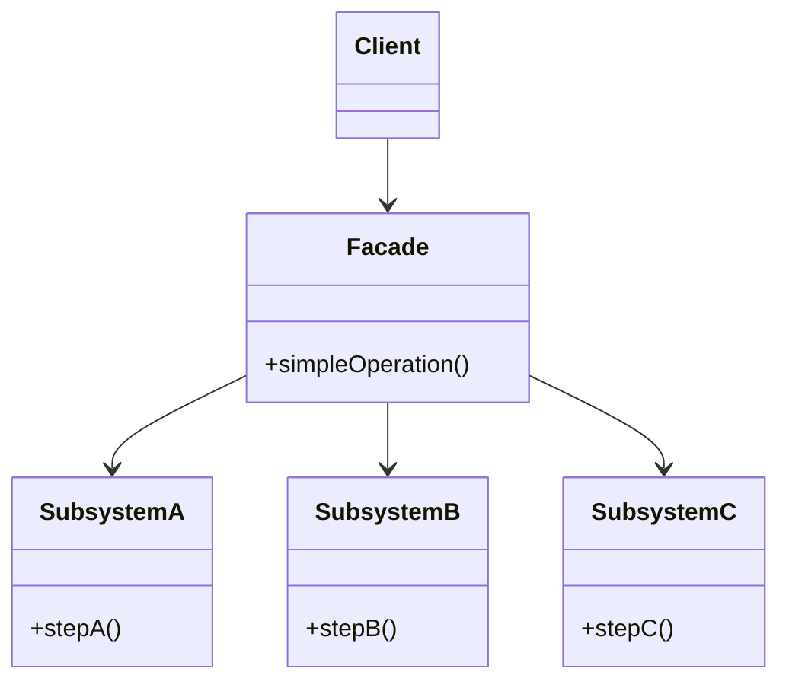

(In the book: `HomeTheaterFacade.watchMovie()` / `endMovie()` over `Amplifier`, `Projector`, `DvdPlayer`, `TheaterLights`, `Screen`, `PopcornPopper`.)

### Example: placing an order

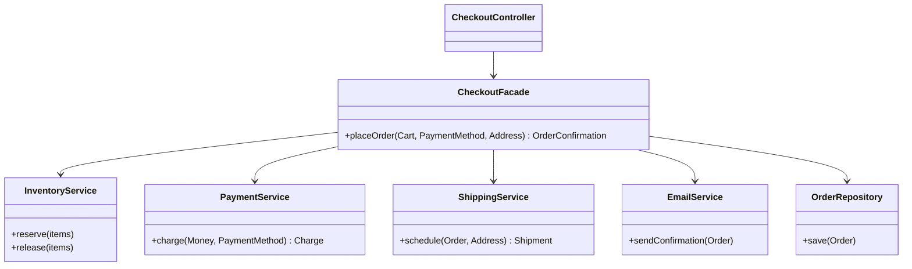

```java
public class CheckoutFacade {
    // injected: inventory, payments, shipping, email, orders

    public OrderConfirmation placeOrder(Cart cart, PaymentMethod method, Address address) {
        inventory.reserve(cart.items());
        try {
            Charge charge = payments.charge(cart.total(), method);
            Order order = Order.from(cart, charge);
            orders.save(order);
            Shipment shipment = shipping.schedule(order, address);
            email.sendConfirmation(order);
            return new OrderConfirmation(order.id(), shipment.eta());
        } catch (PaymentDeclined e) {
            inventory.release(cart.items());
            throw e;
        }
    }
}
```

The web controller, the mobile API, and the "reorder" button all call `placeOrder` — none of them knows the reservation/compensation dance. Admin tools that need to, say, re-send an email can still call `EmailService` directly.

### Comparisons

| Pattern | Intent |
|---|---|
| **Facade** | *Simplify* a set of interfaces behind a new, higher-level one |
| Adapter | *Convert* one interface into the one the client expects (usually wraps one object) |
| Decorator | *Add behavior* without changing the interface |
| Mediator (`behavioral.md`) | Also centralizes, but the colleagues talk *to the mediator*; subsystem classes behind a facade don't know the facade exists |

### Related

- Principle of Least Knowledge (`principles.md`) — introduced in this chapter; the facade is how a client keeps few friends.
- Strive for Loosely Coupled Designs (`principles.md`)
- Adapter Pattern
- Mediator Pattern (`behavioral.md`)
- Decorator Pattern
- Proxy Pattern
- What Is a Design Pattern (`principles.md`)

## Decorator Pattern

> The Decorator Pattern attaches additional responsibilities to an object dynamically. Decorators provide a flexible alternative to subclassing for extending functionality.

**Source:** *Head First Design Patterns*, Chapter 3 — "the Decorator Pattern" (read it). Summary below, book as bibliography — short quotes only where the exact wording matters.

### What it is & when to use it

A decorator implements the same interface as the object it wraps, holds a reference to it, and adds behavior before and/or after delegating to it. Because decorators *are* the same type as what they wrap, you can stack any number of them in any order, at runtime, and the client can't tell the difference. It's the book's first pattern that satisfies the Open-Closed Principle: new behavior without touching existing code.

Reach for it when:

- You need optional, combinable add-ons to an object (compression, encryption, logging, caching, retries) and a subclass per combination would explode (the book's Starbuzz coffee has a subclass for every beverage × condiment mix).
- Extensions must be chosen at runtime or per configuration.
- You want each add-on to be its own small, testable class.

Costs: many small classes that can be hard to follow, and code that checks the *concrete* type of a component breaks once it's wrapped. Instantiation gets verbose — usually hidden behind a factory (`creational.md`) or builder (`creational.md`). Java's `java.io` (`BufferedInputStream(new GZIPInputStream(new FileInputStream(...)))`) is the textbook real-world example.

### How it works

- **Component** — the common interface (or abstract class).
- **ConcreteComponent** — the base object being decorated.
- **Decorator** — implements Component and HAS-A Component (`wrapped`).
- **ConcreteDecorator** — adds behavior around the call to `wrapped`.

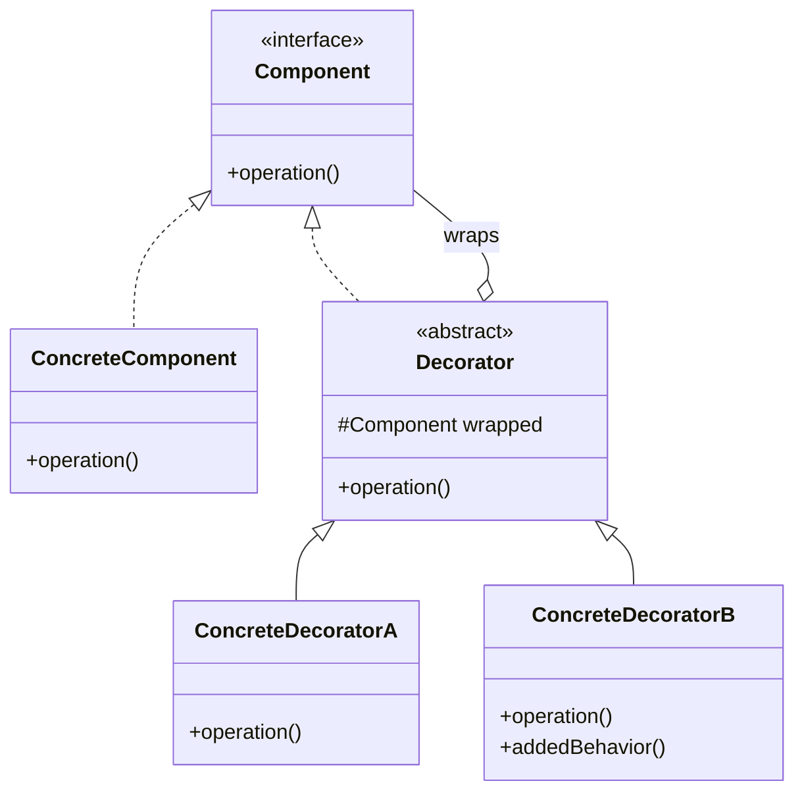

(In the book: `Beverage` is the Component, `Espresso`/`HouseBlend` are ConcreteComponents, `CondimentDecorator` is the Decorator, `Mocha`/`Whip`/`Soy` are ConcreteDecorators — inheritance is used for *type matching*, composition for *behavior*.)

### Example: file storage with compression and encryption

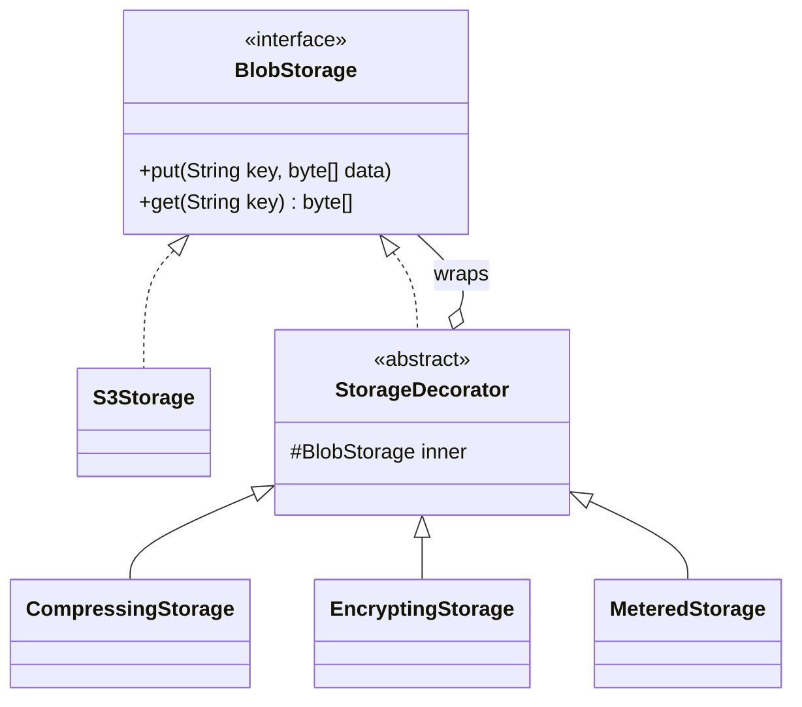

```java
public interface BlobStorage {
    void put(String key, byte[] data);
    byte[] get(String key);
}

public abstract class StorageDecorator implements BlobStorage {
    protected final BlobStorage inner;
    protected StorageDecorator(BlobStorage inner) { this.inner = inner; }
}

public class CompressingStorage extends StorageDecorator {
    public CompressingStorage(BlobStorage inner) { super(inner); }
    public void put(String key, byte[] data) { inner.put(key, Gzip.compress(data)); }
    public byte[] get(String key)            { return Gzip.decompress(inner.get(key)); }
}

public class EncryptingStorage extends StorageDecorator {
    private final Cipher cipher;
    public EncryptingStorage(BlobStorage inner, Cipher cipher) { super(inner); this.cipher = cipher; }
    public void put(String key, byte[] data) { inner.put(key, cipher.encrypt(data)); }
    public byte[] get(String key)            { return cipher.decrypt(inner.get(key)); }
}
```

```java
BlobStorage storage =
    new MeteredStorage(                        // outermost: count bytes written
        new EncryptingStorage(                 // then encrypt
            new CompressingStorage(            // compress before encrypting (order matters)
                new S3Storage(bucket)), cipher));

storage.put("invoices/2024-118.pdf", pdfBytes);
```

The service using `BlobStorage` has no idea how many layers there are; dev environments can skip encryption by building a shorter chain.

### Comparisons

| Pattern | Wraps an object to... |
|---|---|
| **Decorator** | add behavior, same interface |
| Adapter | change the interface |
| Proxy | control access (lazy loading, permissions, remote calls), same interface |
| Facade | simplify a whole subsystem behind a new interface |

Composite has a similar structure (a component holding components), but a composite holds *many* children to build a tree, while a decorator holds *one* to add behavior.

### Related

- Favor Composition Over Inheritance (`principles.md`)
- Program To An Interface (`principles.md`)
- Adapter Pattern
- Proxy Pattern
- Composite Pattern
- Chain of Responsibility Pattern (`behavioral.md`) — also a chain of same-typed objects, but each link may *stop* the request.
- Strategy Pattern (`behavioral.md`) — Strategy changes an object's guts; Decorator changes its skin.
- Builder Pattern (`creational.md`)
- Facade Pattern
- Factory Method Pattern (`creational.md`)
- What Is a Design Pattern (`principles.md`)
- Inheritance Tax (`principles.md`)

## Proxy Pattern

> The Proxy Pattern provides a surrogate or placeholder for another object to control access to it.

**Source:** *Head First Design Patterns*, Chapter 11 — "the Proxy Pattern" (read it). Summary below, book as bibliography — short quotes only where the exact wording matters.

### What it is & when to use it

A proxy implements the same interface as the **real subject** and stands in front of it. Clients talk to the proxy as if it were the real thing; the proxy decides whether, when, and how to forward each call. The common thread of all variants is **controlling access**:

| Variant | Controls access because the real subject is... | Example |
|---|---|---|
| **Remote proxy** | in another process/machine | a gRPC/HTTP client stub; Java RMI in the book |
| **Virtual proxy** | expensive to create | load a large image/report only when first used |
| **Protection proxy** | not for everyone | check the caller's role before forwarding |
| **Caching proxy** | expensive to call repeatedly | memoize results with a TTL |
| Others | synchronization, copy-on-write, firewall, smart reference... | |

Java can generate proxies at runtime (`java.lang.reflect.Proxy` + `InvocationHandler`) — the basis of how frameworks like Spring and Hibernate wrap your objects (transactions, lazy loading). Cost: more classes/objects and an extra hop that can surprise you (e.g. a "simple" getter that actually triggers a network call).

### How it works

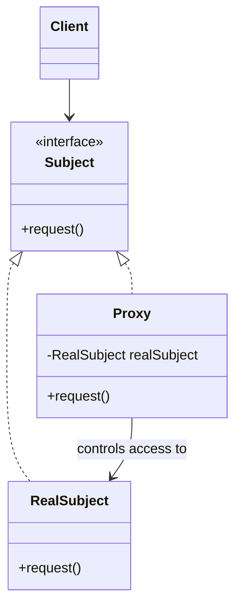

(In the book: a remote `GumballMachine` monitored over RMI; an `ImageProxy` that shows "Loading..." while an album cover downloads; and a dynamic protection proxy for a dating-site `PersonBean` so you can't rate yourself.)

### Example: caching + permission proxy for reports

`ReportService` runs heavy SQL. We want results cached for 10 minutes and only finance roles allowed to see revenue reports — without touching `ReportService`.

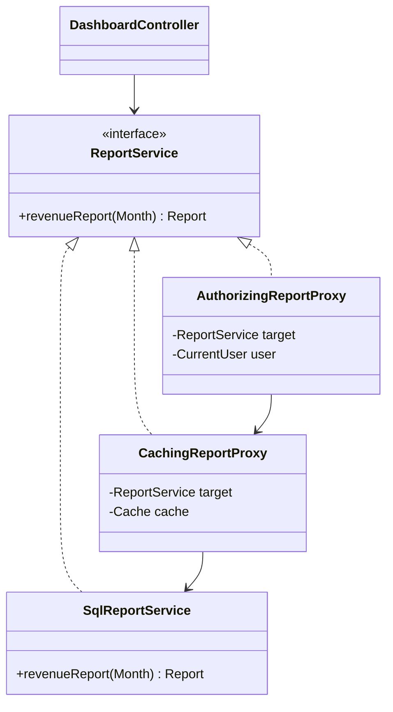

```java
public class AuthorizingReportProxy implements ReportService {
    private final ReportService target; private final CurrentUser user;
    public Report revenueReport(Month month) {
        if (!user.hasRole("FINANCE")) throw new AccessDeniedException("revenue reports");
        return target.revenueReport(month);
    }
}

public class CachingReportProxy implements ReportService {
    private final ReportService target;
    private final Cache<Month, Report> cache = Cache.withTtl(Duration.ofMinutes(10));
    public Report revenueReport(Month month) {
        return cache.computeIfAbsent(month, target::revenueReport);
    }
}
```

```java
ReportService reports =
    new AuthorizingReportProxy(new CachingReportProxy(new SqlReportService(db)), currentUser);
```

The controller depends on `ReportService` and never knows about caching or access checks.

### Comparisons

| Pattern | Structure | Purpose |
|---|---|---|
| **Proxy** | same interface, wraps one object | *control access* — the proxy often creates/owns the real subject |
| Decorator | same interface, wraps one object | *add behavior*; decorators are stacked freely by the client |
| Adapter | *different* interface | translate; a protection proxy may expose a subset of methods, which can look like an adapter |
| Facade | new simplified interface over many objects | simplify |

The line between proxy and decorator is about intent — the caching proxy above could be called a decorator; it's a proxy when the point is to guard the expensive subject.

### Related

- Decorator Pattern
- Adapter Pattern
- Program To An Interface, Not An Implementation (`principles.md`) — the proxy is substitutable only because clients depend on `Subject`.
- Facade Pattern
- Flyweight Pattern
- What Is a Design Pattern (`principles.md`)

## Composite Pattern

> The Composite Pattern allows you to compose objects into tree structures to represent part-whole hierarchies. Composite lets clients treat individual objects and compositions of objects uniformly.

**Source:** *Head First Design Patterns*, Chapter 9 — "the Iterator and Composite Patterns" (read it). Summary below, book as bibliography — short quotes only where the exact wording matters.

### What it is & when to use it

When data is naturally a tree — items inside groups inside groups — Composite gives leaves and containers the **same interface**. A container implements each operation by delegating to its children (and aggregating the results), so client code calls `price()` or `render()` on the root and never checks "is this a single thing or a group?".

Reach for it when:

- You have part-whole hierarchies of arbitrary depth: product bundles, menus with submenus, file systems, org charts, UI widget trees, permission groups.
- Clients should treat single objects and groups the same way.
- You keep writing `if (x instanceof Group) { for (child : ...) }` code.

The book's main **trade-off**: transparency vs. safety. Putting child-management methods (`add`, `remove`, `getChild`) on the shared Component interface makes everything uniform (*transparent*) but lets clients call `add()` on a leaf (which must throw or do nothing). Putting them only on the composite is *safer* but clients must know which is which. Head First chooses transparency and gives up a strict reading of SRP (the component both manages a hierarchy and does its own operations) in exchange.

### How it works

- **Component** — common interface for leaves and composites (plus, in the transparent version, child management).
- **Leaf** — no children; implements operations directly.
- **Composite** — holds child Components; implements operations by iterating over them.

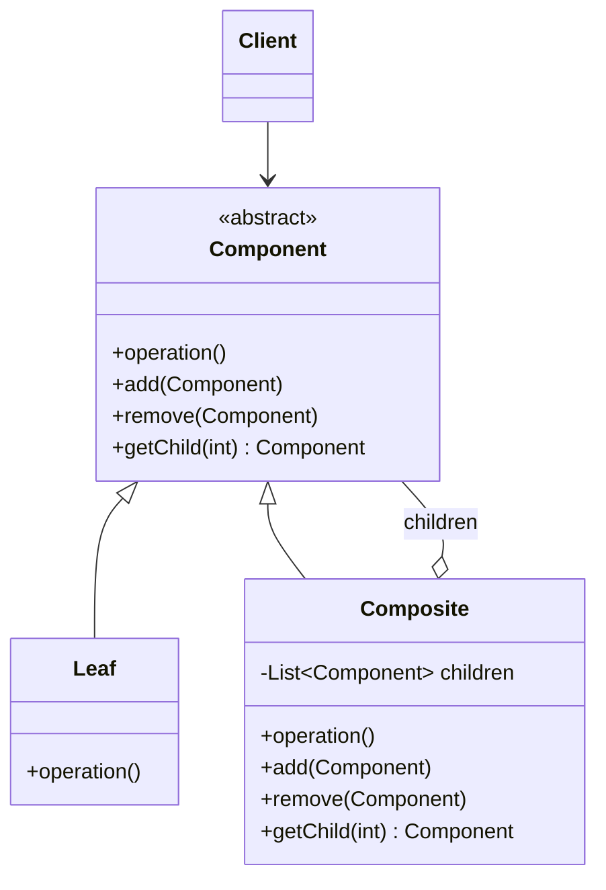

(In the book: `MenuComponent` is the Component, `MenuItem` the Leaf, `Menu` the Composite — so a dessert menu can live inside the diner menu.)

### Example: product bundles in a catalog

A store sells single products and bundles ("Home Office Kit" = desk + chair + "Cable Pack", where Cable Pack is itself a bundle). Cart pricing and shipping weight should work on either.

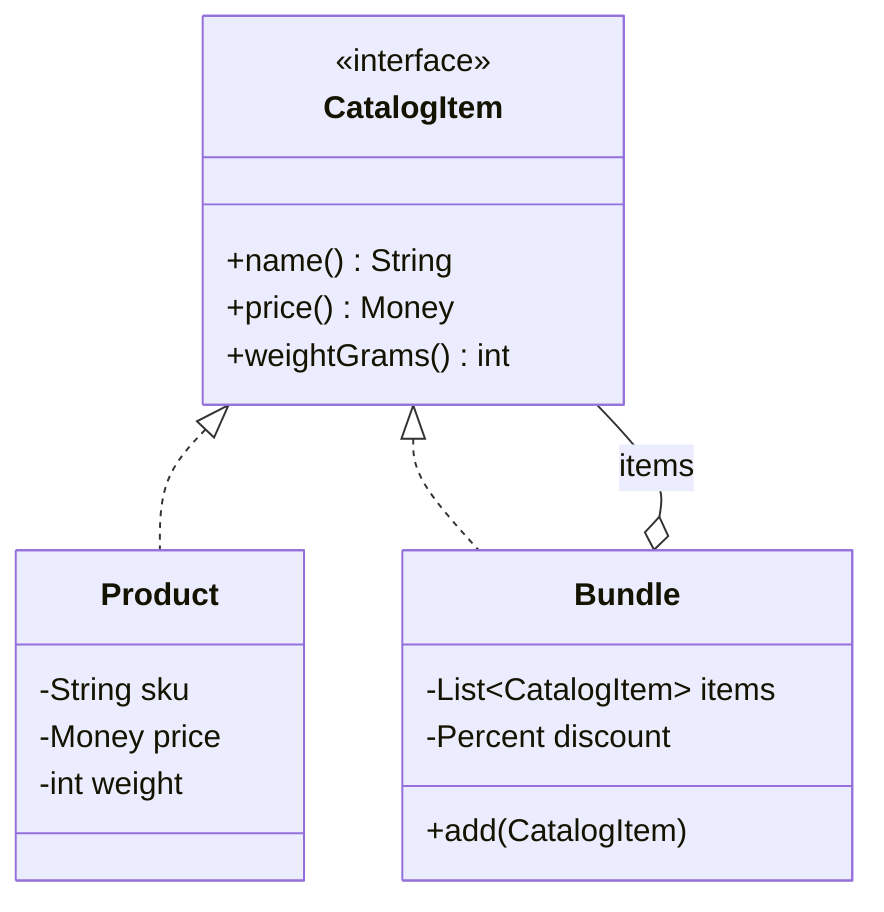

```java
public interface CatalogItem {
    String name();
    Money price();
    int weightGrams();
}

public record Product(String sku, String name, Money price, int weightGrams) implements CatalogItem {}

public class Bundle implements CatalogItem {
    private final String name;
    private final Percent discount;
    private final List<CatalogItem> items = new ArrayList<>();

    public Bundle add(CatalogItem item) { items.add(item); return this; }
    public String name() { return name; }

    public Money price() {
        Money sum = items.stream().map(CatalogItem::price).reduce(Money.ZERO, Money::plus);
        return sum.minus(sum.times(discount));
    }
    public int weightGrams() { return items.stream().mapToInt(CatalogItem::weightGrams).sum(); }
}
```

```java
CatalogItem kit = new Bundle("Home Office Kit", Percent.of(10))
    .add(desk).add(chair)
    .add(new Bundle("Cable Pack", Percent.of(5)).add(hdmi).add(usbC));

cart.add(kit);          // cart just calls price() and weightGrams() on each CatalogItem
```

This version takes the *safe* side: `add()` lives only on `Bundle`.

### Comparisons

| Pattern | Relationship |
|---|---|
| Iterator (`behavioral.md`) | Walking a composite needs a (composite) iterator. |
| Decorator | Same recursive shape, but one wrapped child and the goal is adding behavior, not representing a hierarchy. |
| Visitor (`behavioral.md`) | Adds new operations over a composite without adding methods to every node class. |
| Flyweight | Often used to share leaf objects in large trees. |
| Command (`behavioral.md`) | A macro command is a composite of commands. |
| MVC (`compound.md`) | The view is a composite of nested UI components. |

### Related

- Iterator Pattern (`behavioral.md`)
- Visitor Pattern (`behavioral.md`)
- Program To An Interface, Not An Implementation (`principles.md`)
- Builder Pattern (`creational.md`)
- Chain of Responsibility Pattern (`behavioral.md`)
- Command Pattern (`behavioral.md`)
- Decorator Pattern
- Flyweight Pattern
- Interpreter Pattern (`behavioral.md`)
- Model-View-Controller (Compound Pattern) (`compound.md`)
- What Is a Design Pattern (`principles.md`)

## Bridge Pattern

> The Bridge Pattern allows you to vary the implementation and the abstraction by placing the two in separate class hierarchies.

**Source:** *Head First Design Patterns*, Appendix — "Leftover Patterns" (read it). Summary below, book as bibliography — short quotes only where the exact wording matters.

### What it is & when to use it

Normally you abstract over implementations (one interface, many implementations). Bridge handles the case where **the abstraction itself also needs to vary**. Instead of a subclass for every abstraction × implementation combination, you keep two hierarchies and connect them by composition: the abstraction HAS-A implementor and implements all its operations in terms of the implementor's primitive operations. The HAS-A link is the "bridge".

Reach for it when:

- Two dimensions vary independently and you see a class explosion (`EmailAlert`, `SmsAlert`, `EmailReminder`, `SmsReminder`, ...).
- Platform-specific code must be swappable under a richer, evolving API (windowing systems, drivers, rendering backends).

Benefits: abstraction and implementation are extended independently; changes to concrete abstraction classes don't affect clients. Cost: more complexity up front.

### How it works

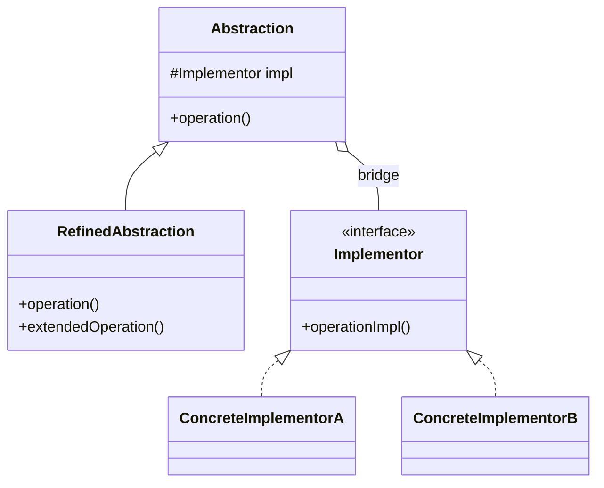

(In the book: `RemoteControl` abstraction with a `ConcreteRemote` refinement, bridged to a `TV` implementor with `Sony`/`RCA` implementations — the remotes' UI evolves and the TV models evolve, independently.)

### Example: notification types × delivery channels

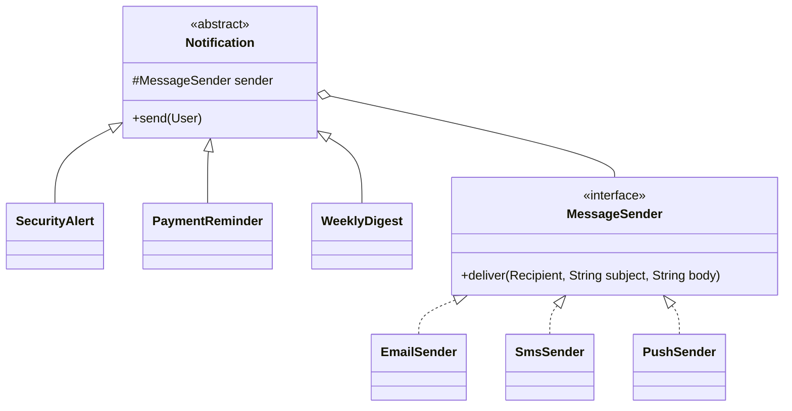

```java
public abstract class Notification {
    protected final MessageSender sender;
    protected Notification(MessageSender sender) { this.sender = sender; }
    public abstract void send(User user);
}

public class PaymentReminder extends Notification {
    private final Invoice invoice;
    public void send(User user) {
        sender.deliver(user.contact(), "Payment due",
            "Invoice " + invoice.number() + " for " + invoice.total() + " is due " + invoice.dueDate());
    }
}

new PaymentReminder(new SmsSender(twilio), invoice).send(user);
new SecurityAlert(new PushSender(fcm), loginEvent).send(user);
```

3 notification types × 3 channels = 6 classes instead of 9, and adding WhatsApp is one new `MessageSender`.

### Comparisons

| Pattern | Difference |
|---|---|
| Adapter | Applied *after the fact* to make mismatched interfaces work; Bridge is designed *up front* to let two hierarchies vary. |
| Strategy (`behavioral.md`) | Same composition shape; Strategy swaps an algorithm, Bridge separates a whole abstraction hierarchy from its platform implementation. |
| Abstract Factory (`creational.md`) | Often used to create and configure the right implementor for a bridge. |

### Related

- Favor Composition Over Inheritance (`principles.md`)
- Encapsulate What Varies (`principles.md`) — two things vary, so encapsulate each.
- Strategy Pattern (`behavioral.md`)
- Adapter Pattern
- Abstract Factory Pattern (`creational.md`)
- What Is a Design Pattern (`principles.md`)

## Flyweight Pattern

> Use the Flyweight Pattern when one instance of a class can be used to provide many "virtual instances."

**Source:** *Head First Design Patterns*, Appendix — "Leftover Patterns" (read it). Summary below, book as bibliography — short quotes only where the exact wording matters.

### What it is & when to use it

When an app creates huge numbers of near-identical objects, most of their memory is spent on data they share. Flyweight splits object state into **intrinsic** state (shared, immutable, stored once in the flyweight) and **extrinsic** state (per-instance, kept by the client or a manager and passed in at call time). Thousands of "virtual" objects then share a handful of real ones.

Reach for it when:

- A class has very many instances that can all be controlled identically.
- Memory (or allocation time) is the actual measured problem.

Benefits: far fewer objects at runtime; state for all virtual instances centralized in one place. Drawback: once flyweighted, the logical instances can't behave independently of each other. `Integer.valueOf()` caching and `String` interning are everyday Java flyweights.

### How it works

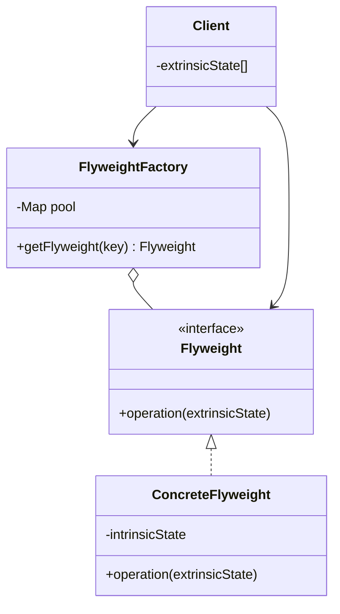

(In the book: a landscape-design app with thousands of `Tree` objects is redesigned around one stateless `Tree` and a `TreeManager` holding every tree's x, y, and age in an array.)

### Example: map markers for live delivery tracking

The dispatch dashboard shows 40,000 couriers. Each marker has an icon bitmap (~30 KB) that depends only on vehicle type and status — so there are ~12 distinct icons, not 40,000.

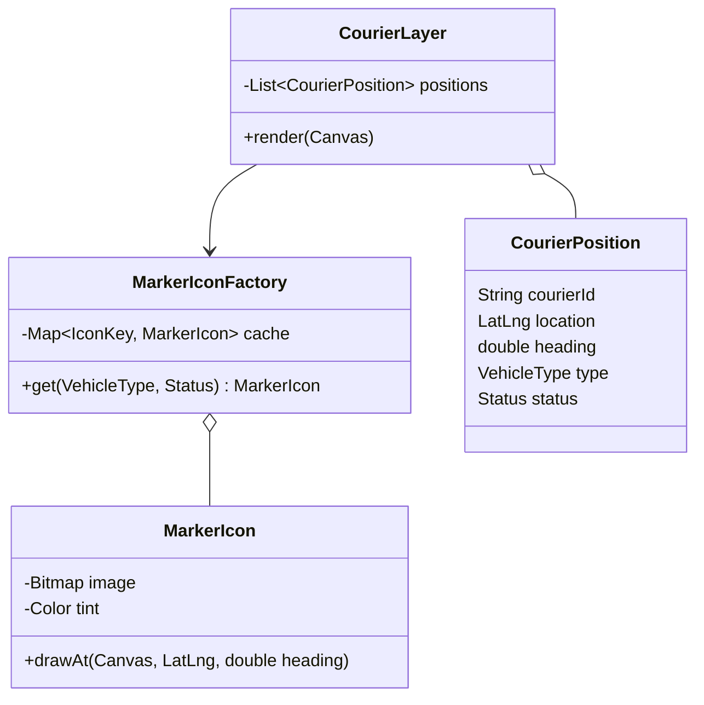

```java
public final class MarkerIconFactory {
    private final Map<IconKey, MarkerIcon> cache = new ConcurrentHashMap<>();
    public MarkerIcon get(VehicleType type, Status status) {
        return cache.computeIfAbsent(new IconKey(type, status),
            k -> new MarkerIcon(Bitmaps.load(k.type().iconPath()), k.status().tint()));
    }
}

public class CourierLayer {
    public void render(Canvas canvas) {
        for (CourierPosition p : positions)                         // extrinsic state
            icons.get(p.type(), p.status()).drawAt(canvas, p.location(), p.heading());
    }
}
```

~12 bitmaps in memory instead of 40,000; positions are just small records.

### Comparisons

| Pattern | Difference |
|---|---|
| Singleton (`creational.md`) | One instance of a class; Flyweight is a *pool* of shared instances, one per distinct intrinsic state. |
| Composite | Leaf nodes in big trees are often flyweights. |
| State (`behavioral.md`) | Stateless state objects can be shared across contexts the same way. |
| Proxy (caching) | Caches *results*; Flyweight shares *objects*. |

### Related

- Singleton Pattern (`creational.md`)
- Factory Method Pattern (`creational.md`) — the flyweight factory is what makes sharing transparent.
- Composite Pattern
- Interpreter Pattern (`behavioral.md`)
- Proxy Pattern
- State Pattern (`behavioral.md`)
- What Is a Design Pattern (`principles.md`)
